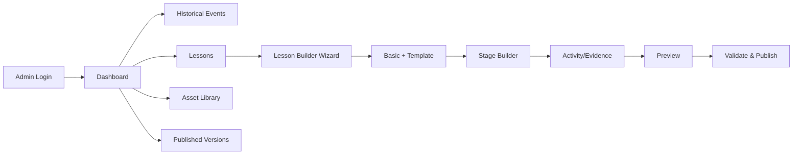

# DẤU VIỆT — ADMIN WEB SCREEN FUNCTIONAL DESIGN (NEXT.JS)

**Nguồn chính:** BA Framework trang 7–18 và mapping Admin ↔ Learner trang 19–29. Admin wireframe trong BA có dạng editor 6 bước: sự kiện → thông tin bài → giai đoạn → hoạt động → xem trước → xuất bản. **8 hình concept người dùng gửi là Mobile, không phải 8 mockup Admin.** Các screen ID/route/layout dưới đây là [Proposal] dựa theo nghiệp vụ BA.

## 1. IA/permissions

**Roles MVP:** Content Admin có quyền edit/publish; Learner không truy cập admin. Reviewer/approver là Should/Could và chưa thuộc baseline. API phải kiểm tra server-side, không dựa vào ẩn UI.

## 2. Screen inventory

| ID | Route đề xuất | Màn hình | Priority | Mục tiêu |
|---|---|---|---|---|
| A-01 | `/login` | Admin sign-in | P0 | bảo vệ CMS |
| A-02 | `/dashboard` | Admin dashboard | P0 | status draft/published, công việc cần xử lý |
| A-03 | `/events` | Event list | P0 | tìm/lọc/tạo event |
| A-04 | `/events/new`, `/events/:id` | Event editor | P0 | metadata, cover, tags, period |
| A-05 | `/lessons` | Lesson list | P0 | filter by event/status/template |
| A-06 | `/lessons/new` | New lesson wizard | P0 | chọn event + template |
| A-07 | `/lessons/:id/basic` | Lesson basic information | P0 | question, objectives, audience, difficulty |
| A-08 | `/lessons/:id/stages` | Stage structure editor | P0 | order/enabled/required, completion |
| A-09 | `/lessons/:id/stages/:stageId/activities` | Activity editor / type library | P0 | add, configure, test activity |
| A-10 | `/evidence`, drawer in A-09 | Evidence/source manager | P0 | provenance, relations, source assets |
| A-11 | `/assets` | Asset/media library | P0 | upload, tag, pick, preview, usage |
| A-12 | `/lessons/:id/rules` | Rule/feedback configuration | P0 | validate, hint, retry/branch |
| A-13 | `/lessons/:id/preview` | Learner preview | P0 | render config as Flutter behavior |
| A-14 | `/lessons/:id/publish` | Validation + publish | P0 | publish immutable snapshot |
| A-15 | `/lessons/:id/versions` | Version history | P0 | audit published versions, inspect, archive |
| A-16 | `/templates` | Template catalog | P1 | view/duplicate presets |
| A-17 | `/users` | User/progress support read-only | P1 | troubleshoot attempts |
| A-18 | `/economy/items` | Shop/catalog/item editor | P2 | ordinary/premium goods |
| A-19 | `/economy/islands` | Island progression + decor editor | P2 | island levels, unlock rules |
| A-20 | `/economy/energy` | Energy policy/pricing editor | P2 | costs, refill, packages |
| A-21 | `/rewards` | Reward/achievement rules | P1/P2 | completion rewards, badges |

## 3. Global page shell

- Sidebar: Dashboard, Events, Lessons, Templates (P1), Media Library, Published Versions, Rewards (P1), Economy (P2), Settings.
- Breadcrumb `Events / Trận Bạch Đằng 938 / Lesson / Stage / Activity`.
- Top toolbar: draft/published status, last saved timestamp, Preview, Validate, Publish; role display.
- Lesson builder workspace: **left stage navigation** (tree) + **center form** + **right learner-preview** (collapsible). No permanent 3-column on narrow browser.
- Global: unsaved-change route guard, autosave with indicator, concurrent editing message, keyboard navigation, error toast + field-level error.

## 4. Screen contracts P0

### A-01 Login / A-02 Dashboard
- **Login fields:** email, password; error: invalid credentials, lockout/rate limit, session expired.
- **Dashboard widgets:** drafts, ready/invalid, published count, recently edited lessons, broken references warning, quick create.
- **No misleading analytics:** if tracking not implemented hide charts; do not show fabricated stats.

### A-03/A-04 Historical Event management

| Field | Type | Requirement/validation |
|---|---|---|
| `title` | required text | nonblank, Vietnamese characters allowed |
| `periodId` | relation | choose historical period |
| `date/dateRange` | structured optional | avoid implicit calendar precision; BCE supported |
| `location` | optional geographic metadata | map uses configured coordinates if available |
| `summary` | rich text | sanitize, maxlength configurable |
| `coverAssetId` | media reference | image approved for public use |
| `tags` | multi-value | normalized IDs/slugs |
| `status/visibility` | selector | published exposure controlled by lesson status |

**Actions:** New, edit, archive (subject to dependencies), go to lessons. **AC:** event can have many lessons; deleting referenced media warns of impact; unused records can be archived instead of destructive deletion.

### A-05/A-06 Lesson catalog and creation
- Columns: title, event, template, difficulty, draft status, latest publish version, updatedAt.
- Create flow: choose/create Event → choose Template (Event Investigation recommended first; Decision Analysis optional second) → create Draft.
- **Validation:** cannot publish without central question/objectives/evidence/conclusion; reusable templates cannot be equated with content.

### A-07 Basic lesson information

| Field | Rules | Preview impact |
|---|---|---|
| title | required | Event/lesson hub title |
| `centralQuestion` | required | Intro, Hypothesis, Conclusion |
| `objectives[]` | min 1 | Intro/teacher metadata |
| audience/grade | optional by policy | filtering/difficulty |
| difficulty | required if exposed | event detail chip |
| estimatedDuration | positive minute value | event detail |
| lesson cover | asset ref | detail hero |
| templateId | immutable/controlled after content exists | stage preset |

**AC:** historical question preserved throughout flow; preview uses same saved draft snapshot.

### A-08 Stage structure editor
- Stage list with order, required/optional, enabled, completion rule, warning icon, number of activities.
- Select from framework: Context, Discovery, Evidence, Reasoning, Hypothesis, Reconstruction, Verification, Conclusion, Reflection.
- Add/reorder only within template guardrails; show error if resulting flow has invalid referenced stage or cycle.
- **AC:** required stage has ≥1 enabled activity; Custom always central question + evidence + conclusion; Stage !== screen.

### A-09 Activity editor — reusable, typed
- Type picker: READ, VIEW_IMAGE, EXPLORE_MAP/HOTSPOT, MULTIPLE_CHOICE, EVIDENCE_SELECT, MATCHING, REASONING_CONNECT, HYPOTHESIS_CHOICE, DRAG_ORDER, VERIFICATION, CER; other types only when renderer implemented.
- Common fields: `id`, title, instruction, required, order, content references, interaction config, validation config, hint, feedback, retry, output contract.
- **Preview mapping:** show exact activity renderer with fake attempt fixture; keep answer keys out of learner API payload.
- **Validation:** schema per activity type; invalid reference must block publish, not just emit warning.

| Type | Admin authoring fields | Learner behavior |
|---|---|---|
| READ/VIEW_IMAGE | body, citations, media | scroll/read/continue |
| EXPLORE_MAP | background, marker coords, required flags, content links | hotspot / markers |
| MCQ | question, choice IDs, correct IDs, explanations, attempts | choose/submit/feedback |
| EVIDENCE_SELECT | evidence references, minimum required/core set, distractors | select evidence |
| MATCHING/REASONING | left/right items, valid relation ID pairs, inference outputs | match/connect |
| HYPOTHESIS | choices/claims, required evidence/concepts, hint | propose explanation |
| DRAG_ORDER | stable event IDs, target order(s), hint | order sequence |
| VERIFICATION | sources, supported/partial/contradicted criteria, fallback stage, retry cap | feedback / revise |
| CER | claim/evidence/reasoning prompts and rubric | learner conclusion |
| REFLECTION | prompt, required/optional, word limit | reflective response |

### A-10 Evidence and source manager
- `id`, title, evidenceType, content, citation/source URL or publication metadata, authorship/date if known, media, relevance/reliability rubric, tags, linked activity usage, relation IDs.
- **Important:** source metadata must be verifiable; generated artwork ≠ historical primary source. UI must label reconstruction/illustration appropriately.
- Filter by event, type, source, referenced/unreferenced. A source that is already published cannot be silently deleted while attempts depend on it.

### A-11 Asset Library
- Grid/list with preview, asset ID, media type, filename, dimensions, file size, attribution, rights/license, locale, status, tags, usage count.
- Upload → client validation → server validation/scanning → store → status Ready → reference from content.
- Required media of published versions must stay accessible. Replacing file creates new revision or asset ID, not destructive overwrite of snapshot dependency.
- Support `Upload`, `Select`, `Inspect Usage`, `Archive` (when safe). File-size/resolution caps: policy TBD, not fake fixed limits.

### A-12 Rule / feedback editor
- Rule fields by type: completion policy, allowed attempts, hint trigger, scoring rubric, correctness criteria, transition on result, fallback stage, max revise count.
- Distinguish `correct`, `partial`, `contradicted`, `incomplete`; prevent transitions to nonexistent stage.
- Reflection often no-score; avoid tying learning objectives to coin purchase.

### A-13 Full preview
- Device frame: 360/390/430dp presets, scale, large-text mode, fake account state (new/in-progress/completed), stage selector.
- Preview **the same public JSON contract** that Flutter consumes, with internal validation simulator or dedicated preview endpoint; not a separate hardcoded picture.
- Test `correct`, `wrong`, `partial`, `offline`, `locked`, `revisit`, `v1/v2`. A preview error blocks publish for required types.

### A-14 Validate & Publish

**Publish validation checklist (BA R1–R8):** central question + objective; required stages have enabled activities; required activity fields/rules valid; referenced evidence exists; hypothesis has verification/feedback; conclusion exists; media valid/mobile renderer available; preview has no broken links; snapshot created before exposure.

**Flow:** `DRAFT → VALID/READY → PUBLISHED → ARCHIVED` (valid may be computed status). `Publish` requires confirmation, optional release note, server transaction + monotonically increasing version. A published version immutable; editing starts next draft.

### A-15 Version history
- Table: version number, publishedBy, publishedAt, release note, snapshot/checksum, active/inactive.
- Actions: preview immutable version, duplicate into new draft, archive (subject to attempt policy).
- **AC:** learner started v1 resumes v1 after v2 published; new attempts use current published version; old media preserved.

## 5. Admin P1/P2 contracts

| ID | Entities | Primary workflow |
|---|---|---|
| A-16 | lesson templates | list preset, duplicate/template metadata, validate allowed stages |
| A-17 | users/attempts | safe read-only search and support; avoid exposing answer content without necessity |
| A-18 | shop items, prices, currencies | catalog → item media → cost → availability → preview → publish |
| A-19 | island levels, placeables, decoration slots | level background → unlock condition → eligible items/slots → preview collisions |
| A-20 | energy policy/packs | energy cost/refill/package config + legal/commercial review |
| A-21 | reward definitions/achievement | condition, event trigger, idempotent grants, copy, badge media |

## 6. Admin error cases and QA

1. Save draft with incomplete mandatory fields allowed; publish blocked with actionable per-field errors.
2. Deleting an Evidence used in a required activity blocks/requests replacement.
3. Reorder stages with broken fallback stage shows cycle/reference error.
4. Publish activity type without Flutter renderer blocked.
5. Admin edits v2 draft while users in v1; preview and live attempts isolated.
6. Upload corrupt/oversized media shows validation error; original remains intact.
7. Two editors modify same draft: optimistic concurrency alert (proposal; scope confirm).
8. Network loss during publish: retry safe; no duplicate version.

## 7. Admin design handoff minimum

Each admin screen needs Figma frames for: empty, populated, edit/dirty, saved, validation errors, loading, forbidden, mobile/narrow desktop if supported; field-to-DTO mapping; keyboard tab order; role matrix; acceptance tests. Use `DESIGN_HANDOFF.md` for cross-system mapping.
