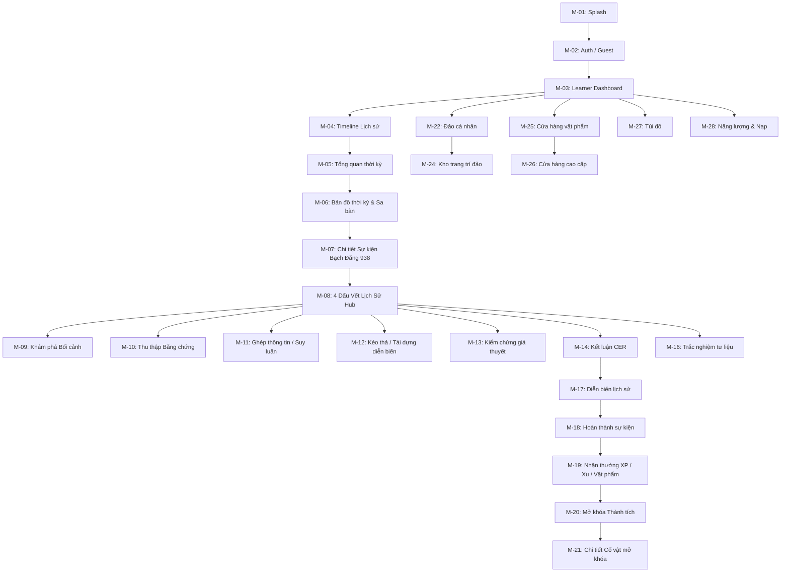

# DẤU VIỆT — MOBILE APP SCREEN FUNCTIONAL DESIGN (FLUTTER)

> **Tài liệu đặc tả chi tiết:** Dành cho ứng dụng học lịch sử người học (Learner App - Flutter).  
> **Nguồn tham chiếu:** 8 concept boards `UI-1..UI-8`, `docs/PROJECT_OVERVIEW.md`, `docs/LEARNING_ENGINE_DESIGN.md`, `design/DESIGN_SYSTEM.md`, `design/DESIGN_HANDOFF.md`.

---

## 1. Information Architecture & Navigation

---

## 2. Danh mục màn hình Mobile (M-01 đến M-28)

| Screen ID | Tên màn hình | Phân loại | Priority | Mockup Ref | Component & Asset chính |
|---|---|---|---|---|---|
| **M-01** | Khởi động (Splash) | Khởi tạo | P1 | — | `AST-BRD-001`, `CMP-004` |
| **M-02** | Đăng nhập / Chế độ khách | Xác thực | P0 | — | `brand.red.700`, Form input |
| **M-03** | Bàn học tập người học | Khám phá | P0 | UI-8 | `CMP-001`, `CMP-006` |
| **M-04** | Dòng thời gian lịch sử | Lộ trình | P0 | UI-1, UI-8 | `AST-HIS-001..004`, `CMP-007` |
| **M-05** | Tổng quan thời kỳ Ngô Quyền | Giới thiệu | P0 | UI-1, UI-8 | `AST-HIS-004`, `CMP-003`, `CMP-005` |
| **M-06** | Bản đồ thời kỳ & Sa bàn | Tuyến sự kiện | P0 | UI-1, UI-2, UI-8 | `AST-MAP-001..002`, `CMP-006` |
| **M-07** | Chi tiết sự kiện Trận Bạch Đằng | Tổng quan | P0 | UI-2, UI-8 | `AST-EVT-001`, `CMP-004`, `CMP-005` |
| **M-08** | Trung tâm 4 Dấu Vết Lịch Sử | Điều tra | P0 | UI-2, UI-8 | `AST-CLUE-001..004`, `CMP-008` |
| **M-09** | Khám phá Bối cảnh (Context) | Hoạt động | P0 | UI-2 | `CMP-004`, `CMP-008` |
| **M-10** | Thu thập Bằng chứng (Discovery) | Hoạt động | P0 | UI-2, BA | `AST-EVD-001..003`, `CMP-008` |
| **M-11** | Ghép thông tin (Matching) | Hoạt động | P0 | UI-3 | `AST-EVD-001..003`, `CMP-009` |
| **M-12** | Kéo thả & Sắp xếp diễn biến | Hoạt động | P0 | UI-3 | `AST-EVT-002..N`, `CMP-010` |
| **M-13** | Kiểm chứng giả thuyết (Verification) | Hoạt động | P0 | BA | `CMP-004`, `CMP-005` |
| **M-14** | Kết luận lịch sử (CER Conclusion) | Hoạt động | P0 | BA | `CMP-004`, `CMP-005` |
| **M-15** | Suy ngẫm lịch sử (Reflection) | Hoạt động | P1 | BA | `CMP-004` |
| **M-16** | Trắc nghiệm tư liệu (Quiz) | Hoạt động | P0 | UI-3, UI-4 | `AST-EVD-001`, `CMP-009` |
| **M-17** | Tái hiện chiến dịch (Story) | Kết quả | P0 | UI-4, BA | `AST-STORY-001..N`, `CMP-004` |
| **M-18** | Hoàn thành sự kiện lịch sử | Kết quả | P0 | UI-4, UI-8 | `AST-RES-001`, `CMP-003`, `CMP-005` |
| **M-19** | Nhận thưởng (EXP, Xu, Rương) | Phần thưởng | P0 | UI-4, UI-8 | `AST-UI-009`, `CMP-011` |
| **M-20** | Mở khóa Thành tích (Hào khí Bạch Đằng) | Vinh danh | P1 | UI-4 | `AST-RES-002`, `CMP-011` |
| **M-21** | Chi tiết Cổ vật (Thuyền Bạch Đằng) | Sưu tập | P1 | UI-4 | `AST-RES-003`, `CMP-012` |
| **M-22** | Bản đồ Đảo cá nhân (Cấp 1 - Đảo nhỏ) | Meta-game | P2 | UI-5, UI-8 | `AST-ISL-001`, `CMP-012` |
| **M-23** | Nâng cấp Đảo (Cấp 2 - Đảo vừa, Cấp 3) | Meta-game | P2 | UI-5 | `AST-ISL-002..003` |
| **M-24** | Kho trang trí & Đặt vật phẩm đảo | Meta-game | P2 | UI-5, UI-8 | `AST-DEC-001..009`, `CMP-012` |
| **M-25** | Cửa hàng vật phẩm thường (Điểm) | Kinh tế | P2 | UI-6 | `AST-DEC-001..009`, `CMP-012` |
| **M-26** | Cửa hàng cao cấp (Kim Cương) | Kinh tế | P2 | UI-6 | `AST-PRM-001..004`, `CMP-012` |
| **M-27** | Túi đồ & Quản lý vật phẩm sở hữu | Kinh tế | P2 | UI-6 | `CMP-012` |
| **M-28** | Quản lý năng lượng & Cửa sổ nạp | Kinh tế | P2 | UI-7 | `AST-ENE-001..004` |

---

## 3. Đặc tả chi tiết từng cụm màn hình

### Cụm 1: Hành trình Khám phá & Dòng thời gian (M-04, M-05, M-06)
- **M-04 Dòng thời gian lịch sử:**
  * Top bar cuốn thư đỏ viền vàng `CMP-001` chữ "DẤU VIỆT".
  * Sub-tabs: Khám phá, Bản đồ, Nhân vật, Thành tựu, Thư viện.
  * Trục thời gian dọc nối các niên đại: Âu Lạc, Hai Bà Trưng, Vạn Xuân, Ngô Quyền.
  * Thẻ thời Ngô Quyền (938 – 944) ở trạng thái Active viền vàng kim `brand.gold.500`.
- **M-05 Tổng quan thời kỳ Ngô Quyền:**
  * Hero banner chân dung Tiền Ngô Vương và chiến thuyền.
  * Tóm tắt bối cảnh: kết thúc nghìn năm Bắc thuộc, mở kỷ nguyên độc lập.
  * Nút CTA đỏ chu sa `brand.red.700`: "Khám phá ngay ›".
- **M-06 Bản đồ thời kỳ & Sa bàn Bạch Đằng:**
  * Sa bàn thủy mặc sông nước Bạch Đằng, cọc gỗ, chiến thuyền.
  * Tuyến sự kiện nét đứt nối 4 điểm: Chuẩn bị lực lượng (937), Trận Bạch Đằng (938) [Active gươm chéo], Xây dựng chính quyền (938), Củng cố đất nước (944).
  * Hộp chú giải (Legend) và la bàn Đông Sơn 8 hướng.

### Cụm 2: Cửa ngõ Bài học & 4 Dấu Vết Lịch Sử (M-07, M-08)
- **M-07 Chi tiết sự kiện Trận Bạch Đằng (938):**
  * Tóm lược chiến dịch, câu hỏi trung tâm bài học.
  * 4 nội dung: Bối cảnh, Diễn biến, Nhân vật, Ý nghĩa.
  * Nút lệnh bài: "Bắt đầu khám phá ›".
- **M-08 Trung tâm 4 Dấu Vết Lịch Sử:**
  * Lưới 2x2 gồm 4 thẻ bài di sản:
    1. Bối cảnh: *Vì sao dẫn đến trận đánh?*
    2. Nhân vật: *Những ai tham gia?*
    3. Diễn biến: *Trận đánh diễn ra như thế nào?*
    4. Ý nghĩa: *Giá trị lịch sử và bài học?*
  * Mỗi thẻ có thumbnail tranh pixel art, huy hiệu số 1-4, nhãn "Sẵn sàng".

### Cụm 3: Learning Engine tương tác (M-11, M-12, M-16)
- **M-11 Ghép thông tin (Matching):**
  * Cột trái: Ngô Quyền, Sông Bạch Đằng, Cọc gỗ, Quân Nam Hán.
  * Cột phải: 4 mô tả vai trò lịch sử tương ứng.
  * Dây nối chỉ son đỏ uốn lượn nối các chấm chốt tương tác.
  * Nút "Kiểm tra kết quả ›".
- **M-12 Kéo thả & Sắp xếp diễn biến (Drag-drop & Ordering):**
  * Màn Kéo thả (Slot Ordering): 4 ô đích 1-2-3-4 và 4 mảnh ghép sự kiện bên dưới.
  * Màn Sắp xếp diễn biến: Danh sách dọc có chốt kéo 3 gạch để di chuyển thứ tự từ đầu đến cuối.
- **M-16 Trắc nghiệm tư liệu (Quiz):**
  * Thẻ tranh tư liệu sa bàn cửa sông.
  * Câu hỏi trung tâm: *"Trận Bạch Đằng (năm 938) diễn ra trên con sông nào?"*
  * 4 lựa chọn A-B-C-D; đáp án đúng chuyển màu ngọc bích `success.600` kèm dấu tích kiểm chứng.

### Cụm 4: Tổng kết & Phần thưởng (M-18, M-19, M-20, M-21)
- **M-18 Hoàn thành sự kiện:** Banner vinh danh tướng quân đại thắng, xác nhận đã hiểu trọn vẹn 4 dấu vết.
- **M-19 Nhận thưởng:** Hiển thị điểm Sử ký (+500), kinh nghiệm (+300 XP), thành tích mở khóa và rương cổ vật.
- **M-20 & M-21 Thành tích & Cổ vật:** Huy chương Hào khí Bạch Đằng và thẻ bài 3D/pixel art mô hình Thuyền chiến Bạch Đằng (phẩm cấp Hiếm).

### Cụm 5: Meta-game Đảo, Cửa hàng & Năng lượng (M-22 đến M-28)
- **M-22/M-23 Đảo cá nhân & Nâng cấp:** Đảo nhỏ cấp 1 $\rightarrow$ Đảo vừa cấp 2 $\rightarrow$ Đảo lớn cấp 3.
- **M-24 Kho trang trí:** Danh mục công trình truyền thống đặt lên đảo (nhà tranh, hồ sen, giếng đá...).
- **M-25/M-26 Cửa hàng:** Vật phẩm thường mua bằng Điểm Sử Ký, vật phẩm cao cấp (Hoàng thành Thăng Long, Chùa Trấn Quốc) mua bằng Kim Cương.
- **M-27 Túi đồ (Inventory):** Bộ lọc Đã mua / Đang dùng / Tất cả.
- **M-28 Năng lượng (Energy):** Thanh thể lực (ví dụ: tiêu tốn 20 năng lượng vào bài học), cơ chế hồi 1 thể lực / 30 phút và các gói nạp.
