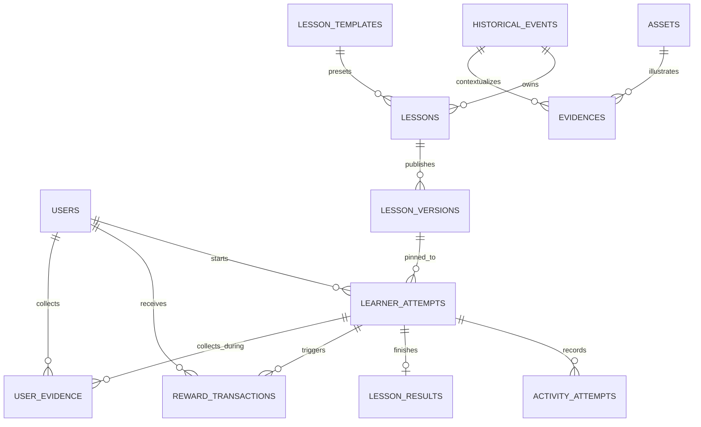

# DẤU VIỆT — Database Design (MVP)

> **Status:** Proposed technical design / cần BA–PO review trước khi baseline.  
> **Stack:** PostgreSQL + Spring Data JPA/Hibernate + Flyway; UUID keys; JSONB cho config activity và snapshot.  
> **Scope:** Learning Core, authoring/publishing, attempts/progress, basic rewards. Island/Shop/Energy chỉ ghi điểm tích hợp ở cuối.

## 1. Nguyên tắc dữ liệu

1. **Event ≠ Lesson.** `historical_events` 1–N `lessons`; mỗi lesson thuộc một primary event (MVP).
2. **Stage ≠ Screen.** Stage thể hiện bước tư duy; activity type chọn Flutter renderer.
3. **Content ≠ Logic.** Không có bảng/column dành riêng Bạch Đằng 938; activity handler dùng schema chung.
4. **Version pinning.** Mỗi learner attempt gắn với duy nhất một `lesson_version_id`. Snapshot published bất biến.
5. **Evidence có định danh.** Evidence có nguồn; output activity lưu evidence IDs/inferences để tham chiếu chéo.
6. **Server authoritative.** Answer key, unlock, score, EXP nằm ở server; response cho Flutter phải redact bí mật.
7. **Idempotency.** Submit/reward phải an toàn khi người dùng retry request.
8. **Asset longevity.** Không hard-delete tài nguyên có published snapshot tham chiếu.
9. **Tất cả ngày giờ** lưu UTC (`timestamptz`); DB constraint/index/FK dùng cùng migration Flyway.

## 2. ERD logic



**Snapshot-bound subentities:** `stages`, `activities`, evidence references và transitions được lưu trong `lesson_versions.snapshot_json` của published version. Phía Admin có bản draft độc lập trong `lessons.draft_json`; không cần bắt buộc có mutable tables `stages/activities` trong MVP. Nếu cần query/report chuyên sâu về stages, cân nhắc materialized read model sau. Cách này tránh tạo hai nguồn chân lý cho published content.

## 3. Bảng cốt lõi

| Table | Trường chính | Ghi chú |
|---|---|---|
| `users` | `id`, `email`, `password_hash`, `role`, `display_name`, `created_at` | Role tối thiểu `LEARNER`, `CONTENT_ADMIN`; password hash không trả client |
| `historical_events` | `id`, `title`, `period`, `start_year`, `summary`, `cover_asset_id`, `status` | Dữ liệu tri thức; không lẫn lesson |
| `lesson_templates` | `id`, `code`, `name`, `schema_version`, `preset_json`, `enabled` | Preset stage/activity/rule (không chứa nội dung sự kiện) |
| `lessons` | `id`, `event_id`, `template_id`, `title`, `central_question`, `objectives_json`, `draft_json`, `status`, `current_version_id` | Chỉnh sửa ở draft; `current_version_id` có thể null ban đầu |
| `lesson_versions` | `id`, `lesson_id`, `version_no`, `schema_version`, `snapshot_json`, `published_at`, `published_by` | Immutable; unique `(lesson_id, version_no)` |
| `evidences` | `id`, `event_id`, `title`, `type`, `source_title`, `source_url`, `reliability`, `relevance`, `asset_id` | Source/citation metadata. Khi publish, dữ liệu tham chiếu cần snapshot/embed hoặc version-pinned |
| `assets` | `id`, `storage_key`, `mime_type`, `size_bytes`, `checksum`, `state`, `created_at` | Lưu metadata; file nằm trong object storage |
| `learner_attempts` | `id`, `user_id`, `lesson_version_id`, `status`, `current_stage_id`, `current_activity_id`, `state_json`, `started_at`, `completed_at` | Status `IN_PROGRESS`, `COMPLETED`, `ABANDONED`; ID stage/activity là stable IDs trong snapshot |
| `activity_attempts` | `id`, `learner_attempt_id`, `activity_id`, `attempt_no`, `submitted_answer_json`, `result_json`, `created_at` | Giữ lịch sử retry/revision, không sửa lesson config |
| `idempotency_records` | `id`, `user_id`, `idempotency_key`, `operation`, `request_hash`, `response_json`, `http_status`, `created_at`, `expires_at` | Unique `(user_id, operation, idempotency_key)`; key reused với payload khác → 409. TASK-0012: `operation` ∈ `SUBMIT_ACTIVITY`/`COMPLETE_ATTEMPT`; `expires_at` = `created_at` + `app.learning.idempotency-ttl` (default 24h), expired → reclaim |
| `lesson_results` | `id`, `learner_attempt_id`, `score`, `completed_at`, `result_json` | Unique attempt; kết thúc một lần. TASK-0012: ghi cùng transaction với flip `COMPLETED` |
| `user_evidence` | `id`, `user_id`, `learner_attempt_id`, `evidence_id`, `snapshot_json`, `evidence_type`, `event_id`, `collected_at` | **TASK-0022 (V10)** — đọc/ghi bởi `GET /me/collection*`. `snapshot_json` (nullable JSONB, `CHECK jsonb_typeof='object'`) = bản embedded evidence node + lessonId/lessonTitle từ pinned version lúc collect; `evidence_type` VARCHAR(48) filter theo loại; `event_id` UUID → historical_events (live title). Unique `(learner_attempt_id, evidence_id)` (V4) + `ux_user_evidence_user_evidence (user_id, evidence_id)` (V10, cross-attempt dedup); `idx_user_evidence_user_event` cho event filter |
| `reward_transactions` | `id`, `user_id`, `learner_attempt_id`, `reward_type`, `amount`, `reason`, `created_at` | **Chỉ là schema (V4)** — ledger nền cho reward về sau; `complete()` hiện CHƯA ghi row, chưa có grant logic; unique event/cause key để không cấp trùng |
| `map_locations` | `id`, `event_id`, `title`, `description`, `latitude`, `longitude`, `unlock_lesson_id`, `display_order`, `status`, `created_at`, `updated_at`, `row_version` | **TASK-0021 (V8)** — địa điểm trên bản đồ learner. `CHECK` lat `[-90,90]`, lng `[-180,180]`; `status` ∈ `DRAFT/PUBLISHED/ARCHIVED`; `row_version` optimistic lock. `unlock_lesson_id` nullable — null = luôn AVAILABLE |

**Đề xuất:** Dùng `UUID` phía Java, `JSONB` cho `draft_json`, `snapshot_json`, `state_json` và các outputs. Dùng `CHECK`/enum mapping thống nhất cho status; index `(user_id, status)`, `(lesson_id, published_at)`, `(learner_attempt_id, activity_id)`.

### Bổ sung V8 — `map_locations` (TASK-0021)

- `unlock_lesson_id` ràng buộc **cùng event** bằng composite FK `(event_id, unlock_lesson_id) REFERENCES lessons(event_id, id)` — cần `ux_lessons_event_id UNIQUE (event_id, id)` trên `lessons`; cross-event link không thể tồn tại ở DB level.
- Unlock rule (server-side, không lưu cột trạng thái): `EXISTS learner_attempts a JOIN lesson_versions v ON v.id = a.lesson_version_id WHERE a.user_id = :uid AND a.status='COMPLETED' AND v.lesson_id = unlock_lesson_id` — đếm trên **mọi** pinned version nên republish không reset.
- Learner chỉ thấy `map_locations.status='PUBLISHED'` của `historical_events.status='PUBLISHED'` (join qua `event_id`).
- Index: `(event_id, status, display_order)` cho admin list; `(unlock_lesson_id)` cho FK lookup.

## 4. Contract snapshot bài học

```json
{
  "schemaVersion": 1,
  "lessonId": "uuid-lesson",
  "centralQuestion": "Vì sao Ngô Quyền chiến thắng trên sông Bạch Đằng?",
  "templateCode": "EVENT_INVESTIGATION",
  "stages": [
    {
      "id": "stage-context",
      "type": "CONTEXT",
      "order": 1,
      "required": true,
      "activities": [
        {
          "id": "act-intro",
          "type": "READ",
          "required": true,
          "instruction": "Đọc bối cảnh",
          "config": {"text": "..."},
          "validation": {"kind": "ACKNOWLEDGE"},
          "feedback": {}
        }
      ],
      "nextStageId": "stage-discovery"
    }
  ],
  "evidence": [
    {"id": "ev-tide", "title": "Thủy triều", "source": {"title": "Nguồn đã thẩm định"}}
  ]
}
```

**Chú ý:** JSON minh họa cấu trúc, **không** phải lesson hoàn chỉnh để publish. Snapshot thực tế phải chứa đủ stages, transitions, required evidence và metadata media; `validation` không được xuất nguyên dạng trong learner response.

## 5. Sample Flyway migration (trích yếu có thể chạy)

```sql
-- V1__learning_core.sql (minimum skeleton; chưa phải toàn bộ schema)
CREATE TABLE users (
    id UUID PRIMARY KEY,
    email VARCHAR(320) NOT NULL UNIQUE,
    password_hash VARCHAR(255) NOT NULL,
    role VARCHAR(32) NOT NULL,
    display_name VARCHAR(120),
    created_at TIMESTAMPTZ NOT NULL DEFAULT now()
);
CREATE TABLE historical_events (
    id UUID PRIMARY KEY,
    title VARCHAR(255) NOT NULL,
    period VARCHAR(100),
    start_year INTEGER,
    summary TEXT,
    status VARCHAR(24) NOT NULL DEFAULT 'DRAFT'
);
CREATE TABLE lesson_templates (
    id UUID PRIMARY KEY,
    code VARCHAR(64) NOT NULL UNIQUE,
    name VARCHAR(150) NOT NULL,
    schema_version INTEGER NOT NULL,
    preset_json JSONB NOT NULL,
    enabled BOOLEAN NOT NULL DEFAULT TRUE
);
CREATE TABLE lessons (
    id UUID PRIMARY KEY,
    event_id UUID NOT NULL REFERENCES historical_events(id),
    template_id UUID NOT NULL REFERENCES lesson_templates(id),
    title VARCHAR(255) NOT NULL,
    central_question TEXT NOT NULL,
    objectives_json JSONB NOT NULL,
    draft_json JSONB NOT NULL,
    status VARCHAR(24) NOT NULL DEFAULT 'DRAFT',
    current_version_id UUID
);
CREATE TABLE lesson_versions (
    id UUID PRIMARY KEY,
    lesson_id UUID NOT NULL REFERENCES lessons(id),
    version_no INTEGER NOT NULL CHECK (version_no >= 1),
    schema_version INTEGER NOT NULL,
    snapshot_json JSONB NOT NULL,
    published_at TIMESTAMPTZ NOT NULL DEFAULT now(),
    published_by UUID NOT NULL REFERENCES users(id),
    UNIQUE (lesson_id, version_no)
);
ALTER TABLE lessons ADD CONSTRAINT fk_current_version
    FOREIGN KEY (current_version_id) REFERENCES lesson_versions(id);
CREATE TABLE learner_attempts (
    id UUID PRIMARY KEY,
    user_id UUID NOT NULL REFERENCES users(id),
    lesson_version_id UUID NOT NULL REFERENCES lesson_versions(id),
    status VARCHAR(24) NOT NULL DEFAULT 'IN_PROGRESS',
    current_stage_id VARCHAR(100),
    current_activity_id VARCHAR(100),
    state_json JSONB NOT NULL DEFAULT '{}'::jsonb,
    started_at TIMESTAMPTZ NOT NULL DEFAULT now(),
    completed_at TIMESTAMPTZ,
    row_version BIGINT NOT NULL DEFAULT 0
);
CREATE INDEX idx_attempt_user_status ON learner_attempts(user_id, status);
CREATE TABLE activity_attempts (
    id UUID PRIMARY KEY,
    learner_attempt_id UUID NOT NULL REFERENCES learner_attempts(id),
    activity_id VARCHAR(100) NOT NULL,
    attempt_no INTEGER NOT NULL CHECK (attempt_no >= 1),
    submitted_answer_json JSONB NOT NULL,
    result_json JSONB NOT NULL,
    created_at TIMESTAMPTZ NOT NULL DEFAULT now(),
    UNIQUE (learner_attempt_id, activity_id, attempt_no)
);
```

`row_version` dùng với JPA `@Version` hoặc lock phù hợp khi concurrent submit. Migration tiếp theo bổ sung `evidences`, `assets`, collection, idempotency và reward ledger. Không sửa migration đã áp dụng trong môi trường shared.

**Trạng thái áp dụng (2026-10-15):** schema thực tế trong `dau-viet-backend/src/main/resources/db/migration/` hiện gồm V1 (`historical_events`), V2 (`users`, `auth_refresh_tokens`), V3 (`assets`, `evidences`, `lesson_templates`, `lessons`, `lesson_versions` + trigger immutable), V4 (`learner_attempts`, `activity_attempts`, `idempotency_records`, `lesson_results`, `user_evidence`, `reward_transactions`), V5 (`historical_events.row_version`), V6 (`evidences.row_version` cho optimistic locking phía admin). Nguồn đề xuất: `dau-viet-db/` (xem README của nó cho các quyết định mô hình và giới hạn validation phía service).

### Contract `draft_json` v1 (TASK-0009)

```json
{
  "schemaVersion": 1,
  "stages": [
    {
      "id": "stage-context",
      "type": "CONTEXT",
      "title": "Bối cảnh",
      "required": true,
      "activities": [
        {
          "id": "act-intro",
          "type": "READ",
          "required": true,
          "instruction": "Đọc bối cảnh",
          "config": {"text": "..."},
          "validation": {},
          "feedback": {},
          "evidenceRefs": ["<evidence-uuid>"]
        }
      ],
      "nextStageIds": ["stage-evidence"],
      "requiredEvidenceIds": []
    }
  ],
  "completion": {
    "requireAllRequiredStages": true,
    "requiredStageIds": [],
    "minScore": null
  }
}
```

- Top-level keys được phép: `schemaVersion`, `stages`, `completion`, `objectives` (mảng string, sync một chiều sang `lessons.objectives_json` khi save nếu có).
- Stage `id`/`activity.id` theo `^[a-z0-9][a-z0-9-]{1,63}$`, unique trong draft; thứ tự = vị trí mảng (không cần cột `order`).
- `nextStageIds` là đồ thị chuyển stage (nhiều nhánh được phép); validator DFS ba-màu chặn chu trình thật và target không tồn tại — đồ thị hội tụ (diamond, shared destination) KHÔNG bị coi là chu trình. Entry = `stages[0]`; publish yêu cầu terminal reachable từ entry.
- 9 `StageType` × 12 `ActivityType` theo allow-map `STAGE_ALLOWED_ACTIVITIES` (READ ở mọi stage); chi tiết trong `docs/LEARNING_ENGINE_DESIGN.md` §2/§6.
- `evidenceRefs`/`requiredEvidenceIds` lưu `evidences.id` dạng string UUID; publish-level check yêu cầu cùng `event_id` + status `DRAFT|APPROVED`.
- Answer keys (`correctOptionIds`, `correctPairs`, `expectedOrder`, ...) tồn tại trong `config`/`validation` nhưng **server-only** — strip khi xuất learner payload (TASK-0010).

### Contract `snapshot_json` (TASK-0010)

Bản ghi bất biến được `POST /admin/lessons/{id}/publish` ghi vào `lesson_versions.snapshot_json`; là single published source of truth — admin sửa draft/evidence sau đó không ảnh hưởng version đã publish.

```json
{
  "schemaVersion": 1,
  "lessonId": "<uuid>",
  "title": "...",
  "centralQuestion": "...",
  "objectives": ["..."],
  "templateCode": "tpl-code",
  "stages": [ /* verbatim từ draft — giữ server-only keys */ ],
  "completion": { /* verbatim nếu có */ },
  "evidence": [
    {
      "id": "<uuid>", "title": "...", "evidenceType": "...",
      "description": "...",
      "source": {"title": "...", "author": "...", "url": "...",
                 "citation": "...", "publishedAt": "..."},
      "reliability": "HIGH", "relevance": "...",
      "assetId": "<uuid|null>"
    }
  ],
  "assets": [
    {"id": "<uuid>", "storageKey": "...", "mimeType": "...",
     "sizeBytes": 0, "originalFilename": "...", "altText": "..."}
  ]
}
```

- `evidence[]` được embed **denormalized** từ bảng `evidences` tại thời điểm publish (id thu thập từ `config.visibleEvidenceIds/requiredEvidenceIds/visibleSourceIds`, `activity.evidenceRefs`, `stage.requiredEvidenceIds`); `assets[]` từ `evidence.assetId` + `config.imageAssetId`. Embed giữ cho quét `EVIDENCE_IN_USE` LIKE-based vẫn thấy id trong snapshot — trả lời câu hỏi mở §7.3: chọn embed đầy đủ learner-facing fields, không pin version.
- Server-only keys (`correctOptionIds`, `validation`, stage `requiredEvidenceIds`...) **có trong snapshot** để phục vụ evaluation phía server; `LearnerProjectionService` strip khi đọc learner. Admin `GET /versions/{id}` thấy snapshot đầy đủ.
- Immutability: trigger `trg_lesson_versions_immutable` chặn UPDATE/DELETE ở DB level — không phụ thuộc code phía app.

## 6. Invariants giao dịch

- **Publish:** `SELECT FOR UPDATE` trên `lessons` (pessimistic lock) → PUBLISH-level `DraftValidator` → `version_no = max+1` → insert `lesson_versions` → cập nhật `current_version_id` + `status=PUBLISHED` — tất cả trong một transaction; attempt cũ không đổi version (đã implement TASK-0010).
- **Start/resume:** ưu tiên resume attempt `IN_PROGRESS` đã có theo chính sách PO; tránh hai attempt active ngoài ý muốn bằng transaction/constraint phù hợp.
- **Submit:** xác thực owner → check state/version/activity → lock/optimistic concurrency → evaluate server-side → append activity attempt → update cursor/state → commit.
- **Complete:** ghi `lesson_results` trong cùng transaction với flip `COMPLETED` (đã implement TASK-0012); `UNIQUE` per attempt + idempotent `alreadyCompleted`.
- **Reward (mục tiêu bất biến, chưa implement):** khi có grant logic, phải ghi reward ledger trong cùng transaction với complete; `UNIQUE` guard + idempotency key giúp không trao thưởng trùng. Hiện `complete()` **không** ghi `reward_transactions`.
- **Archive:** ngăn attempt mới trên nội dung archived, giữ bản cũ cho attempt đang học (cần chốt chính sách).
- **Deletion:** soft delete/retire media còn được publish tham chiếu.

## 7. Quyết định nghiệp vụ còn mở

1. Một người được làm lại lesson bao nhiêu lần? EXP có thưởng mỗi lần hay lần đầu?
2. Resume giữ draft chưa submit hay chỉ submitted state?
3. Snapshot evidence/media embed đầy đủ hay pin version reference?
4. Có cho published archived version nhận resume vô thời hạn không?
5. Cấu trúc điểm, XP, xu và số dư chưa baseline; **không** coi số trong mockup là business rule đã chốt.
6. Island/map unlock, năng lượng và mua hàng đưa sang tài liệu riêng sau khi thống nhất MVP.

## 8. Nguồn và truy vết

- `Dau_Viet_BA_MVP_Learning_Framework.docx`: mục 2–8, đặc biệt Event ≠ Lesson, schema Stage/Activity, requirement ENG-01…10, versioning, publish.
- `Functional_Requirements_Dau_Viet_MVP.docx`: FR-01…46; tiến độ, collection, map và interaction.
- Tài liệu này là **technical proposal**, không tự tuyên bố tất cả những lựa chọn schema là yêu cầu BA đã duyệt.
