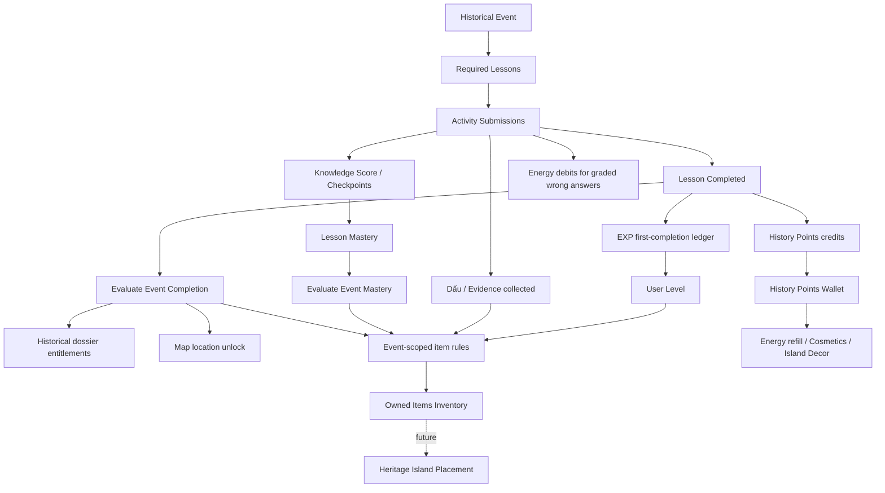

# DẤU VIỆT — GAMIFICATION BUSINESS RULES

**Mã tài liệu:** DV-GAME-BR-001  
**Phiên bản:** 1.0 — baseline nghiệp vụ cho triển khai  
**Ngày:** 24/10/2026  
**Phạm vi:** Learner Mobile, Learning Engine, Rewards, Energy, Wallet, Collection, Map, Inventory, Achievements, Admin  
**Vị trí đề xuất trong repo:** `docs/GAMIFICATION_BUSINESS_RULES.md`  
**Trạng thái:** Thống nhất định hướng sản phẩm; **chưa đồng nghĩa code đã triển khai**. Các định lượng V1 dưới đây là baseline để triển khai và hiệu chỉnh bằng cấu hình, không phải dữ liệu hiện có.

> **Nguyên tắc sử dụng:** Tài liệu này là nguồn nghiệp vụ thống nhất cho các task `GAME-*`. Khi code đang tồn tại khác quy định mới, phải lập migration/compatibility plan, không âm thầm sửa hành vi của attempt đã hoàn thành. Phần `BA` là nội dung có trong tài liệu gốc; phần `QD-MOI` là quyết định sản phẩm bổ sung; phần `HIEN-CO` mô tả kết quả rà source nhánh `main` ngày 24/10/2026. Tài liệu thiết kế M-18–M-28 là *concept*, không mặc nhiên được hiểu là rule backend đã có.

---

## 1. Mục đích, phạm vi, thứ tự ưu tiên

### 1.1 Mục đích

1. Quy định rõ ý nghĩa, cách kiếm, sử dụng và mối quan hệ giữa **EXP, Điểm Sử Ký, Thể lực, Bài học, Sự kiện, Dấu/bằng chứng, Bộ sưu tập lịch sử, Huy hiệu và Vật phẩm**.
2. Phân biệt **hoàn thành nội dung học** với **chứng minh hiểu kiến thức**, tránh mở phần thưởng thành thạo chỉ vì đã hết lượt trả lời.
3. Mở khóa **địa điểm, nhân vật, hiện vật** theo sự kiện được cấu hình, không gộp nhầm với kho vật phẩm hoặc cấp thưởng tùy tiện.
4. Đảm bảo mọi thay đổi số dư, sinh lực, tiến độ, quyền sở hữu đều do **server quyết định**, truy vết được và an toàn khi retry/đồng thời.
5. Cung cấp contract cho Backend, Flutter, Admin, DB, QA trước khi phát triển Đảo Di Sản.

### 1.2 Ngoài phạm vi giai đoạn này

- Tạm hoãn các task `ISLAND-01` đến `ISLAND-08` (các khái niệm trang trí chỉ được dùng để định nghĩa mục đích của điểm/vật phẩm).
- Chưa triển khai mua hàng bằng tiền thật, kim cương, cửa hàng cao cấp, quảng cáo thưởng, bán gói nạp trả phí.
- Không đổi Learning Engine thành trò chơi không có kiểm chứng kiến thức.
- Không xem mô hình/phiên bản số trong game là hiện vật lịch sử thật.

### 1.3 Nguồn căn cứ và mức độ chắc chắn

| Nguồn | Nội dung được dùng | Trạng thái |
|---|---|---|
| `Functional_Requirements_Dau_Viet_MVP.docx` | FR-31–34 tiến độ/EXP; FR-35–38 Map; FR-39–41 Collection; FR-42–43 Achievement | BA gốc |
| `Dau_Viet_BA_MVP_Learning_Framework.docx` | LRN-09–14, hoàn thành lesson, result/reward, lưu collection/map, outcome Partial/Contradicted | BA gốc |
| `design/MOBILE_SCREEN_DESIGN.md` | M-18–21 phần thưởng; M-22–27 Island/shop/inventory; M-28 Energy | Thiết kế concept, không phải triển khai thật |
| `design/ASSET_CATALOG.md` | Ghi chú giá/năng lượng/XP trong mockup chỉ là concept | Cảnh báo kỹ thuật |
| Source backend/mobile của repo | `RewardPolicy`, `RewardGrantService`, `ItemUnlockService`, `CollectionService`, `MapLocationService`, `profile-screen.dart`, `energy_management_screen.dart` | Hiện trạng rà soát; kiểm tra lại trước khi code |

**Điều chỉnh so với concept M-28:** Màn demo ghi tiêu hao khi vào bài và hồi `+1/30 phút`. Baseline mới **không trừ lúc vào bài**, chỉ trừ khi thực sự trả lời sai câu chấm điểm; hồi `+5/15 phút`. Đó là thay đổi sản phẩm có chủ đích, không phải chức năng BA đã yêu cầu.

---

## 2. Từ điển nghiệp vụ & ranh giới khái niệm

| Khái niệm | Định nghĩa chuẩn | Không được nhầm với |
|---|---|---|
| **EXP** | Tổng điểm kinh nghiệm vĩnh viễn của người học, tăng để tính Level. | Tiền tệ chi tiêu |
| **Level** | Cấp tài khoản tính từ EXP tích lũy và bảng ngưỡng. | Cấp đảo, độ khó của bài, mức thông thạo sự kiện |
| **Điểm Sử Ký** | Tiền tệ mềm có **số dư khả dụng**, tổng đã kiếm và tổng đã tiêu. | EXP và `knowledgeScore` |
| **Thể lực** | Tài nguyên 0–100; trừ khi submit đáp án được chấm là sai, hồi theo thời gian. | Tim Duolingo; phí vào bài; số lần làm bài |
| **Lesson Completed** | Hoàn thành luồng hoạt động bắt buộc, kể cả nhánh hết số lần thử mà vẫn được phép tiến tiếp. | `Lesson Mastered` |
| **Lesson Mastered** | Có kết quả chấm kiến thức đủ ngưỡng và các checkpoint yêu cầu. | Chỉ nhấn hết màn hình/đã completed |
| **Event Completed** | Hoàn thành **tập lesson bắt buộc đã công bố** của một sự kiện. | Hoàn thành một lesson bất kỳ thuộc sự kiện |
| **Event Mastered** | Event Completed cộng với yêu cầu kiến thức của sự kiện. | Event Completed |
| **Dấu / Evidence** | Tư liệu, bằng chứng người học đã khám phá/thu thập trong bài; có ID và nguồn. | Huy hiệu hay món hàng inventory |
| **Hồ sơ lịch sử** | Trang sưu tầm nhân vật/địa điểm/hiện vật liên quan sự kiện, xem lại miễn phí khi mở khóa. | Vật phẩm mua/đặt trên đảo |
| **Vật phẩm (Item)** | Quyền sở hữu một vật phẩm số trong `user_inventory`, gồm mô hình, phiên bản số, huy hiệu, thẩm mỹ (sau mở rộng). | Hồ sơ lịch sử, Dấu |
| **Huy hiệu thành tích** | Chứng nhận đạt điều kiện thành tựu; không thể mua để giả mạo kết quả học. | Vật phẩm trang trí bán bằng điểm |
| **Map Unlock** | Quyền mở địa điểm trên bản đồ hành trình. | Hồ sơ địa điểm đã đưa vào Bộ sưu tập |

### 2.1 Sự kiện và bài học: quan hệ 1–N

- `historical_events` có nhiều `lessons`. Không suy ra `Event Completed` từ `Lesson Completed` duy nhất.
- Admin xác định tập lesson **required** để hoàn thành sự kiện; lesson **optional** không ngăn hoàn thành.
- Điều kiện hoàn thành sự kiện phải được *publish/version* và lưu dấu tập required lesson đã dùng tại lúc ghi nhận, tránh việc thêm bài mới làm mất kết quả đã đạt.
- Các quyền đã mở khóa là **permanent entitlement** trừ khi bị thu hồi có chủ đích qua quy trình kiểm soát gian lận/tài khoản (không tự thu hồi do admin republish).

---

## 3. Sơ đồ quan hệ chuẩn



**Quan hệ thời gian:** Collect evidence xảy ra khi submission hợp lệ trong lúc học; unlock hồ sơ tổng hợp xảy ra khi event được hoàn thành; vật phẩm đặc biệt theo sự kiện cần rule và có thể đòi hỏi mastery. Các việc này không được trộn vào một con số "6 vật phẩm".

---

## 4. Chính sách EXP, cấp độ và thưởng bài học

### 4.1 EXP — luật bất biến

| ID | Quy định |
|---|---|
| `EXP-01` | EXP tích lũy, **không tiêu/không âm**, không chuyển thành Điểm Sử Ký. |
| `EXP-02` | Lần đầu hoàn thành **một lesson logic**: **+100 EXP**. Làm lại hay hoàn thành version mới của cùng lesson không nhận lại thưởng này. |
| `EXP-03` | Mỗi user/lesson/reward type chỉ nhận first-completion grant một lần; khóa nghiệp vụ bằng cause key unique, xử lý trong transaction complete. |
| `EXP-04` | Không thưởng EXP theo tỷ lệ knowledgeScore trong V1; mastery thưởng bằng thành tựu/vật phẩm riêng, tránh thay đổi thưởng đã cấp từ code cũ. |
| `EXP-05` | Level được tính ở server từ tổng EXP; level không giảm do chi tiêu. Không dùng level để chặn xem bài hoặc tri thức lịch sử cốt lõi. |

**Mốc Level mặc định V1 (cấu hình, không hard-code Flutter):**

| Level | EXP tích lũy tối thiểu | Ví dụ quyền lợi |
|---:|---:|---|
| 1 | 0 | Bắt đầu hành trình |
| 2 | 500 | Huy hiệu cấp 2 |
| 3 | 1.200 | Khung hồ sơ theo cấp |
| 4 | 2.100 | Mở quyền mua một nhóm trang trí (khi shop triển khai) |
| 5 | 3.200 | Huy hiệu cột mốc |

Sau level 5 phải có bảng ngưỡng cấu hình rõ ràng trước khi hiển thị level 6; không tự suy một công thức vô hạn. Quyền lợi level là **cosmetic/mở khóa tính năng phụ**, không phải mua kết quả kiến thức. Khung avatar/đồ trang trí là lợi ích đề xuất, chưa triển khai hiện tại.

### 4.2 Hoàn thành, thông thạo, thưởng

| Điều kiện | Progress | First-completion EXP/Điểm | Mastery/Huy hiệu |
|---|---|---|---|
| Hoàn thành đầy đủ với câu đúng | `COMPLETED` | Có, nếu lần đầu | Xét knowledgeScore |
| Hết retry nhưng Learning Engine cho tiến tiếp | `COMPLETED` | Có, nếu lần đầu | **Không** tự đạt mastery |
| Đang học, chưa đạt completion rule | `IN_PROGRESS` | Không | Không |
| Làm lại sau đã completed | Vẫn giữ lịch sử đã completed | **Không thưởng trùng** | Có thể cải thiện mastery nếu chính sách cho phép |

**Lý do:** `lesson_results.score` hiện là tỷ lệ required activities hoàn thành, **không phải điểm kiến thức**. Phải dùng `knowledgeScore`/các verdict đúng-sai do server chấm để xét `MASTERED`. Không dùng `score` của progress thay thế.

---

## 5. Điểm Sử Ký: ví tiền tệ và chi tiêu

### 5.1 Nguồn kiếm

| ID | Quy định |
|---|---|
| `POINT-01` | Lần đầu hoàn thành một lesson logic: **+50 Điểm Sử Ký** (tương thích reward policy hiện tại). |
| `POINT-02` | Không thưởng lại khi retry complete, republish lesson, làm lại lesson hoặc truy cập lại màn kết quả. |
| `POINT-03` | V1 không thưởng điểm theo số câu trả lời đúng, streak hoặc lặp hoạt động; mọi nguồn cộng mới phải đăng ký policy/cause unique. |
| `POINT-04` | Điểm Sử Ký là tiền tệ **có thể tiêu**, không phải "tổng lifetime" duy nhất. |

### 5.2 Các số phải phân biệt

- `pointsEarned` = tổng tín dụng hợp lệ từng kiếm được.
- `pointsSpent` = tổng ghi nợ hợp lệ đã tiêu.
- `pointsBalance` = `pointsEarned - pointsSpent` (luôn **>= 0**).
- Profile hiện có chỉ trường `historyPoints` và đang là tổng thưởng; khi hỗ trợ chi tiêu, UI "Điểm Sử Ký" phải hiển thị **số dư**. Có thể mở rộng API thêm earned/spent; xử lý tương thích client cũ có chủ đích.
- EXP ledger và History Points wallet là **hai khái niệm nghiệp vụ khác nhau**, không được lẫn vào một trường số dư.

### 5.3 Mục đích chi tiêu

| Nhóm | Có thể dùng điểm? | Quy tắc |
|---|---|---|
| Hồi phục Thể lực tại Viện Thái Y | **Có** | Gói V1 bên dưới, giới hạn và kiểm tra server |
| Vật phẩm trang trí Đảo Di Sản | Có **sau khi Island/Shop được triển khai** | Catalog có giá, mua tạo ownership, không tự đặt vào đảo |
| Khung avatar / nền hồ sơ | Có **sau khi có catalog cosmetic** | Không tác động kết quả học |
| Huy hiệu thành tựu thật | **Không** | Chỉ cấp theo điều kiện thành tựu |
| Hồ sơ nhân vật/địa điểm/hiện vật, Dấu | **Không** | Không bán tri thức đã thuộc phạm vi học tập |
| EXP / Level / điểm kiểm chứng | **Không** | Không mua cấp độ hoặc đáp án đúng |

**Giá khởi tạo để cân bằng (cấu hình, chưa phải dữ liệu bán trong hệ thống):**

| Hàng hóa/dịch vụ | Giá | Trạng thái |
|---|---:|---|
| Hồi +20 Thể lực | 30 Điểm Sử Ký | Gói triển khai trước |
| Cây cảnh nhỏ | 100 | Chờ Shop/Island |
| Nhà tranh | 200 | Chờ Shop/Island |
| Hồ sen | 300 | Chờ Shop/Island |
| Khung hồ sơ | 400 | Chờ Cosmetic |

### 5.4 An toàn giao dịch và chuyển đổi dữ liệu

| ID | Quy định |
|---|---|
| `POINT-05` | Mọi debit phải kiểm tra số dư và ghi ledger **cùng transaction** với tác dụng mua/hồi; không được trừ điểm nếu giao dịch thất bại. |
| `POINT-06` | Không chấp nhận `pointsBalance < 0`, kể cả mua đồng thời từ hai thiết bị. Phải có lock/optimistic version và unique business request key. |
| `POINT-07` | Một `purchaseId`/`Idempotency-Key` chỉ được xử lý một lần. Gọi lại trả kết quả cũ, không trừ thêm tiền. |
| `POINT-08` | Lưu amount, source/reason, cause key, userId, thời gian UTC, actor, item/service tham chiếu; có lịch sử cộng/trừ truy vết được. |
| `POINT-09` | `reward_transactions` hiện ghi credit EXP/History Points (số dương) và có idempotency. **Không xóa/sửa ledger cũ**. Khi triển khai wallet, chuyển các credit History Points cũ sang nguồn đọc mới bằng migration/backfill idempotent có khóa tham chiếu giao dịch gốc, tránh nhân đôi. |
| `POINT-10` | Lựa chọn kỹ thuật khuyến nghị: `wallet_accounts` (balance + version/row lock) và `wallet_transactions` (credit/debit signed hoặc direction + positive amount). Chỉ công nhận một nguồn truth cho balance; phân tách/history bridge từ `reward_transactions` phải được xác định trong GAME implementation design. |

> **Điểm cần kiểm tra khi thiết kế migration:** `reward_transactions` hiện có constraint/logic chỉ dành cho amount dương; **không** âm thầm insert amount âm vào bảng cũ. Có thể dùng wallet ledger riêng và đồng bộ credit cũ; API kết quả lesson hiện đọc `reward_transactions`, cần bảo toàn hiển thị phần thưởng lần đầu.

---

## 6. Thể lực (Energy) — dùng thanh 0–100 hiện có

### 6.1 Chính sách V1

| ID | Rule | Giá trị mặc định |
|---|---|---|
| `ENGY-01` | Khởi tạo tài khoản | 100/100 |
| `ENGY-02` | Giới hạn | 0 ≤ energy ≤ 100 |
| `ENGY-03` | Vào bài học / tiếp tục bài | 0 điểm (miễn phí) |
| `ENGY-04` | Đáp án đúng, đọc tư liệu, xem hoạt họa, map | 0 điểm |
| `ENGY-05` | Submit sai ở activity **có chấm đúng/sai** | -10 Thể lực/lần submit hợp lệ |
| `ENGY-06` | Partial / suy luận lịch sử có nhiều cách đúng / hoạt động không chấm | 0 điểm; không tự quy là sai |
| `ENGY-07` | Hồi tự nhiên | +5 mỗi 15 phút thực, tính theo giờ server |
| `ENGY-08` | Khi đầy | Dừng tích lũy hồi; không tích 'thời gian hồi' để nhận bonus vượt 100 |
| `ENGY-09` | Thể lực = 0 | Không nhận **submission mới có chấm điểm**, vẫn đọc, ôn tập, xem collection, và hoàn tất lesson nếu đủ điều kiện từ trước |
| `ENGY-10` | Sinh lực dương nhưng <10 | Vẫn có thể submit; nếu sai trừ `min(currentEnergy,10)` rồi về 0 |
| `ENGY-11` | Hồi bằng điểm | +20 Thể lực với 30 Điểm Sử Ký, tối đa 1 lần/24 giờ liên tiếp và chỉ khi energy ≤ 80 |

**Mốc thời gian:** nếu energy=0 và không có giao dịch nào khác, đầy trở lại sau 20 chu kỳ × 15 phút = **5 giờ**. Điều này thay thế concept `+1/30 phút` trong UI M-28.

### 6.2 Thế nào là "trả lời sai"?

Chỉ backend xác định sai dựa vào published lesson version đã pin; client không được tự trừ. Quy tắc phân nhóm:

| Loại hoạt động | Có thể trừ? | Điều kiện |
|---|---|---|
| `MULTIPLE_CHOICE`, `MATCHING`, `DRAG_ORDER`, `CER_CHOICE` | Có | Evaluation thực sự `incorrect`, không phải partial |
| `EVIDENCE_SELECT`, `REASONING_CONNECT` | Chỉ khi `config.graded=true` | Sai có quyết định chấm rõ ràng |
| `READ`, `VIEW_IMAGE`, `EXPLORE_MAP`, `REFLECTION_PROMPT` | Không | Không có đáp án đúng/sai |
| `HYPOTHESIS_CHOICE`, `VERIFICATION` | Mặc định không | `PARTIAL`/`CONTRADICTED` có thể là bước tư duy, **không phải** sai kiến thức để trừ tự động |
| Câu hỏi lỗi / đáp án thiếu / API lỗi / reject invalid payload | Không | Không coi là submit chấm sai hợp lệ |

- `result.completed=true` **không đồng nghĩa trả lời đúng** (có logic exhausted). Cần chuẩn hóa server-side `gradingVerdict`/`penalizableIncorrect` từ handler hoặc adapter an toàn; tuyệt đối không suy `completed=false => sai`.
- Một submission sai hợp lệ dù đã exhausted và cho tiến tiếp vẫn trừ **một lần**, nếu bắt đầu submit khi còn energy > 0.
- Một câu hỏi có thể sai nhiều lần, mỗi lần submit sai **mới**, có key khác, bị trừ riêng. Retry cùng key/cùng payload phải replay kết quả cũ, **không trừ tiếp**.
- `Partial` không bị phạt mặc định. Nếu về sau muốn chế độ khác, phải thông qua thay đổi policy có version và kiểm tra fairness.

### 6.3 Tính hồi theo thời gian server

- Lưu trạng thái tối thiểu: `user_id`, `current_energy`, `last_recovery_at` (UTC), `row_version`; thêm `energy_transactions`/idempotency ledger để audit debit/credit/purchase nếu triển khai.
- Khi đọc/ghi, server lazy-recalculate số chu kỳ hồi từ mốc hồi trước, giới hạn max. Phần thời gian lẻ của chu kỳ được bảo tồn; khi đầy, neo lại mốc để không tích lũy hồi tràn.
- Khi từ 100 giảm xuống dưới 100, bắt đầu chu kỳ hồi mới từ thời điểm trừ; không nhận ngay 5 điểm do thời gian đã ở 100.
- Đồng hồ điện thoại chỉ dùng hiển thị countdown từ `serverTime` + `nextRecoveryAt` server trả, không quyết định số hồi.
- Thể lực và penalty ghi trong **cùng transaction** với accepted submission/attempt persistence, sau bước idempotency check; các lock phải có thứ tự nhất quán để tránh deadlock.

### 6.4 Hết Thể lực và ôn tập

- Không tự động xóa/sửa answer đã nộp, attempt cursor, progress hay kiến thức đã thu thập.
- App hiển thị số Thể lực còn lại, thời gian hồi kế tiếp, nút **Ôn tập miễn phí** hoặc **Đổi điểm hồi phục** nếu đủ điều kiện.
- Chế độ ôn tập miễn phí là mode riêng **không cấp EXP/Điểm Sử Ký, không cấp item, không làm thay đổi outcome của pinned attempt**. Không tạo đường đi để vượt zero-energy gate qua endpoint khác.
- Hoạt động không chấm vẫn khả dụng trong bài nếu engine cho phép; không chặn xem lại lesson/history.
- Không tự động mở quảng cáo hay mua hàng trả phí.

### 6.5 Gói hồi điểm — quy tắc trừ/nhận nguyên tử

1. User có thể đổi chỉ khi `energy <= 80`, `pointsBalance >= 30`, chưa dùng gói trong **24 giờ trượt** gần nhất.
2. Transaction: lock user/wallet/energy theo thứ tự cố định → tính hồi natural → kiểm tra điều kiện → trừ 30 điểm → cộng `min(20, max-current)` → ghi lịch sử và thời điểm → commit.
3. Retry cùng request không trừ thêm hoặc hồi thêm. Nếu một bước fail, rollback toàn bộ.
4. Các nút hồi trong màn `energy_management_screen.dart` hiện chỉ mô phỏng; không được cho Flutter `setState` tăng điểm rồi hiển thị đã mua khi server chưa xác nhận.
5. Các gói Nước Vối/Trà Sen/Nấm Linh Chi/Sâm Ngọc Linh và Đồng Cổ/Kim Cương đang ở bản demo không tự xem là SKU hợp lệ; V1 chỉ có **một gói +20/30 điểm** cho đến khi Admin/BA chốt catalog hồi phục.

---

## 7. Lesson, mastery và event completion

### 7.1 Trạng thái chuẩn

| Trạng thái | Cách xác định | Tác dụng |
|---|---|---|
| `LESSON_IN_PROGRESS` | Attempt đang học | Không cấp first-completion reward |
| `LESSON_COMPLETED` | Engine kiểm tra tất cả required activity đạt completion rule | Cấp EXP/điểm một lần theo lesson |
| `LESSON_MASTERED` | Completed và đạt ngưỡng kiến thức/checkpoint cấu hình | Xét các rule mastery |
| `EVENT_COMPLETED` | Hoàn thành tất cả required lessons thuộc **published event policy** | Mở dossier nhân vật/địa điểm/hiện vật của sự kiện |
| `EVENT_MASTERED` | Event Completed + knowledge mastery policy của sự kiện | Mở badge/mô hình đặc biệt nếu có rule |

### 7.2 KnowledgeScore / mastery

- `lesson_results.score` (existing): phần trăm **required completed**, dùng progress UI, **không dùng để xét mastery**.
- `lesson_results.result_json.knowledgeScore` (existing): thước đo kiến thức từ hoạt động chấm điểm. Đề nghị chuẩn hóa cùng metadata `gradableRequiredCount`, `masteryThreshold`, `masteryStatus`, `checkpointStatus`.
- **Mặc định ngưỡng mastery = 70/100**, giá trị theo version bài/sự kiện do Admin cấu hình. Đây là đề xuất khởi tạo, không phải mốc cứng bất biến.
- Nếu bài không có activity có khả năng chấm (`gradableRequiredCount=0`), trạng thái **`NOT_ASSESSED`**, không coi 0 là điểm kiến thức và **không tự mastery**. Event policy phải có tối thiểu checkpoint đánh giá nếu dùng Event Mastered.
- Các activity hết lượt sai nhưng được đánh dấu completed **đóng góp 0 hoặc partial thật** theo kết quả lưu, không nhận full credit nhờ completion.
- Nên dùng *best valid result* khi learner ôn tập/retry hợp lệ để đạt mastery sau; không thưởng lại first-completion EXP/điểm. Quy tắc cải thiện phải kiểm tra trên version hợp lệ và lưu event mastery grant audit một lần.
- Với sự kiện nhiều required lessons, V1 `EVENT_MASTERED` khi **mọi required lesson có chấm điểm đều đạt mastery**, và event có ít nhất một graded lesson; các required lesson không chấm không tự tính mastery nhưng vẫn phải completed. Nếu cần dùng average trọng số về sau, phải tăng policy version.

### 7.3 Chính sách hoàn thành sự kiện

| ID | Quy định |
|---|---|
| `EVT-01` | Admin cấu hình rõ danh sách `requiredLessonIds` cho mỗi event (ít nhất 1 published lesson), `optionalLessonIds` tách biệt. |
| `EVT-02` | Event Completed khi tất cả required lessons đã `LESSON_COMPLETED` bởi user trên bất kỳ pinned version hợp lệ. |
| `EVT-03` | Nếu lesson được publish lại, attempt cũ và completion cũ vẫn có giá trị; không reset event progression. |
| `EVT-04` | Ghi nhận event-completion entitlement/ledger **một lần mỗi user/event**, kèm `policyVersion` và snapshot required lesson IDs. |
| `EVT-05` | Admin thêm required lesson sau khi user đã completed không được tự thu hồi entitlements/collection đã mở; chính sách mới áp dụng cho những người chưa hoàn thành hoặc mốc mới có version. |
| `EVT-06` | Học lại lesson/sự kiện không cấp trùng. Event có thể chưa mastered dù đã completed. |
| `EVT-07` | Sự kiện chưa có published completion policy hợp lệ được báo `NOT_CONFIGURED`, không tự suy "học một bài bất kỳ là hoàn thành sự kiện". |

**Cách cập nhật trên runtime:** Lesson complete → ghi result/reward → evaluate event policy → nếu vừa đủ điều kiện, ghi event completed → unlock dossiers/map/achievement/item-rule (nếu đủ điều kiện), với idempotency cho từng grant. Nếu tách transaction bất đồng bộ, bắt buộc outbox/reconciliation idempotent để tránh trạng thái nửa vời; không được chỉ phụ thuộc client mở màn kết quả.

---

## 8. Bộ sưu tập lịch sử, Map và quyền xem tri thức

### 8.1 Hai lớp Collection khác nhau

**Lớp A — Dấu/Bằng chứng thu thập trong bài (`Evidence Collection`)**

- Người học nhận khi submit activity thu thập hợp lệ, theo published lesson snapshot; có thể xem lại ngay.
- Giữ `user_evidence` và uniqueness `(user_id, evidence_id)` hiện có; `snapshot_json` giữ nguồn/ngữ cảnh lịch sử không bị mất khi Admin sửa/ẩn evidence.
- Có `event_id`, `lesson_id`, `source`, evidence type, thời gian thu; cho phép lọc theo event và loại.
- Thu thập evidence **không cần trả lời đúng câu hỏi kiến thức** trừ khi activity đó được cấu hình là bài kiểm chứng với rule riêng; không lấy Dấu làm vật phẩm thưởng.

**Lớp B — Hồ sơ lịch sử đã mở (`Historical Dossiers`)**

- Loại bản ghi: `PERSON`, `LOCATION`, `ARTIFACT` và có thể mở `CONTEXT` về sau; mỗi hồ sơ gắn ID canonical, mô tả và source được kiểm duyệt.
- Admin **liên kết hồ sơ với event** qua bảng liên kết; một nhân vật/địa điểm có thể liên quan nhiều event mà không tạo bản sao vô nghĩa.
- Khi `EVENT_COMPLETED`, mở toàn bộ hồ sơ **được đánh dấu unlock-on-event-completed** cho sự kiện đó; người đã mở được xem vĩnh viễn dù event sau này archive, miễn là nội dung không bị gỡ vì lý do pháp lý/bản quyền.
- Trong lúc chưa hoàn thành, app có thể cho xem **giới thiệu công khai** nếu đã publish, nhưng không coi là `collected/unlocked`.
- Bộ sưu tập cần tab/nhóm và bộ lọc rõ: **Dấu**, **Nhân vật**, **Địa điểm**, **Hiện vật**; mỗi item hiển thị sự kiện liên quan và nguồn.

### 8.2 Map và Collection có liên quan nhưng khác nghĩa

| Quyền | Cách mở | Đích UI |
|---|---|---|
| `MAP_LOCATION_UNLOCKED` | Giữ FR-37: hoàn thành lesson được map location chỉ định; về sau có thể mở rộng rule có version | Bản đồ hành trình |
| `HISTORICAL_DOSSIER_UNLOCKED` | Event Completed + event/dossier link published | Bộ sưu tập tri thức |
| `EVIDENCE_COLLECTED` | Accepted exploration/evidence submission | Bộ sưu tập Dấu |
| `ITEM_OWNED` | Item rule thỏa hoặc mua hợp lệ | Túi đồ |

**Không đồng nhất 4 điều kiện trên.** Ví dụ người học hoàn thành bài về Bạch Đằng có thể mở một node bản đồ theo lesson, thu thập 3 bằng chứng lúc học; chỉ khi hoàn thành **toàn bộ** required lessons của event mới nhận đủ bộ hồ sơ nhân vật/địa điểm/hiện vật liên quan. Những item chưa có dữ liệu liên kết thì không phát sinh unlock ảo.

### 8.3 Nội dung liên quan không được suy theo tên

- Không dùng so khớp chuỗi "Bạch Đằng" hoặc tag chung để cấp item/hồ sơ.
- Mọi unlock phải qua quan hệ chính thức: `event_id`, `lesson_id`, `evidence_id`, `dossier_id`, `item_id`, và rule có version.
- Một nhân vật liên quan nhiều event có thể được mở qua bất kỳ sự kiện **đã cấu hình**. Quyền sở hữu/dossier của user là unique theo canonical ID, không nhân đôi số lượng.
- Dossier nêu rõ tư liệu gốc, mô hình/ảnh tái dựng, và citation; asset bị archive phải có chiến lược snapshot/pin tương tự evidence.

---

## 9. Vật phẩm, huy hiệu và Rule Engine

### 9.1 Danh mục và quyền sở hữu

- Giữ `item_catalog`, `item_unlock_rule`, `user_inventory` làm lõi; item có `code`, `rarity`, loại, asset, metadata nguồn.
- Mỗi loại item **non-stackable** ở V1: tối đa một ownership `(user_id, item_id)`. Phải mở rộng schema riêng nếu về sau cho vật phẩm stackable.
- **Không phải item nào cũng có thể trang trí đảo**: huy hiệu có thể chỉ là thành tựu, phiên bản số có thể là trang hồ sơ trưng bày, một số mô hình có cấu hình `placeable=true` sau Island task.
- Các item học thuật là mô hình/phiên bản số/huy hiệu **không phải hiện vật thật**; mô tả rõ nguồn và cảnh báo tái dựng.
- Vật phẩm đã cấp không bị tự thu hồi khi admin tắt catalog, đổi rule hoặc republish event. Giữ khả năng hiển thị owned-inactive.

### 9.2 Phân loại cách nhận

| Acquisition | Điều kiện mẫu | Có được mua? |
|---|---|---|
| `ACHIEVEMENT` | Event Mastered / đủ số sự kiện mastered / mốc Level | Không |
| `HISTORICAL_REPLICA` | Event Completed AND Evidence thuộc chính event đạt ngưỡng | Không, trừ item được chính sách định nghĩa là cosmetic riêng |
| `DIGITAL_EDITION` | Đạt nhiệm vụ sưu tầm liên quan event; có thể cần mastery | Không mặc định |
| `DECOR` (sau Island) | Mua bằng Điểm Sử Ký, có thể thêm Level tối thiểu | Có |
| `COSMETIC` (sau profile shop) | Mua bằng Điểm Sử Ký hoặc mở theo Level | Có nếu được cấu hình |

### 9.3 Rule Engine chặt chẽ, event-scoped

Rule v1 hiện có 3 loại đơn: `LESSON_COMPLETED`, `COLLECTION_COUNT`, `LESSON_COUNT`, một rule active/item. Khi mở rộng cần thêm:

- `EVENT_COMPLETED(eventId)`
- `EVENT_MASTERED(eventId)`
- `LESSON_MASTERED(lessonId)`
- `EVENT_EVIDENCE_COUNT(eventId, threshold)` — **chỉ đếm evidence thuộc event này**, unique canonical ID.
- `SPECIFIC_EVIDENCE_SET(evidenceIds)` (đã thu thập đủ các evidence cụ thể)
- `TOTAL_EVENTS_COMPLETED(threshold)`
- `TOTAL_EVENTS_MASTERED(threshold)`
- `LEVEL_AT_LEAST(level)`
- `ALL([...])` / `ANY([...])` — kết hợp AND/OR có giới hạn độ sâu để dễ review, validation và backfill.

**Ví dụ chính sách** (Admin phải duyệt và khai báo ID thực trước publish):

```json
{
  "code": "BACH_DANG_REPLICA_REWARD",
  "itemCode": "PHIEN_BAN_SO_COC_BACH_DANG",
  "eventCode": "bach-dang-938",
  "condition": {
    "all": [
      {"type": "EVENT_COMPLETED", "eventCode": "bach-dang-938"},
      {"type": "EVENT_EVIDENCE_COUNT", "eventCode": "bach-dang-938", "threshold": 3}
    ]
  },
  "grant": "ONCE_PER_USER_ITEM"
}
```

`eventCode` là cách đọc cho người; thực thi dùng ID canonical. **Rule trên là ví dụ**, không tự cập nhật seed V12 hay thay thế rule production khi chưa migration.

### 9.4 Bảo toàn lịch sử, version rule, backfill

| ID | Quy định |
|---|---|
| `ITEM-01` | Mỗi item phải có `unlockRuleId`, phiên bản rule, điều kiện, phạm vi event/lesson nếu liên quan. |
| `ITEM-02` | Rule được đánh giá server-side khi phát sinh sự kiện phù hợp (submit collect, lesson mastered/completed, event mastered/completed, level changed, purchase). |
| `ITEM-03` | Grant lưu `userId`, `itemId`, `triggeringEventId/lessonId/attemptId`, `ruleVersion`, `acquiredAt`, acquisition source, cause key. |
| `ITEM-04` | Unique `(user_id, item_id)` / cause key đảm bảo không cấp trùng. |
| `ITEM-05` | Thay đổi rule/threshold không thu hồi quyền cũ; cần backfill idempotent dành cho user đủ điều kiện trước đó. |
| `ITEM-06` | Rule mơ hồ, tham chiếu sai event, chưa publish hay vòng lặp điều kiện phải bị Admin validation chặn. |
| `ITEM-07` | Vật phẩm mua bằng điểm tạo transaction debit + ownership trong cùng transaction; không có ownership nếu trừ điểm thất bại. |
| `ITEM-08` | Không mua huy hiệu chứng nhận thành tích, không dùng tiền unlock bài học lịch sử bắt buộc. |

---

## 10. Trải nghiệm Flutter / hệ thống chỉ số

### 10.1 Màn thành tích học tập (4 cột đang có)

| Chỉ số | Hiển thị chính xác | Khi chạm mở |
|---|---|---|
| EXP | Lifetime EXP đã kiếm | Chi tiết cấp độ + progress tới level kế |
| Điểm Sử Ký | **Số dư khả dụng** (có giao dịch credit/debit) | Ví điểm + lịch sử kiếm/tiêu |
| Bài học | Số **distinct lessons** completed | Tiến độ: bài và sự kiện; chưa mastered vs mastered |
| Vật phẩm | Số **distinct owned items** trong inventory | Túi đồ/Thành tựu theo nhóm, không cộng hồ sơ lịch sử |

- Màn `profile-screen.dart` đang hiển thị các số từ `GET /api/v1/me/rewards/summary`; tiếp tục dùng backend làm nguồn chính, bổ sung trường khi cần, không tự tính từ dữ liệu Flutter.
- Bổ sung widget nhỏ **Thể lực** trên Home/lesson header và liên kết màn Viện Thái Y; giữ **thanh 0–100**, **không dùng biểu tượng 5 tim**.
- Thông báo khi sai: “Chưa đúng, thử lại nhé. -10 Thể lực” chỉ khi server trả `energyDelta=-10`; nếu partial thì phản hồi học tập phù hợp, không hiển thị mất thể lực.
- Khi hết năng lượng: vẫn có thể đọc/ôn tập; hiển thị thời gian hồi, nút dùng điểm nếu đủ điều kiện.
- Màn kết quả phân biệt rõ `completed`, `knowledgeScore`, `masteryStatus`, reward lần đầu, newlyUnlocked events/dossiers/items; lần mở lại không tạo hiệu ứng “nhận thưởng mới”.

### 10.2 Không để demo giả mạo backend

- `energy_management_screen.dart` hiện dùng `_currentEnergy=80`, tăng bằng `setState`; `energy_pill.dart` có giá trị mặc định demo 100/100 và History Points. Phải bỏ local-authoritative mode khi triển khai thực tế; mock chỉ chạy trong cấu hình mock được nhận diện.
- Một thanh Energy duy nhất lấy từ API trên Home, lesson, profile, viện thái y; tất cả màn thống nhất cùng user state.
- Không hiển thị Đồng Cổ/Kim Cương là tiền tệ có thật khi chưa có backend và hợp đồng kinh tế.

---

## 11. Contract kỹ thuật đề xuất (chưa phải API hiện hành)

### 11.1 Read models

| API đề xuất | Nội dung trả về tối thiểu |
|---|---|
| `GET /api/v1/me/gamification/summary` | `expTotal`, `level`, `levelProgress`, `pointsBalance`, `pointsEarned`, `pointsSpent`, `energy`, `lessonsCompleted`, `eventsCompleted`, `itemsOwned`, `dossiersUnlocked` |
| `GET /api/v1/me/energy` | `current`, `max`, `recoveryAmount`, `recoveryIntervalSeconds`, `nextRecoveryAt`, `serverTime`, `canSubmitGraded`, `refillEligibility` |
| `GET /api/v1/me/wallet/transactions` | Credit/debit, `causeKey`, `reference`, timestamp, balance-after nếu có |
| `GET /api/v1/me/events/{eventId}/progress` | Required lessons + trạng thái; `eventCompleted`, `eventMastered`, policyVersion, unlock summary |
| `GET /api/v1/me/collection/dossiers` | Hồ sơ unlocked, filter loại/event, canonical ID và metadata nguồn |
| `GET /api/v1/me/inventory/catalog` | Giữ endpoint hiện có; mở rộng rule breakdown/eligibility/version khi cần |

`GET /api/v1/me/rewards/summary`, `GET /api/v1/me/collection`, Map APIs hiện có phải được giữ tương thích trong thời gian chuyển đổi. **Không triển khai trùng nhiều endpoint với cùng nguồn truth**: kiến trúc cuối cùng quyết định summary chính, response cũ có thể làm adapter.

### 11.2 Write endpoints/events

| API/hành động | Quy tắc server |
|---|---|
| Submit activity hiện tại | Evaluate → idempotency check → energy settle/penalty → attempt result, tất cả atomic |
| Complete attempt hiện tại | Grant first completion → evaluate event completion/mastery → unlock entitlements, idempotent |
| `POST /api/v1/me/energy/refills` | Request idempotency key; atomically debit wallet + credit energy, kiểm tra rate limit |
| Admin publish event completion policy | Validate lessonIds, published status, rule completeness và version |
| Admin publish item unlock rule | Validate event/lesson refs, rule AST, circular/unsupported combinations |
| Admin reconcile/backfill | Chạy idempotent, không nhân đôi thành tựu hay debit/credit cũ |

**Ưu tiên contract:** Không đổi tên/trạng thái của endpoint hiện có khi chưa kiểm tra Flutter caller. `Idempotency-Key` cùng payload → replay; cùng key khác payload → conflict, không side-effect. Với các thao tác ảnh hưởng từ nhiều DB module, dùng transaction xuyên module hoặc outbox/replay có khóa nghiệp vụ.

### 11.3 DB logical model cần có (thêm/mở rộng qua Flyway mới)

| Logical table hoặc aggregate | Tác dụng | Nguyên tắc |
|---|---|---|
| Existing `reward_transactions` | EXP + credits lịch sử; first-completion audit | Không sửa ngược giao dịch |
| `wallet_accounts` + `wallet_transactions` | Số dư spendable, credit/debit | UNIQUE cause key; atomic nonnegative |
| `user_energy` + `energy_transactions` | Thể lực, mốc hồi, lịch sử trừ/hồi | Server clock; idempotent |
| `level_thresholds` hoặc versioned config | EXP → level | Chính sách một nguồn |
| `event_completion_policies` | Required lessons + version | Immutable published policy/snapshot |
| `user_event_progress` / `user_event_entitlements` | Event completion/mastery | Unique per user,event,milestone; audit |
| `historical_dossiers`, `event_dossiers` | Canonical nhân vật/địa điểm/hiện vật và liên kết sự kiện | Nhiều-nhiều, có source/review |
| `user_dossier_unlocks` | Quyền mở hồ sơ | Unique user,dossier |
| Versioned `item_unlock_rules` (nâng cấp) | Rule AST/bộ điều kiện scoped | Validate before publish; versioned |
| Existing `user_inventory`, `user_evidence`, `map_locations` | Ownership, evidence và map | Tái sử dụng, không tạo bản sao |

Tên bảng final do task thiết kế kỹ thuật quyết định sau khi scan migrations mới nhất; đây là logical contract. Không cần hiện thực toàn bộ trong một migration duy nhất.

---

## 12. Ma trận kích hoạt — nghiệp vụ end-to-end

| Trigger | Tiến độ | EXP | Điểm | Thể lực | Evidence | Event/Dossier | Item |
|---|---|---|---|---|---|---|---|
| Bắt đầu/resume lesson | Có | 0 | 0 | 0 | Không | Không | Không |
| Submit graded đúng | Lưu + tiến | 0 | 0 | 0 | Nếu activity collect hợp lệ | Chưa | Xét scoped evidence nếu có |
| Submit graded sai | Lưu sai/retry | 0 | 0 | -10 (tối đa số còn) | Theo activity collect hợp lệ | Chưa | Không vì sai kiến thức |
| Submit `PARTIAL` | Lưu feedback | 0 | 0 | 0 | Theo rule collect | Chưa | Chỉ loại không yêu cầu mastery |
| Lesson Completed **lần đầu** | Completed | +100 | +50 | 0 | Giữ evidence | Xét event requirements | Xét lesson rule |
| Lesson Completed **lần sau** | Completed | 0 | 0 | 0 | Không nhân đôi | Xét mastery nếu tăng | Không nhân đôi |
| Event Completed mới | Ghi milestone | 0 (V1) | 0 (V1) | 0 | Giữ evidence | Mở hồ sơ liên quan đã cấu hình | Xét rule event |
| Event Mastered mới | Ghi mastery | 0 (V1) | 0 (V1) | 0 | Giữ evidence | Không cần mở lại | Xét badge/rare item |
| Chờ 15 phút khi chưa đầy | Không | 0 | 0 | +5 | Không | Không | Không |
| Đổi 30 Điểm lấy +20 Thể lực | Không | 0 | -30 | +20 | Không | Không | Không |

**Lưu ý:** Đây là ma trận rule chuẩn; những dữ liệu hiện có không tự backfill mastery khi thiếu đánh giá đáng tin cậy. Backfill chỉ những mốc có bằng chứng trong persisted result và policy hợp lệ.

---

## 13. Ví dụ nghiệp vụ xuyên hệ thống

### Ví dụ A — 4 bài hoàn thành, chưa có chi tiêu

- User hoàn thành **4 lesson khác nhau lần đầu**: `EXP=400`, `pointsEarned=200`, `pointsSpent=0`, `pointsBalance=200`, `lessonsCompleted=4` (khớp dạng thống kê ở ảnh tham khảo).
- `itemsOwned=6` là **số thực tế** từ `user_inventory`; không suy ra 6 từ 4 bài, và không cộng các hồ sơ lịch sử.
- Level theo bảng V1: 400 EXP → Level 1, còn 100 EXP để lên Level 2.
- Khi user đổi gói hồi 30 điểm: `pointsBalance=170`; `EXP=400`, `lessonsCompleted=4`, `itemsOwned=6` không đổi; energy cộng 20 tối đa 100.

### Ví dụ B — làm sai và hết năng lượng

1. User có 15 Thể lực, làm sai câu trắc nghiệm đã chấm: -10 → còn 5.
2. User tiếp tục submit câu có chấm, làm sai: -5 (clamp về 0).
3. Submit graded mới bị từ chối theo `ENERGY_DEPLETED` và trả `nextRecoveryAt`; không thay đổi attempt state.
4. User có thể xem evidence/story, học chế độ ôn tập không thưởng hoặc chờ 15 phút để có 5 Thể lực.
5. Retry network của submission bước 1 cùng key không trừ lần hai.

### Ví dụ C — Bạch Đằng 938 có nhiều lesson

- Admin publish event policy required lessons `L1,L2,L3`, optional lesson `L4`; gắn dossier `Ngô Quyền`, `Sông Bạch Đằng`, `Tái dựng cọc gỗ` theo canonical IDs.
- Sau L1: ghi evidence đã thu, cấp reward L1 lần đầu, có thể mở map location link L1; **chưa** Event Completed.
- Sau L2: tiếp tục, không mở tất cả dossier chỉ vì tên event tương tự.
- Sau L3: Event Completed → mở 3 dossier linked, xét item rule `EVENT_COMPLETED && EVENT_EVIDENCE_COUNT >= 3`.
- Nếu knowledgeScore/chặng kiểm chứng chưa đủ 70 ở graded required lesson: Event vẫn Completed, nhưng **chưa** Mastered; badge "Hào khí Bạch Đằng" chỉ cấp khi đạt rule `EVENT_MASTERED`.
- Nếu republish L2 hoặc thêm L5 vào required policy mới, completion/entitlement đã earned **không bị thu hồi**.

---

## 14. Những lỗi cần tránh / tiêu chí nghiệm thu

### 14.1 Security, consistency, fairness

1. Không tin `userId`, answer key, `energyDelta`, thời gian hay giá do mobile gửi; user từ JWT.
2. Không thể dùng request cũ/2 thiết bị để trừ wallet 2 lần hoặc nhận energy 2 lần.
3. Không thể làm số dư âm, energy âm hoặc vượt 100.
4. Không thể farm EXP/points qua republish/recomplete/backfill.
5. Không thể biến `INCORRECT + exhausted + completed=true` thành mastery.
6. Không phạt energy cho `PARTIAL`, `CONTRADICTED` học thuật hoặc read/view activity theo chính sách mặc định.
7. Event policy thay đổi không thu hồi collection, item, hay map entitlement đã earned.
8. Vật phẩm của event A không được mở nhờ chỉ thu thập evidence từ event B, trừ khi rule toàn cục minh định.
9. Không tự thêm huy hiệu "đã hiểu lịch sử" bằng mua điểm.
10. Nếu asset/lesson/collection archived, quyền sở hữu vẫn có thông tin snapshot/nguồn đọc phù hợp.

### 14.2 Bảng kiểm nghiệm thu chức năng

| ID | Scenario | Expected |
|---|---|---|
| `QA-01` | Lesson first-completion 2 request concurrent | Chỉ +100 EXP và +50 điểm một lần |
| `QA-02` | Lesson version mới, completed lần nữa | Không cấp lại first-completion reward |
| `QA-03` | 4 lesson completed | EXP 400, points earned 200, count 4; balance = earned - spent |
| `QA-04` | Sai graded, retry cùng key | Trừ energy đúng một lần |
| `QA-05` | Sai graded với energy=5 | Submit accepted và energy về 0 |
| `QA-06` | Sai khi energy=0 | Không thay đổi attempt; response depleted có mốc hồi |
| `QA-07` | Partial / ungraded | Không trừ energy |
| `QA-08` | Chờ 45 phút từ energy=0 | +15 (3 chu kỳ); không vượt max |
| `QA-09` | Energy đầy, chờ lâu, rồi sai | Không có “tín dụng hồi” tích trước lúc mất năng lượng |
| `QA-10` | Hai refill cùng lúc balance=30 | Tối đa một debit và một refill; balance không âm |
| `QA-11` | Refill +20 với energy=90 | Reject; không debit |
| `QA-12` | Refill trong 24h kể từ lần trước | Reject; không debit |
| `QA-13` | Event required L1,L2,L3, chỉ hoàn thành L1 | Event chưa completed; không mở tất cả dossier |
| `QA-14` | Hoàn thành đủ required lessons | Event completed một lần; unlock dossiers theo link |
| `QA-15` | Hết retry nhưng completed, knowledgeScore thấp | Không mastered; first-completion reward theo policy vẫn đúng |
| `QA-16` | Collection đủ 3 evidence event B, rule item event A | Không mở item A |
| `QA-17` | Rule sửa, user đã có item | Không revoke; read inventory vẫn hiện |
| `QA-18` | Admin backfill cùng rule 2 lần | Không grant/credit trùng |
| `QA-19` | Profile sau tiêu 30 điểm | EXP, bài học, item không đổi; points balance giảm 30 |
| `QA-20` | Mobile tắt mở lại / đổi thiết bị | Energy/points/unlocks khớp server |

### 14.3 NFR tối thiểu

- Timezone chuẩn lưu server UTC; định dạng trả ISO8601, UI Việt Nam hiển thị giờ địa phương.
- Currency/energy thay đổi phải có audit và response rõ ràng khi 409 conflict, 422 invalid rule hoặc insufficient funds, không tự replay request mới với key cũ khác payload.
- Chính sách điểm, hồi energy, mastery threshold đều là **configuration có version**, hỗ trợ thay đổi mà không sửa ngược kết quả lịch sử.
- Kiểm tra PostgreSQL migration trên database trống **và database đã có dữ liệu**.
- Không yêu cầu Playwright; ưu tiên backend integration tests, Flutter widget/unit tests, migration verification và static analysis.

---

## 15. Lộ trình triển khai và dependency

**Tạm hoãn Island. Không code cả chuỗi một lượt.**

| Task | Việc chính | Điều kiện chuyển task |
|---|---|---|
| `GAME-01` | Chốt nghiệp vụ/contract versioned completion, mastery, XP/points/wallet/energy; audit điểm xung đột code | Mọi invariant & migration strategy được review |
| `GAME-02` | DB + service/API energy server-authoritative, settle penalty atomic trên submit | Energy state/timer/retry/concurrency pass |
| `GAME-03` | Flutter Energy Bar 0–100, depletion, countdown, free review, refill UX | Không còn energy giả ngoài mock, các màn đồng bộ |
| `GAME-04` | Event completion policy, dossiers theo event, collection/map semantics | Multi-lesson event unlock đúng, không revoke khi republish |
| `GAME-05` | Rule engine scoped cho vật phẩm và achievement, mastery gates | Không cross-event unlock, item idempotent |
| `GAME-06` | Admin CMS cấu hình event/dossier/item rules + validation | Admin tạo rule không hard-code event/lesson |
| `GAME-07` | Profile summary, level progress, wallet history, result/reward UX; chi điểm hồi energy | Earn/spend/balance/audit nhất quán |
| `GAME-08` | Migration data cũ, backfill idempotent, regression tổng thể | Nghiệm thu ma trận QA-01–20 |

**Điều chỉnh thứ tự khi lập kỹ thuật:** Nếu GAME-02 yêu cầu `wallet_accounts`, chỉ tạo nền dữ liệu tối thiểu; cơ chế refill bằng điểm không được mở trên mobile khi wallet transactional debit chưa hoàn tất. Có thể triển khai wallet core trước hoặc cùng GAME-07, nhưng không có trạng thái "nút mua hoạt động giả".

### 15.1 Phân chia quyền quyết định

- **Product/BA:** cấu hình gameplay, điều kiện mastery, quan hệ event–dossier–item, giá, chính sách hồi/penalty.
- **Backend:** server truth về chấm đúng/sai, reward, wallet balance, energy, mastery, unlock; idempotency/locking.
- **Admin:** tạo và publish policy/rule, kiểm duyệt nguồn, preview/validation; không ghi thành tựu người học bằng thao tác UI bình thường.
- **Flutter:** trình bày và gửi ý định; không tự quyết định award/trừ điểm/trừ năng lượng/mở khóa.
- **QA:** kiểm thử migration, retry, race, backfill, historical policy changes.

---

## 16. Đối chiếu hiện trạng code để tránh hiểu sai tiến độ

| Module/đường dẫn | Đã có tại thời điểm rà soát | Còn cần theo tài liệu này |
|---|---|---|
| `reward/application/RewardPolicy.java` | +100 EXP/+50 HISTORY_POINTS first lesson completion | Level/progress; wallet spend/transactions |
| `reward/application/RewardGrantService.java` | Grant first time idempotent | Bảo toàn khi thêm wallet/mastery policy |
| `reward/application/ItemUnlockService.java` | `LESSON_COMPLETED`, `COLLECTION_COUNT`, `LESSON_COUNT`; one rule active/item | Event-scoped AND/OR, mastery, provenance, version |
| `collection/application/EvidenceCollectionRecorder.java` | Thu evidence từ `EVIDENCE_SELECT`, snapshot | Dossier historical entities và event-completion unlock |
| `map/application/MapLocationUnlockQuery.java` | Unlock theo completed lesson được link | Duy trì; không đánh đồng với dossier unlock |
| `learning/application/LearnerAttemptService.java` | Grading, submit, complete, knowledgeScore; idempotent submission | Energy penalty atomic; event/milestone integration |
| `profile/presentation/profile-screen.dart` | 4 stats đọc backend `/me/rewards/summary` | Wallet balance semantics, level, event progression |
| `meta/presentation/energy_management_screen.dart` | 80/100 demo; nút tự setState hồi | Backend energy/recovery/refill thực |
| `core/widgets/energy_pill.dart` | Default hiển thị energy/points demo | Nguồn dữ liệu backend thống nhất |
| `meta/presentation/inventory_screen.dart` | Catalog + owned/locked từ backend | Rule detail grouped, provenance, purchase sau này |

**Không được báo đã hoàn thành chỉ vì có UI tĩnh hoặc domain bảng.** Tính năng đạt khi có API thật, màn mobile đọc API, test luồng và migration dữ liệu thật.

---

## 17. Các quyết định đóng băng và quản lý thay đổi

### 17.1 Quyết định V1 đã thống nhất làm baseline

1. **Giữ một thanh Thể lực 0–100** thay vì tim.
2. Bắt đầu lesson không tốn Thể lực; **sai graded -10**, partial/ungraded không phạt.
3. Tự hồi **+5/15 phút**, đồng hồ server; cạn vẫn được ôn tập miễn phí không thưởng.
4. Gói hồi khởi đầu **+20 Thể lực/30 Điểm Sử Ký**, điều kiện ≤80 và 1 lần/24 giờ.
5. Lần đầu hoàn thành lesson: **+100 EXP, +50 Điểm Sử Ký**; không farm từ replay/republish.
6. EXP không tiêu, dùng tính Level và mở đặc quyền phụ. Level threshold V1 như mục 4.
7. Điểm Sử Ký có số dư và ledger chi tiêu; hồi Thể lực triển khai trước, décor/cosmetic sau.
8. `Lesson Completed` khác `Lesson Mastered` (ngưỡng đề xuất 70%), `Event Completed` khác `Event Mastered`.
9. Event Completed mở hồ sơ nhân vật/địa điểm/hiện vật được liên kết; Dấu thu thập ngay trong lúc học.
10. Vật phẩm/huy hiệu có rule event-scoped hoặc mastery và cấp một lần; kiến thức lịch sử không bán bằng điểm.
11. Đảo Di Sản hoãn, về sau tiêu thụ `user_inventory` đã chuẩn hóa.

### 17.2 Quy trình thay đổi

- Mọi thay đổi định lượng (`-10`, `+5/15 phút`, `70%`, `+100/+50`, giá) phải update: tài liệu này → policy config version → API contract → migration/backfill nếu cần → test → changelog.
- Không ghi ngược/thu hồi lịch sử rewards/entitlements do đổi chính sách. Nếu đổi policy, nêu rõ áp dụng cho *attempt đã pin* hay *attempt mới* và thời điểm hiệu lực.
- Khi BA gốc và quyết định mới khác nhau, giữ cột "Nguồn" rõ ràng; quyết định ở mục này chi phối module gamification khi được triển khai, không làm đổi các luật học tập lõi trừ nơi ghi rõ.
- Mọi task chỉ được đóng khi báo cáo thay đổi nguồn truth, kết quả kiểm thử, migration, tương thích client cũ và những phần còn chưa triển khai.

---

## Phụ lục A — Cấu hình baseline (minh họa, không phải API JSON production)

```yaml
gamification:
  exp:
    lesson-first-completion: 100
    level-thresholds: [0, 500, 1200, 2100, 3200]
  history-points:
    lesson-first-completion: 50
  energy:
    max: 100
    initial: 100
    wrong-graded-submit-cost: 10
    recovery:
      amount: 5
      interval-minutes: 15
    refill:
      points-cost: 30
      energy-gain: 20
      max-uses: 1
      rolling-window-hours: 24
      eligible-at-or-below: 80
  mastery:
    lesson-default-threshold-percent: 70
    event-policy: ALL_GRADED_REQUIRED_LESSONS_MASTERED
  first-completion-reward:
    key-scope: USER_LESSON_TYPE
  event-unlock:
    dossiers-on-event-completed: true
    grant-key-scope: USER_EVENT_DOSSIER
```

> Baseline này được viết rõ nhằm đồng bộ BA, backend, frontend và QA. **Tuyệt đối không** coi đây là yêu cầu thay ngay cấu hình của bài đã publish; triển khai phải áp dụng versioning, migration và kiểm thử.

## Phụ lục B — Nguồn source cần đọc trước mỗi task

- `docs/DATABASE_DESIGN.md`, `docs/CODING_RULES.md`, `docs/LEARNING_ENGINE_DESIGN.md`, `docs/PROJECT_OVERVIEW.md`
- `design/MOBILE_SCREEN_DESIGN.md`, `design/ASSET_CATALOG.md`, `design/ART_DIRECTION.md`
- `dau-viet-backend/src/main/java/com/dauviet/learning/application/LearnerAttemptService.java`
- `dau-viet-backend/src/main/java/com/dauviet/reward/` (API, services, domain, repositories)
- `dau-viet-backend/src/main/java/com/dauviet/collection/`, `/map/`
- `dau-viet-backend/src/main/resources/db/migration/` và `dau-viet-db/db/migration/`
- `dau-viet-mobile/lib/features/meta/presentation/energy_management_screen.dart`
- `dau-viet-mobile/lib/features/profile/presentation/profile-screen.dart`
- `dau-viet-mobile/lib/features/collection/`, `/rewards/`, `/learning/`

**Kết thúc tài liệu — DV-GAME-BR-001 v1.0.**
