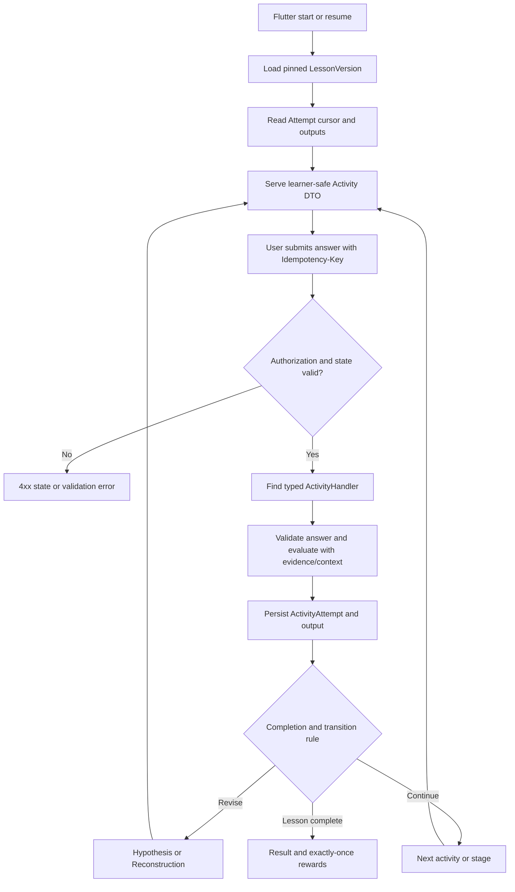

# DẤU VIỆT — Learning Engine Design (Spring Boot + Flutter)

> **Status:** Proposed implementation design; ưu tiên vertical slice Bạch Đằng 938, nhưng engine phải dùng chung.  
> **Main principle:** HistoricalEvent → Lesson → Template → Stage → Activity → Content/Evidence → Rule.  
> **Target:** Spring Boot engine authoritative; Flutter renderer chịu trách nhiệm UI.

## 1. Trách nhiệm từng lớp

| Domain element | Trách nhiệm | Không nên làm |
|---|---|---|
| HistoricalEvent | Tri thức lịch sử, metadata, địa điểm/thời kỳ | Lưu UI state của người học |
| LessonTemplate | Preset stage/activity/rule | Gắn cứng một sự kiện |
| Lesson | Câu hỏi trung tâm, mục tiêu, audience | Đóng vai version published |
| LessonVersion | Snapshot immutable có thể chạy | Sửa khi có attempt đang học |
| Stage | Bước tư duy (`CONTEXT`, `EVIDENCE`, …) | Đồng nhất với một Flutter screen |
| Activity | Tương tác có type, config, validation, feedback, output | Chứa business logic hard-code theo event |
| Evidence | Nguồn, nội dung, reliability/relevance, ID | Chỉ lưu ảnh mà không có provenance |
| LearnerAttempt | State, current cursor, answer/output, revision | Chỉnh sửa lesson config |
| LearningEngine | Check rules, evaluate, transition, progress | Tin vào `isCorrect`/EXP do client gửi |

## 2. Master stages và outputs

| Stage | Hoạt động tiêu biểu | Output |
|---|---|---|
| Context | READ, VIEW_IMAGE | acknowledged/contextViewed |
| Discovery | EXPLORE_MAP, HOTSPOT | discoveredItemIds[] |
| Evidence | EVIDENCE_SELECT, CLASSIFY | selectedEvidenceIds[] |
| Reasoning | MATCHING, REASONING_CONNECT | inferences[] |
| Hypothesis | HYPOTHESIS_CHOICE, CLAIM_EVIDENCE | hypothesis + linkedEvidenceIds[] |
| Reconstruction | DRAG_ORDER, MAP_PLACE | orderedSequence / reconstruction |
| Verification | VERIFY | `SUPPORTED`, `PARTIAL`, `CONTRADICTED` + feedback |
| Conclusion | CER | claim, evidenceIds[], reasoning |
| Reflection | REFLECTION_PROMPT (optional MVP) | reflectionText/takeaway |

Framework là tầng tư duy. Template có thể chọn/bỏ/đổi thứ tự stage trong guardrails; `Reflection` có thể optional, còn Conclusion hoặc equivalent phải có trước hoàn thành theo tài liệu BA mới.

## 3. Runtime flow



## 4. Published schema & learner-safe projection

**Stored server-side:**

```json
{
  "id": "activity-verify",
  "type": "VERIFICATION",
  "instruction": "Kiểm chứng giả thuyết với chứng cứ",
  "config": {"visibleSourceIds": ["ev-tide", "ev-stakes"]},
  "validation": {
    "type": "HYPOTHESIS_SUPPORT",
    "requiredEvidenceIds": ["ev-tide", "ev-stakes"]
  },
  "feedback": {
    "supported": "Giả thuyết được chứng cứ hỗ trợ",
    "partial": "Cần bổ sung bằng chứng",
    "contradicted": "Xem xét lại lập luận"
  },
  "onPartial": "stage-hypothesis",
  "onContradicted": "stage-hypothesis"
}
```

**Flutter receive:** id/type/instruction, whitelisted `config`, exposed evidence và progress. Không nhận hidden validation keys, required scoring secrets hoặc unpublished asset refs.

**Schema validation:** `schemaVersion` + per-activity config schema (có thể sử dụng Jackson + Bean Validation/custom validators). Admin publish validator phải kiểm tra tất cả supported activity types và foreign IDs trước khi tạo version.

## 5. Java contracts (đề xuất)

```java
public enum ActivityType {
    READ, VIEW_IMAGE, MULTIPLE_CHOICE, EXPLORE_MAP,
    EVIDENCE_SELECT, MATCHING, REASONING_CONNECT,
    HYPOTHESIS_CHOICE, DRAG_ORDER, VERIFICATION,
    CER, REFLECTION_PROMPT
}

public interface ActivityHandler {
    ActivityType supports();
    EvaluationResult evaluate(
        ActivityDefinition activity,
        JsonNode submittedAnswer,
        AttemptContext context
    );
}

public record EvaluationResult(
    String outcome,
    boolean completed,
    JsonNode output,
    String feedbackCode
) {}
```

`ActivityDefinition`, `AttemptContext` là domain classes sẽ implement; ví dụ là interface design, chưa phải source compile ngay. Không dùng reflection để chạy biểu thức động từ Admin; validation rules chỉ hỗ trợ một tập rule đã whitelist.

### Registry

```java
@Service
public class ActivityEngine {
    private final Map<ActivityType, ActivityHandler> handlers;

    public ActivityEngine(List<ActivityHandler> implementations) {
        this.handlers = implementations.stream().collect(
            Collectors.toUnmodifiableMap(ActivityHandler::supports, Function.identity())
        );
    }

    public EvaluationResult evaluate(
        ActivityDefinition definition, JsonNode input, AttemptContext context
    ) {
        ActivityHandler handler = handlers.get(definition.type());
        if (handler == null) throw new UnsupportedActivityTypeException(definition.type());
        return handler.evaluate(definition, input, context);
    }
}
```

Domain exceptions custom phải định nghĩa khi code. Registry đảm bảo activity type không được hỗ trợ không thể lọt qua publish.

## 6. Activity handler catalog cho MVP

| ActivityType | Input | Server validation | Output |
|---|---|---|---|
| READ | acknowledgment | active, required context viewed | viewed |
| VIEW_IMAGE | acknowledgment | active/asset valid | viewed |
| MULTIPLE_CHOICE | optionIds[] | valid options, cardinality, answer rule | selected options, correctness/feedback |
| EXPLORE_MAP | markerId | visible & discoverable marker | discoveredItemIds[] |
| EVIDENCE_SELECT | evidenceIds[] | evidence in published snapshot, minimum required | selectedEvidenceIds[] |
| MATCHING | pairs[] | card IDs, allowed relationships | inferences[]/pairs |
| REASONING_CONNECT | relations[] | source/target IDs, relation rule | inferences[] |
| HYPOTHESIS_CHOICE | hypothesisId, evidenceIds[] | allowable claim/evidence support | hypothesis |
| DRAG_ORDER | orderedIds[] | same set as configured, accepted sequences | reconstruction |
| VERIFICATION | submission/acknowledgment | support mapping from previous outputs | verificationResult |
| CER | claim, evidenceIds[], reasoning | structure/preset rubric (avoid naive free-text exact match) | conclusion |
| REFLECTION_PROMPT | text or optionId | length/basic constraints; optional | reflection |

**UX:** Drag & drop cần fallback tap/reorder; kiểm chứng không chỉ pass/fail mà có feedback và đường sửa giả thuyết.

**Authoring allow-map (đã chốt TASK-0009):** bảng §2 là "hoạt động tiêu biểu" theo tư duy; phía authoring (`DraftSchema.STAGE_ALLOWED_ACTIVITIES`) cho phép `READ` ở mọi stage và `MULTIPLE_CHOICE` cũng được dùng trong `EVIDENCE`, `REASONING`, `VERIFICATION` (kiểm tra nhận diện/đối chứng nhanh), ngoài các ánh xạ tự nhiên theo bảng trên. Vi phạm → `STAGE_ACTIVITY_MISMATCH` (422) khi save draft.

## 7. Attempt state machine

```text
IN_PROGRESS
  ├─ activity submitted → progress saved → next activity
  ├─ verification PARTIAL / CONTRADICTED → revise stage (bounded retries)
  ├─ interrupted → resume at saved cursor and pinned version
  └─ required outputs satisfied + conclusion → COMPLETED
COMPLETED → immutable result (optional repeat = new Attempt)
ABANDONED → no new reward (replay policy BA to decide)
```

Không tin `pageIndex` từ client; server tính `currentStageId`, `currentActivityId`. Khi verification revise, phải giữ attempt history; output nào thay đổi phải invalidate hoặc re-evaluate dependent outputs theo dependency graph. MVP có thể giới hạn một loop cố định `VERIFICATION → HYPOTHESIS` thay vì viết workflow DSL đa năng.

## 8. Submit transaction (pseudocode)

```text
@Transactional submit(user, attemptId, activityId, idempotencyKey, answer)
  1. Verify owner, state = IN_PROGRESS, pinned version exists
  2. Check idempotency key & request fingerprint
  3. Lock attempt (optimistic @Version or SELECT FOR UPDATE)
  4. Ensure activityId equals current executable activity
  5. Get ActivityHandler by activity.type
  6. Evaluate and produce typed domain output
  7. Append ActivityAttempt (never overwrite previous)
  8. Merge outputs; compute stage completion and transition
  9. Persist cursor/progress
 10. If finished, persist Result + reward ledger ONCE
 11. Persist idempotency response in same transaction
 12. Return learner-safe result
```

Trên lỗi mạng, client retry **cùng key và cùng payload**; backend trả kết quả cũ. Nếu cùng key mà payload khác, trả conflict. Transaction boundary phải đảm bảo không cấp thưởng hai lần; integration test concurrent submissions rất quan trọng.

## 9. Publish validation guardrails

Publish phải chặn nếu:

- Thiếu `centralQuestion` hoặc learning objectives.
- Required stage không có enabled activity.
- Activity thiếu instruction/config/rule hoặc thiếu Flutter renderer hỗ trợ.
- Broken evidence/media reference, evidence/source bắt buộc chưa có.
- Có Hypothesis mà không có verification/feedback path.
- Thiếu Conclusion hoặc template-specific equivalent.
- Transition tới stage/activity không tồn tại, infinite loop không có escape/retry bounds.
- Schema version/config không phù hợp với published engine.

`Draft → Ready/Valid → Published → Archived`. Publish tạo immutable version snapshot; Preview dùng cùng projection/renderer contract để giảm lệch Admin–Flutter.

## 10. Example: Bạch Đằng 938 vertical slice

| Step | Configured activity | Output target |
|---|---|---|
| Context | READ | Nắm central question về chiến thắng |
| Discovery | EXPLORE_MAP | Tìm dấu địa hình, bãi cọc, thủy triều |
| Evidence | EVIDENCE_SELECT | `ev-stakes`, `ev-tide` và dữ kiện liên quan |
| Reasoning | MATCHING/REASONING_CONNECT | Liên hệ nước lên–nước rút với bãi cọc |
| Hypothesis | HYPOTHESIS_CHOICE | Chọn giải thích và evidence support |
| Reconstruction | DRAG_ORDER | Chuẩn bị → nhử địch → nước rút → phản công |
| Verification | VERIFICATION | Supported/Partial/Contradicted và feedback |
| Conclusion | CER | Trả lời câu hỏi lịch sử bằng claim + evidence + reasoning |
| Reflection | REFLECTION_PROMPT | Một điều học được (optional) |
| Result | System screen (không bắt buộc là stage) | Story/result/EXP nếu rule cho phép |

Dùng lesson thứ hai (ví dụ Cách mạng tháng Tám 1945, template `DECISION_ANALYSIS`) để chứng minh **không cần đổi Java handlers/Flutter renderers** khi thêm nội dung.

## 11. Flutter renderer contract

```dart
Widget buildActivity(ActivityView activity) {
  switch (activity.type) {
    case ActivityType.multipleChoice:
      return MultipleChoiceActivity(activity: activity);
    case ActivityType.dragOrder:
      return DragOrderActivity(activity: activity);
    case ActivityType.evidenceSelect:
      return EvidenceSelectActivity(activity: activity);
    default:
      return UnsupportedActivity(activity: activity);
  }
}
```

Snippet biểu diễn pattern, chưa phải code chạy độc lập; tất cả renderer còn lại được thêm theo activity catalog. Flutter quản lý interaction state + optimistic UI hợp lý; backend là single source of truth của progress.

## 12. Test plan / Acceptance criteria

- [ ] Không có `if (lessonId == "bach-dang")` hoặc switch theo eventId trong engine.
- [ ] Admin publish chặn missing references/rules/renderer.
- [ ] Đổi lesson draft rồi publish v2 không thay attempt pinned v1.
- [ ] Submit sai/partial → feedback + retry/revise như rule.
- [ ] Output Evidence được sử dụng trong Reasoning, Hypothesis, CER.
- [ ] Retry same request/idempotency key không thêm duplicate answer/reward.
- [ ] Hai concurrent submit không vượt state hoặc tăng EXP hai lần.
- [ ] Learner không truy cập draft/unpublished lesson hoặc đáp án ẩn.
- [ ] Pause/resume mở đúng activity cùng lesson version.
- [ ] Bạch Đằng 938 và lesson thứ hai chạy từ snapshot config, không thay handler.

## 13. Evaluation semantics đã chốt (TASK-0011)

Phần này ghi lại các quyết định semantic cho những điểm BA chưa định nghĩa deterministic rule, đã được duyệt khi implement `com.dauviet.learning`:

| ActivityType | Quy tắc evaluate (server-authoritative) |
|---|---|
| READ, VIEW_IMAGE | Bất kỳ submission nào cũng là acknowledgment → `COMPLETED`, output `{viewed:true}`. |
| MULTIPLE_CHOICE | `selectedOptionIds` so set-equality với `correctOptionIds` → `COMPLETED`/`INCORRECT`. `maxAttempts` (default 1) đạt giới hạn → `exhausted:true`, activity vẫn tính completed (cursor đi tiếp). Option id không khai báo trong `config.options` → `INCORRECT` (không 500). |
| MATCHING | `pairs` (`"l=r"`) so pair-set với `correctPairs` → `COMPLETED`/`INCORRECT`. |
| DRAG_ORDER | `orderedIds` so order-equality với `expectedOrder`/`correctOrder` ∪ `acceptedSequences` → `COMPLETED`/`INCORRECT`. |
| EVIDENCE_SELECT | `selectedEvidenceIds` ⊆ snapshot evidence ∩ `visibleEvidenceIds` (id lạ → `INCORRECT`); `completed` khi số hợp lệ ≥ `minRequired` (default 1). |
| EXPLORE_MAP | Tích luỹ `discoveredMarkerIds` qua `priorOutputs` (idempotent); `completed` khi đủ `minMarkers` (default = tất cả markers trong config). |
| HYPOTHESIS_CHOICE | Ghi `{hypothesisId, evidenceIds}` vào outputs (không chấm đúng/sai) → luôn `COMPLETED`; dữ liệu là input cho VERIFICATION. |
| VERIFICATION | Đọc hypothesis mới nhất từ `priorOutputs`: `SUPPORTED` khi hypothesis khớp `expectedHypothesis` (nếu authored) VÀ `evidenceIds` ⊇ `requiredEvidenceIds`; `PARTIAL` khi có hypothesis nhưng thiếu; `CONTRADICTED` khi không có/không khớp. Chỉ `SUPPORTED` mới `completed`. Không echo required/expected keys trong output. |
| REASONING_CONNECT | Validate `relations[].{from,to}` ∈ `config.nodes[].id` và `relation` ∈ `allowedRelations` → `COMPLETED` + `relationCount`; id/relation lạ → `INCORRECT`. |
| CER | `claim` + `reasoning` ≥ 20 ký tự mỗi field → `COMPLETED`; `evidenceIds` được filter theo snapshot evidence; output echo claim/reasoning/evidenceIds. Không exact-match free text. |
| REFLECTION_PROMPT | `text` non-empty ≤ 4000 ký tự hoặc `optionId` hợp lệ → `COMPLETED`. |

`AttemptState` (`state_json`): `{completedActivityIds[], discoveredMarkerIds[], outputs{activityId:{...}}, currentStageId, currentActivityId}` — learner-safe, không chứa hidden keys.

**Stage transition resolver** (thứ tự ưu tiên): **(0) activity required vừa submit mà `completed=false` → REVISE hop nếu `onPartial`/`onContradicted` khớp target, ngược lại cursor GIỮ NGUYÊN để retry** (chống soft-lock khi MCQ chưa hết `maxAttempts`, VERIFICATION `PARTIAL`/`CONTRADICTED`, EVIDENCE_SELECT/EXPLORE_MAP chưa đủ ngưỡng; các bước (a)–(e) chỉ chạy sau submit completed hoặc optional); (a) required activity chưa xong kế tiếp trong cùng stage sau activity vừa submit; (b) REVISE hop (target thiếu → bỏ qua); (c) đi tới qua `nextStageIds` — target đầu tiên còn required activity chưa xong thắng; stage đã COMPLETE không lộ successors, chỉ stage "transparent" (không có required activity) mới được traverse xuyên qua; (d) fallback stage đầu tiên theo array-order còn required chưa xong; (e) `null` = hết đường đi. Cycle-safe qua visited set.

**Optional activity navigation** (chốt 2026-10-16): cursor chỉ dừng ở required activity; submit lên activity **optional trong current stage** được chấp nhận — evaluate + ghi `activity_attempts` + `outputs` bình thường nhưng **không đổi cursor, không tính progress/completion**. Learner "experience" optional bằng cách submit nó; "skip" bằng cách đi tiếp (cursor vốn đã chỉ vào required). Optional ở stage khác → `409 ACTIVITY_NOT_AVAILABLE`.

**Optional STAGE semantics** (chốt 2026-10-16 sau P1 review): `stage.required=false` làm toàn bộ activities bên trong optional cho progress/completion/cursor — `SnapshotModel.requiredActivities()` chỉ trả activities khi stage `required:true`. Cursor không bao giờ bị kéo vào optional stage (resolver traverse xuyên như stage "transparent"); progress `totalRequired` không đếm; `DEFAULT_ALL_REQUIRED` không gate. `activity.required=true` bên trong optional stage là shape mâu thuẫn — publish reject `REQUIRED_IN_OPTIONAL_STAGE`, còn runtime/snapshot legacy bỏ qua flag an toàn. Ngoại lệ duy nhất: `completion.requiredStageIds` explicit chỉ định stage → đếm `required:true` bên trong stage đó (author explicit override).

**Activity id uniqueness** (chốt 2026-10-16): activity id phải unique **toàn snapshot** (runtime index theo id đơn, collision cross-stage sẽ shadow ngầm). Publish-time: `DUPLICATE_ID` → `422 DRAFT_SCHEMA_INVALID`; runtime hand-edited snapshot: `SnapshotCorruptException`.

**Completion evaluator**: AND-combination của `requireAllRequiredStages`, `requiredStageIds`, `minScore`; vắng config → `DEFAULT_ALL_REQUIRED`. Reason ưu tiên `ALL_REQUIRED_STAGES` → `REQUIRED_STAGE_IDS` → `MIN_SCORE` → `DEFAULT_ALL_REQUIRED`; thất bại → `NOT_COMPLETE`. **Config rỗng/không-clause (đã chốt 2026-10-16 sau P1 review):** object `completion` không chứa clause nào được kích hoạt (`{}`, hoặc chỉ `requireAllRequiredStages:false` + `requiredStageIds:[]` + `minScore:null`) được evaluator coi như **vắng mặt** → `DEFAULT_ALL_REQUIRED`, KHÔNG được trả `complete=true` sớm (trước fix, `completion:{}` complete ngay với 0 activity). Phía authoring: `DraftValidator` reject `completion:{}` ở PUBLISH (`EMPTY_COMPLETION` → 422) để authoring intent tường minh; SAVE vẫn tolerant. Snapshot legacy đã publish trước siết vẫn an toàn nhờ fallback runtime.

~~**MVP limits đã ghi nhận**~~ *(lịch sử — ghi trước TASK-0012, KHÔNG còn mô tả hiện trạng)*: lúc đó idempotency chỉ chấp nhận + log header, `complete` chỉ trả verdict. **Hiện trạng (TASK-0012 đã chốt):** idempotency persist trên `idempotency_records` (scope `user+operation+key`, TTL 24h), `complete` flip `COMPLETED` + ghi `lesson_results` atomically trong một transaction với `alreadyCompleted` idempotent. **Vẫn chưa có:** reward/EXP thật (`reward_transactions` chỉ là schema/ledger, chưa có grant logic tích hợp vào `complete`), dashboard/resume đa attempt vẫn giới hạn một IN_PROGRESS attempt per (user, lesson).

### TASK-0012 — attempt lifecycle, resume, idempotency & completion (đã chốt 2026-10-16)

**Resume scope = lesson, không phải version.** `POST /lessons/{id}/attempts` tra `learner_attempts` IN_PROGRESS join `lesson_versions.lesson_id` trước: có → trả cùng attempt `resumed=true` (pin version cũ, progress giữ nguyên); không có → validate `PUBLISHED` + pin `current_version_id` mới. Vậy attempt v1 sống sót republish v2 mà không phá version pinning; server không bao giờ tự thay attempt đang chạy.

**Cross-version start race → `pg_advisory_xact_lock` (đã chốt 2026-10-16 sau review).** Partial unique index chỉ phủ `(user_id, lesson_version_id)` — hai start concurrent mà republish rơi vào giữa check+insert có thể tạo 2 IN_PROGRESS attempt (mỗi cái pin một version) cho cùng (user, lesson). Fix: `pg_advisory_xact_lock(hashtextextended(userId|lessonId))` ở đầu transaction start — serialize check+insert cho cặp (user, lesson) mà không chặn publish hay user khác; version pinning giữ nguyên (attempt pin `current_version_id` đọc được dưới lock). IT deterministic `CrossVersionStartRaceIT` chứng minh cả 2 kịch bản (republish giữa hai start tuần tự; 4 thread start + republish mid-race) đều hội tụ về đúng 1 attempt.

**Persistent idempotency** trên `idempotency_records`, scope `(user_id, operation, idempotency_key)`; `operation` ∈ `SUBMIT_ACTIVITY` | `COMPLETE_ATTEMPT`, `request_hash` = SHA-256(`attemptId|activityId|canonical(answerJson)`) cho submit (canonical = sorted-field JSON — cùng payload khác thứ tự field trùng hash), `attemptId` cho complete. `submit()`/`complete()` lock `learner_attempts` `PESSIMISTIC_WRITE` **trước** khi tra idempotency → duplicate concurrent block trên row lock rồi thấy committed response (không thể double-write). Claim row `saveAndFlush` + response lưu `response_json`/`http_status=200` commit **cùng transaction** với `activity_attempts`/state — business error rollback luôn claim, key không bị burn. Expired (TTL `app.learning.idempotency-ttl`, default 24h) → delete + reclaim. Không dùng in-memory cache cho correctness.

**Completion server-authoritative.** `complete()`: lock → nếu `COMPLETED` trả stored verdict `alreadyCompleted=true` (idempotent repeat); nếu không `IN_PROGRESS` → `409 ATTEMPT_NOT_IN_PROGRESS`; `completionEvaluator` `!complete` → `409 ATTEMPT_NOT_COMPLETE` + `details`; else `markCompleted` + `lesson_results` row (unique per attempt) cùng tx. `score` là **completion percentage** `completedRequired*100/totalRequired`, HALF_UP 2 decimals (0 khi totalRequired=0) — **không phải assessment score**: required activity đếm completed kể cả khi retry-exhausted trên đáp án sai (quy tắc TASK-0011). Submit-on-`COMPLETED` → `409 ATTEMPT_ALREADY_COMPLETED`; start-after-complete → attempt mới pin version hiện tại.

**Progress/history APIs (owner-only).** `GET /attempts/{id}/result` (404 `RESULT_NOT_FOUND` trước khi complete), `GET /me/attempts?status&page&size` (PageResponse, `size≤50`, `AttemptSummaryResponse` với cursor+progress cho resume), `GET /me/progress` (`inProgress[]` + `completedCount` — mobile resume surface). `lessonId` resolve qua `lesson_versions`; snapshot corrupt → progress `0/0` thay vì 500. `JwtSubjectExtractor` chung: malformed `sub` → `AuthenticationFailedException` → `401` trên mọi learner endpoint (không 500, không bypass ownership).

**Vẫn mở**: retention policy 24h là config mặc định (PO xác nhận nếu cần khác); `result_json` shape `{attemptId,lessonVersionId,reason,score,completedRequired,totalRequired,detail}` chưa có field reward/EXP; **reward grant thật chưa được code** — `reward_transactions` chỉ là schema (V4), không có service/endpoint nào ghi row (xem `docs/MAP_COLLECTION_REWARDS_ISLAND.md`).

## 14. Open decisions

- 2 template MVP: `EVENT_INVESTIGATION`, `DECISION_ANALYSIS` là đề xuất từ BA mới, cần PO duyệt.
- CER grading: structure-based/manual rubric/preset choices trong MVP; free text AI grading không thuộc must. TASK-0011 đã chọn structure-based (độ dài tối thiểu + evidence filter) cho MVP — rubric chấm tay vẫn mở.
- Tỷ trọng điểm/retry/hint, số lần học lại, reward repeat và unlock conditions phải có product decision.
- Reflection optional vs required từng template; Story/Result là stage hay presentation sau hoàn thành?
- Island/energy/shop là metagame của mockup, chưa ép vào core engine.
- ~~`stage.required` vs `activity.required` semantics~~ — **ĐÃ CHỐT 2026-10-16**: `stage.required=false` nghĩa là toàn bộ stage + activities của nó là optional (BA: Reflection optional, Result không bắt buộc là stage). `requiredActivities()` chỉ trả activities khi stage `required:true` → progress `totalRequired`, default completion và cursor transition đều bỏ qua optional stage; `requiredStageIds` explicit vẫn override (đếm `required:true` bên trong stage được chỉ định). Publish reject shape mâu thuẫn `REQUIRED_IN_OPTIONAL_STAGE`; snapshot legacy vẫn an toàn nhờ runtime fallback.

## 15. Sources

- `Dau_Viet_BA_MVP_Learning_Framework.docx`: master stages, templates, ENG requirements, Admin authoring, sample lesson 938, gap Conclusion/Reflection.
- `Functional_Requirements_Dau_Viet_MVP.docx`: activity types, 4 Dấu, progress, map và collection.
- Architecture/handler code trong file này là **đề xuất triển khai**, không phải trích dẫn code sẵn có trong tài liệu BA.
