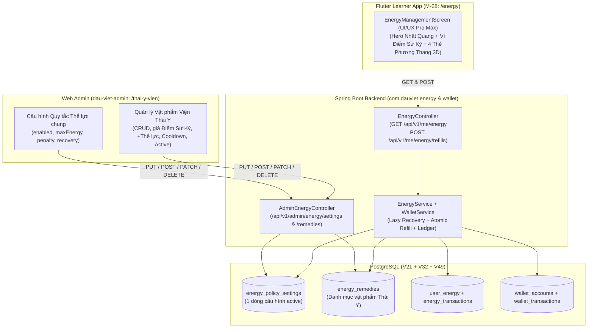

# Kế Hoạch Chi Tiết — Issue #28 (`[GAME-07] Hoàn thiện chức năng Viện Thái Y`)

> **GitHub Issue:** https://github.com/longv0208/Dau_Viet/issues/28  
> **Task ID:** `TASK-0028` (`tasks/TASK-0028/task.json`)  
> **Branch:** `feat/issue-28-vien-thai-y`  
> **Worktree:** `E:/Telegram Desktop/Dau viet/Dau_Viet-issue-28`

---

## 1. Quyết định Thiết kế đã Chốt

1. **Áp dụng Phương án B cho 4 Vật phẩm / Liệu pháp mặc định (Seed khởi tạo trong DB `V49`, Admin chỉnh sửa được mọi lúc):**
   - **1 gói Miễn phí mỗi ngày (`0 Điểm Sử Ký`)** hỗ trợ Sĩ Tử + **3 gói mua bằng Điểm Sử Ký**.
2. **Điều kiện bấm mua/sử dụng linh hoạt:**
   - **Cho phép bấm mua mọi vật phẩm miễn là Thể lực chưa đầy (`currentEnergy < maxEnergy`, tức `< 100 ⚡`)**.
   - Lượng Thể lực thực nhận tự động giới hạn không vượt trần `maxEnergy` (`credited = min(energyGain, maxEnergy - currentEnergy)`).
3. **Bổ sung đầy đủ Hệ thống Quản trị Admin (`dau-viet-admin` + Backend Admin API + Database `V49`):**
   - Chuyển toàn bộ thông số Thể lực (mức trừ khi sai, tốc độ hồi tự nhiên, bật/tắt hệ thống) và danh mục Vật phẩm Viện Thái Y (tên, mô tả, lượng hồi `+⚡`, giá Điểm Sử Ký, thời gian cooldown, bật/tắt bán, thứ tự hiển thị) vào **Database (`V49`)** kèm **Trang Setting Admin (`/thai-y-vien`)**.
4. **Nâng cấp toàn diện Giao diện Mobile (`EnergyManagementScreen` — `M-28`) theo chuẩn `ui-ux-pro-max`:**
   - Đồng bộ 100% ngôn ngữ thiết kế **Di Sản Văn Hiến Dấu Việt v2.0** với `LearnerDashboardScreen`, `IslandShopScreen`, `InventoryScreen` và `LearningStreakScreen` (bảng màu `DauVietColors`, font `Noto Serif` + `Be Vietnam Pro`, nút bấm lò xo 3D `Tactile3DButton`, huy hiệu ví `_buildWalletPill`, hộp thoại xác nhận trước/sau khi bồi bổ, và hiệu ứng thanh Thể lực tăng mượt).

---

## 2. Bảng Thông số Chi tiết 4 Vật phẩm Viện Thái Y (Phương án B — Seed Mặc định trong `V49`)

| STT | Mã vật phẩm (`code`) | Tên Vật Phẩm / Liệu Pháp | Minh họa (`icon_key`) | Phẩm cấp (`rarity`) | Lượng Hồi (`energy_gain`) | Giá Mua (`points_cost`) | Điều kiện Mua | Hồi chiêu (`cooldown`) | Mô tả công dụng |
|:---:|---|---|---|---|---:|---:|---|---|---|
| 1 | `NUOC_VOI` | **Nước Vối Tĩnh Tâm** | `energy_nuoc_voi` | `COMMON` (Phổ thông) | **`+20 ⚡`** | **`0 Điểm` (Miễn phí)** | Khi Thể lực `< 100 ⚡` | **24 giờ** (`86.400s` — 1 lần/ngày) | Bát nước vối ấm lành tính giúp sĩ tử thư giãn gân cốt, bồi bổ miễn phí mỗi ngày. |
| 2 | `TRA_SEN` | **Trà Sen Tây Hồ** | `energy_tra_sen` | `UNCOMMON` (Thanh tao) | **`+30 ⚡`** | **`30 Điểm Sử Ký`** | Khi Thể lực `< 100 ⚡` | **4 giờ** (`14.400s`) | Trà sen ướp hương thơm ngát giúp tinh thần minh mẫn tức thì. |
| 3 | `NAM_LINH_CHI` | **Nấm Linh Chi Ngự Dược** | `energy_linh_chi` | `RARE` (Quý hiếm) | **`+50 ⚡`** | **`55 Điểm Sử Ký`** | Khi Thể lực `< 100 ⚡` | **12 giờ** (`43.200s`) | Thảo dược đại bổ triều đình bồi bổ nguyên khí, chống mỏi mệt. |
| 4 | `SAM_NGOC_LINH` | **Sâm Ngọc Linh Hoàng Gia** | `energy_sam_ngoc_linh` | `EPIC` (Bảo vật) | **`+100 ⚡` (Đầy bình)** | **`90 Điểm Sử Ký`** | Khi Thể lực `< 100 ⚡` | **24 giờ** (`86.400s`) | Bảo vật sâm rừng nghìn năm phục hồi 100% sinh lực tức thì. |

---

## 3. Cấu trúc các Phase trong Kế hoạch

| Phase | Tên Phase | File chi tiết | Nội dung chính |
|---|---|---|---|
| **Phase 01** | Database Migration `V49` (Settings & Remedies) | [phase-01-database-v49-migration.md](./phase-01-database-v49-migration.md) | Tạo bảng `energy_policy_settings` & `energy_remedies`, constraints, indexes và seed mặc định Phương án B. |
| **Phase 02** | Backend Runtime API, Admin API & Đồng bộ Ví | [phase-02-backend-runtime-and-admin-api.md](./phase-02-backend-runtime-and-admin-api.md) | Entities, Repositories, `EnergyService` đọc DB policy, `GET /api/v1/me/energy`, `POST /api/v1/me/energy/refills`, `AdminEnergyController`, sửa `RewardService.summary()`. |
| **Phase 03** | Web Admin CMS (`/thai-y-vien`) | [phase-03-web-admin-thai-y-vien-cms.md](./phase-03-web-admin-thai-y-vien-cms.md) | Thêm mục Sidebar, trang `/thai-y-vien`, form chỉnh quy tắc Thể lực chung, bảng CRUD vật phẩm Viện Thái Y và Preview Card. |
| **Phase 04** | Mobile UI/UX Pro Max (`EnergyManagementScreen`) | [phase-04-mobile-ui-ux-pro-max.md](./phase-04-mobile-ui-ux-pro-max.md) | Cập nhật DTOs/Repository/Controller và thiết kế lại `EnergyManagementScreen` đồng bộ với `IslandShopScreen` & `LearnerDashboardScreen`. |
| **Phase 05** | Kiểm thử Toàn diện & Cập nhật Tài liệu | [phase-05-testing-and-docs.md](./phase-05-testing-and-docs.md) | Unit/IT tests Backend (`EnergyRecoveryTest`, `EnergySystemIT`), Typecheck/Test Admin, Widget tests Mobile (`energy_management_screen_test.dart`) và cập nhật `docs/*`. |

---

## 4. Kiến trúc Tổng thể & Bất biến Kỹ thuật

### Bất biến Kỹ thuật (Non-Negotiable Invariants)
1. **Thứ tự khóa chống Deadlock (`GAMIFICATION_TECHNICAL_CONTRACT.md` §5):** Trong `POST /api/v1/me/energy/refills`, luôn khóa `user_energy` (`PESSIMISTIC_WRITE`) **trước**, sau đó mới khóa `wallet_accounts` (`PESSIMISTIC_WRITE` bên trong `WalletService.debit`).
2. **Tính nguyên tử (Atomicity):** Trừ Điểm Sử Ký và cộng Thể lực diễn ra trong cùng một `@Transactional`. Nếu bất kỳ điều kiện nào thất bại (`ENERGY_FULL`, `REFILL_RATE_LIMITED`, `INSUFFICIENT_FUNDS`, `REMEDY_NOT_FOUND`), toàn bộ transaction rollback.
3. **Idempotency 2 tầng:**
   - Tầng HTTP: `IdempotencyService.execute(userId, "ENERGY_REFILL", idempotencyKey, "REFILL:" + remedyCode, ...)`.
   - Tầng DB Ledger: `cause_key = "REFILL:" + idempotencyKey` là `UNIQUE` trong cả `wallet_transactions` và `energy_transactions`.
4. **Bảo toàn đồng hồ hồi tự nhiên (`ENGY-08`):**
   - Nếu sau khi nạp, `currentEnergy == maxEnergy`: neo lại `last_recovery_at = now`.
   - Nếu sau khi nạp, `currentEnergy < maxEnergy`: **giữ nguyên** `last_recovery_at` để không làm mất số phút đang đếm dở của chu kỳ hồi tự nhiên.

---

## 5. Ma trận Ánh xạ Tiêu chí Nghiệm thu (AC Traceability Matrix)

| Mã AC | Tiêu chí nghiệm thu (Issue #28) | Phase | Cách kiểm chứng & Bằng chứng |
|---|---|---|---|
| **AC-1** | Migration `V49` tạo bảng `energy_policy_settings` & `energy_remedies`, seed đúng quy tắc Thể lực mặc định và 4 vật phẩm Phương án B (`NUOC_VOI` +20⚡/0đ/24h, `TRA_SEN` +30⚡/30đ/4h, `NAM_LINH_CHI` +50⚡/55đ/12h, `SAM_NGOC_LINH` +100⚡/90đ/24h). | Phase 1 | Flyway migrate clean (`V1`–`V49`) trong `EnergySystemIT`. |
| **AC-2** | `GET /api/v1/me/energy` trả `pointsBalance` & `remedies[]`; `POST /api/v1/me/energy/refills` cho phép dùng mọi gói `active` khi `currentEnergy < maxEnergy`, chặn khi `== maxEnergy` (`422 REFILL_NOT_ELIGIBLE`), kiểm tra cooldown từng gói (`409 REFILL_RATE_LIMITED`), trừ Điểm Sử Ký nguyên tử (`409 INSUFFICIENT_FUNDS`), clamp trần `maxEnergy`, neo `last_recovery_at = now` khi đạt `maxEnergy`, idempotent theo `Idempotency-Key`. | Phase 2, 5 | `EnergyRecoveryTest` + `EnergySystemIT`. |
| **AC-3** | Sau khi mua vật phẩm có phí tại Viện Thái Y, cả `GET /api/v1/me/wallet` và `GET /api/v1/me/rewards/summary` đều phản ánh đúng số dư Điểm Sử Ký đã trừ; EXP, số bài học và vật phẩm giữ nguyên (`QA-19`). | Phase 2, 5 | `EnergySystemIT` + `energy_management_screen_test.dart`. |
| **AC-4** | Admin xem và cập nhật được quy tắc Thể lực chung (`PUT /api/v1/admin/energy/settings`) và thêm/sửa/xóa/bật-tắt vật phẩm Viện Thái Y (`/api/v1/admin/energy/remedies`) trên giao diện Web Admin `/thai-y-vien`; thay đổi của Admin phản ánh ngay trên API người học. | Phase 2, 3, 5 | `EnergySystemIT` (Admin endpoints) + `npm run typecheck` / `npm test` trong `dau-viet-admin`. |
| **AC-5** | Màn hình Viện Thái Y (`M-28`) hiển thị đồng bộ chuẩn Di Sản Dấu Việt v2.0 (Top Bar có `_buildWalletPill`, Hero Nhật Quang & thanh 10 vạch mượt mà, 4 thẻ phương thang với `Tactile3DButton`, Dialog xác nhận trước/sau khi nạp, đếm ngược cooldown thực tế) và vượt qua toàn bộ bộ test tự động. | Phase 4, 5 | `flutter analyze` + `flutter test test/energy/energy_management_screen_test.dart`. |
