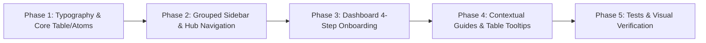

# Plan — Issue #44: Cải tổ Giao diện & Luồng Quản trị Web Admin (`dau-viet-admin`)

> **Nguồn chân lý:** [Issue #44](https://github.com/longv0208/Dau_Viet/issues/44)  
> **Branch:** `feat/issue-44-admin-web-ux-overhaul` · **Task:** `TASK-0033`  
> **Module:** `dau-viet-admin` (Next.js 15 + React 19 + Tailwind CSS + Vitest)  
> **Risk:** `normal` (chỉ thay đổi tầng giao diện, điều hướng, hướng dẫn và chú thích trên `dau-viet-admin`; không thay đổi API contract, database schema hay logic nghiệp vụ backend).

---

## 1. Mục tiêu & Đối chiếu Acceptance Criteria

| AC | Yêu cầu từ Issue #44 | Giải pháp kỹ thuật & Điểm chạm |
|---|---|---|
| **AC-1** | **Sửa triệt để lỗi font chữ tiếng Việt:** Không còn tiêu đề bảng, nhãn eyebrow, con dấu hay badge tiếng Việt bị nhảy font/lệch dấu do `Press_Start_2P`; hiển thị đồng nhất, sắc nét bằng `Be Vietnam Pro` / `Noto Serif`. | Loại bỏ `Press_Start_2P` khỏi văn bản tiếng Việt; khai báo `JetBrains_Mono` (`subsets: ["vietnamese", "latin"]`) cho `--font-mono`; trỏ `--font-pixel` về font hỗ trợ tiếng Việt; cập nhật `DataTable`, `SectionEyebrow`, `StampSeal`, `ChapterBadge`, `IslandShopManager`, `AdminPingCard`, `EventOverviewTab`, `PathVersions`. |
| **AC-2** | **Thu gọn Sidebar theo cấu trúc Cha – Con rõ ràng:** Giữ mục `Sự kiện` làm nhánh gốc, đưa toàn bộ thành phần thuộc về Sự kiện thành nhánh con (`children` thụt lề có vạch nối cây); gom nhóm các mục còn lại gọn gàng. | Tái cấu trúc `admin-shell.tsx` từ 15 mục phẳng thành **Cây điều hướng phân cấp (Tree Sidebar)**: mục cha **`Sự kiện` (`/events`)** chứa các nhánh con trực thuộc (*Bài học, Mẫu bài học, Bằng chứng, Hoạt họa lịch sử, Hồ sơ lịch sử, Địa điểm di tích, Phiên bản*); mục cha **`Đảo Di Sản` (`/island-builder`)** chứa nhánh con *Cửa hàng Đảo Di Sản* (`/island-shop`); hỗ trợ đóng/mở nhánh con mượt mà kèm `<WorkspaceHubTabs />` đồng bộ. |
| **AC-3** | **Hướng dẫn cho người mới trên Dashboard:** Trang `/dashboard` có khu vực hướng dẫn quy trình biên tập từng bước (Sự kiện → Học liệu → Bài học → Phần thưởng → Xuất bản). | Tạo `<OnboardingWorkflowCard />` (Quy trình Biên tập 4 Bước) trên `/dashboard` kèm số liệu thực tế từ API và nút CTA đi thẳng tới từng bước; tinh gọn bố cục `AdminPingCard` và `QUICK_NAV`. |
| **AC-4** | **Chú thích & Chỉ dẫn ngữ cảnh:** Các trang quản lý chính có khung hướng dẫn vai trò màn hình, giải thích các cột/trường trạng thái (*Điều kiện mở khóa*, *Đặt lên đảo*) và liên kết trực tiếp tới nơi cấu hình. | Tạo `<PageGuideBanner />` (đóng/mở, lưu trạng thái `localStorage`) gắn vào các trang quản trị chính; nâng cấp `DataTable` hỗ trợ `headerTooltip`; bổ sung liên kết `+ Cấu hình mở khóa →` (`/items/[id]#unlock-rule`) và `Cấu hình bán tại Shop →` (`/island-shop`) ngay trên bảng `ItemsTable`. |
| **AC-5** | **Kiểm chứng giao diện & Tests:** Kiểm tra trực quan trên trình duyệt, không vỡ bố cục, pass toàn bộ test suite (`vitest`, `tsc`). | Cập nhật & bổ sung unit/component tests (`atoms.test.tsx`, `dashboard-page.test.tsx`, `admin-shell.test.tsx`, `items-table.test.tsx`), chạy `npx tsc --noEmit`, `npx vitest run` và kiểm tra trực quan trên trình duyệt. |

---

## 2. Phân tích Hiện trạng & Nguyên nhân Gốc rễ

### 2.1. Lỗi Typography (`Press_Start_2P` & `font-mono` hệ thống)
Qua khảo sát mã nguồn `dau-viet-admin/src`:
1. `src/app/layout.tsx`: `Press_Start_2P` chỉ có `subsets: ["latin"]` và được gán vào `--font-pixel`. Khi hiển thị chữ tiếng Việt có dấu (`Ậ, Ẩ, Ặ, Ả, Ở, Ó, Ạ, Á, Đ, Ư...`), trình duyệt lấy chữ không dấu từ `Press_Start_2P` (nét pixel vuông lớn) và chữ có dấu từ font fallback hệ thống, gây hiện tượng lệch cỡ và nhảy dòng nghiêm trọng.
2. Các vị trí đang dùng `font-pixel` cho chữ tiếng Việt hoặc số liệu:
   - `src/components/data-table.tsx` (dòng 50): `<th>` tiêu đề cột bảng dùng `font-pixel text-[10px] uppercase`.
   - `src/features/island-shop/island-shop-manager.tsx` (dòng 268): `<thead>` bảng cửa hàng dùng `font-pixel text-[10px] uppercase`.
   - `src/components/atoms/stamp-seal.tsx` (dòng 29): con dấu (`QUẢN TRỊ`, `ĐÃ DUYỆT`, `ẤN HÀNH`) dùng `font-pixel text-[9px]`.
   - `src/components/atoms/chapter-badge.tsx` (dòng 20): huy hiệu chương dùng `font-pixel text-xs`.
   - `src/features/dashboard/admin-ping-card.tsx` (dòng 38, 49), `src/features/events/workspace/event-overview-tab.tsx` (dòng 49), `src/features/learning-path/path-versions.tsx` (dòng 55).
3. `src/components/atoms/section-eyebrow.tsx` (dòng 28): dùng `font-mono` nhưng `layout.tsx` chưa khai báo `--font-mono`, dẫn tới rơi về `Consolas`/`Courier` hệ thống lệch tông với `Be Vietnam Pro` và `Noto Serif`.

### 2.2. Thanh điều hướng Sidebar 15 mục phẳng & Phân mảnh luồng thao tác
- `src/components/admin-shell.tsx` đang render mảng phẳng `NAV_ITEMS` gồm 15 mục ngang hàng.
- Quản trị viên mới không phân biệt được đâu là **Không gian biên tập chính** (`/events` → Event Workspace) và đâu là **Danh mục tra cứu / Thư viện dùng chung** (`/lessons`, `/templates`, `/versions`, `/evidence`, `/dossiers`, `/assets`, `/animations`) hay **Cấu hình Gamification** (`/island-builder`, `/island-shop`, `/items`, `/thai-y-vien`).
- Các cặp trang có quan hệ nghiệp vụ chặt chẽ như **Đảo Di Sản (`/island-builder`) ↔ Cửa hàng Đảo (`/island-shop`)**, **Bản đồ Dấu Ấn (`/learning-path`) ↔ Địa điểm di tích (`/map-locations`)**, **Thư viện Media (`/assets`) ↔ Hoạt họa (`/animations`)**, **Bằng chứng (`/evidence`) ↔ Hồ sơ lịch sử (`/dossiers`)** chưa có thanh chuyển đổi nhanh (Hub Tabs) ngay trên đầu trang.

### 2.3. Thiếu Onboarding trên `/dashboard` & Chú thích ngữ cảnh
- `src/features/dashboard/dashboard-page.tsx` mới chỉ có lời chào, `AdminPingCard`, 5 nút `QUICK_NAV` và `RecentLessonsCard`. Chưa có sơ đồ hướng dẫn quy trình biên tập 4 bước từ đầu đến cuối.
- Các trang quản lý chính chưa có banner giải thích mối liên hệ giữa cấu hình trên Admin CMS với hiển thị thực tế trên ứng dụng học viên (`dau-viet-mobile`).
- Tại `src/features/items/items-table.tsx`, cột *"Điều kiện mở khóa"* chỉ hiện text tĩnh `"Chưa cấu hình"`, không có nút dẫn sang phần Rule Builder tại `/items/[id]#unlock-rule`; cột *"Đặt lên đảo"* không có liên kết sang `/island-shop`.

---

## 3. Thiết kế Chi tiết theo Từng Phase



---

### Phase 1: Chuẩn hóa Typography, Bảng dữ liệu & Atoms (AC-1)

#### 1.1. Cấu hình Font trong `src/app/layout.tsx`, `src/app/globals.css`, `tailwind.config.ts`
- **File `src/app/layout.tsx`**:
  - Bỏ import `Press_Start_2P`.
  - Giữ `Be_Vietnam_Pro` (`subsets: ["vietnamese", "latin"]`, weights `400, 500, 600, 700`, variable `--font-sans`) và `Noto_Serif` (`subsets: ["vietnamese", "latin"]`, weights `600, 700`, variable `--font-display`).
  - Thêm `JetBrains_Mono` từ `next/font/google` (`subsets: ["vietnamese", "latin"]`, weights `400, 500, 600`, variable `--font-mono`) phục vụ hiển thị mã định danh kỹ thuật (`code`, `canonicalCode`, `renderKey`, `slug`, `assetId`).
- **File `tailwind.config.ts`**:
  - Cập nhật `fontFamily`:
    ```ts
    fontFamily: {
      sans: ["var(--font-sans)", "system-ui", "sans-serif"],
      display: ["var(--font-display)", " Georgia", "serif"],
      mono: ["var(--font-mono)", "ui-monospace", "monospace"],
      // Giữ alias font-pixel trỏ về font-sans/display để tương thích ngược, tuyệt đối không vỡ dấu tiếng Việt
      pixel: ["var(--font-sans)", "system-ui", "sans-serif"],
    },
    ```

#### 1.2. Chuẩn hóa Atoms & Bảng dữ liệu
- **`src/components/atoms/section-eyebrow.tsx`**:
  - Đổi từ `font-mono text-[11px]` sang `font-sans text-[11px] font-bold uppercase tracking-[0.08em] rounded-sm border-2 px-2.5 py-0.5 shadow-pixel-sm`. Chữ tiếng Việt in hoa (`QUẢN TRỊ · VẬT PHẨM THƯỞNG`) hiển thị bằng `Be Vietnam Pro` đồng đều, rõ dấu.
- **`src/components/atoms/stamp-seal.tsx`**:
  - Đổi từ `font-pixel text-[9px]` sang `font-display text-[10px] font-bold uppercase tracking-widest` (dùng `Noto Serif` đậm mang chất ấn triện cổ truyền, hỗ trợ đầy đủ dấu tiếng Việt).
- **`src/components/atoms/chapter-badge.tsx`**:
  - Đổi từ `font-pixel text-xs` sang `font-display text-sm font-bold tabular-nums` (giữ class hoặc cập nhật test trong `atoms.test.tsx`).
- **`src/components/data-table.tsx`**:
  - Cập nhật `<th>`: đổi `font-pixel text-[10px] uppercase tracking-wider text-ink-muted` thành `font-sans text-xs font-bold uppercase tracking-wider text-ink-secondary`.
  - Hỗ trợ thuộc tính mở rộng trên `Column<T>`:
    ```ts
    export interface Column<T> {
      key: string;
      header: string;
      headerTooltip?: string;
      cell: (row: T) => ReactNode;
    }
    ```
    Khi cột có `headerTooltip`, hiển thị icon `Info` (`size-3.5 text-ink-muted hover:text-brand`) kèm `title` / tooltip popover nhẹ giải thích ý nghĩa nghiệp vụ của cột.
- **Các bảng và thẻ thống kê khác**:
  - `src/features/island-shop/island-shop-manager.tsx` (dòng 268): đổi header bảng từ `font-pixel text-[10px]` sang `font-sans text-xs font-bold uppercase tracking-wider text-ink-secondary`.
  - `src/features/dashboard/admin-ping-card.tsx`, `src/features/events/workspace/event-overview-tab.tsx`, `src/features/learning-path/path-versions.tsx`: đổi `font-pixel` ở các con số/trạng thái lớn sang `font-display font-bold tabular-nums`.

---

### Phase 2: Thu gọn Sidebar theo Cấu trúc Cây Cha – Con (`Sự kiện` & Nhánh con) (AC-2)

#### 2.1. Thiết kế Cây Điều hướng Phân cấp (Tree Sidebar) trong `src/components/admin-shell.tsx`
Thay vì dàn trải 15 mục ngang hàng hoặc ẩn hoàn toàn các mục con, tổ chức Sidebar theo **3 nhóm với cấu trúc Cha – Con (`children` thụt lề có đường kẻ nhánh dọc `border-l-2 border-border ml-5 pl-2.5`)**:

```text
BẮT ĐẦU & BIÊN TẬP CHÍNH
  ● Tổng quan & Hướng dẫn (/dashboard)
  ▼ Sự kiện (/events)                         [Mục cha — bấm mở/đóng nhánh con]
      ├─ Bài học (/lessons)                   [Thành phần trong Sự kiện]
      ├─ Mẫu bài học (/templates)             [Khung bài học của Sự kiện]
      ├─ Bằng chứng (/evidence)               [Tư liệu nguồn của Sự kiện]
      ├─ Hoạt họa lịch sử (/animations)       [Cảnh tương tác HTML của Sự kiện]
      ├─ Hồ sơ lịch sử (/dossiers)            [Thẻ nhân vật/hiện vật mở khóa từ Sự kiện]
      ├─ Địa điểm di tích (/map-locations)    [Ghim bản đồ gắn với Sự kiện/Bài học]
      └─ Phiên bản xuất bản (/versions)       [Lịch sử snapshot bài học]
  ● Bản đồ Dấu Ấn (/learning-path)            [Lộ trình Thời kỳ tổng thể]

KHO DÙNG CHUNG
  ● Thư viện Media (/assets)                  [Kho ảnh & tệp toàn hệ thống]

GAMIFICATION & ĐẢO DI SẢN
  ▼ Đảo Di Sản (/island-builder)              [Mục cha — bố cục đảo 2.5D]
      └─ Cửa hàng Đảo Di Sản (/island-shop)   [Nhánh con — vật phẩm bày bán trên Đảo]
  ● Vật phẩm thưởng (/items)                  [Danh mục vật phẩm & điều kiện mở khóa]
  ● Viện Thái Y & Thể lực (/thai-y-vien)      [Cấu hình thể lực & thuốc hồi phục]
```

**Hành vi tương tác trên Sidebar (`admin-shell.tsx`):**
- **Nhìn là hiểu ngay quan hệ nghiệp vụ:** Quản trị viên thấy rõ *Bài học, Mẫu bài học, Bằng chứng, Hoạt họa, Hồ sơ, Địa điểm di tích, Phiên bản* đều là **nhánh con phục vụ cho Sự kiện**; *Cửa hàng Đảo Di Sản* là **nhánh con của Đảo Di Sản**.
- **Đóng / Mở nhánh con thông minh (`expandedGroups`):**
  - Mục cha `Sự kiện` có nút mũi tên (`ChevronDown` / `ChevronRight`) để thu gọn hoặc mở rộng danh sách nhánh con (mặc định mở `Sự kiện` để người mới thấy rõ cấu trúc, hoặc tự động mở khi `pathname` đang nằm ở bất kỳ nhánh con nào).
  - Khi đang ở một nhánh con (ví dụ `/lessons` hoặc `/evidence`), nhánh con được tô đậm active (`bg-brand/10 text-brand font-semibold border-l-2 border-brand`), đồng thời mục cha `Sự kiện` hiển thị trạng thái đang chứa nhánh active (`text-brand font-semibold`).
  - Khi Sidebar ở chế độ thu gọn (`collapsed = true` chỉ hiện icon): ẩn danh sách nhánh con thụt lề để giữ thanh icon gọn 7 mục cấp 1, tự động highlight icon mục cha khi đang ở route con.

#### 2.2. Thanh chuyển đổi nhanh `<WorkspaceHubTabs />` (`src/components/workspace-hub-tabs.tsx`)
Song song với nhánh con trên Sidebar, đặt thanh tab chuyển nhanh ở đầu các trang liên quan để giảm thao tác rê chuột:
1. **Trong cụm Sự kiện** (`/lessons`, `/templates`, `/versions`): thanh chuyển nhanh giữa *Danh sách Bài học (`/lessons`)* ↔ *Mẫu bài học (`/templates`)* ↔ *Lịch sử Phiên bản (`/versions`)* kèm nút quay về *Không gian Sự kiện (`/events`)*.
2. **Trong cụm Học liệu Sự kiện** (`/evidence`, `/dossiers`, `/assets`, `/animations`): thanh chuyển nhanh giữa *Bằng chứng (`/evidence`)* ↔ *Hồ sơ lịch sử (`/dossiers`)* và *Thư viện Media (`/assets`)* ↔ *Hoạt họa HTML (`/animations`)*.
3. **Trong cụm Đảo Di Sản** (`/island-builder`, `/island-shop`): thanh chuyển nhanh giữa *Bố cục Đảo 2.5D (`/island-builder`)* ↔ *Cửa hàng Đảo Di Sản (`/island-shop`)*.
#### 2.3. Tối ưu hóa Luồng Biên tập trong Event Workspace (`src/features/events/workspace/*`)
- Trên `event-workspace-tabs.tsx` và `event-overview-tab.tsx`:
  - Đánh số thứ tự quy trình trực quan trên các tab của Không gian Sự kiện để người dùng đi theo thứ tự tự nhiên:
    1. `Tổng quan & Tiến độ` (`overview`)
    2. `1. Thông tin & Địa điểm` (`info`)
    3. `2. Học liệu & Bằng chứng` (`hoc-lieu`)
    4. `3. Bài học điều tra` (`lessons`)
    5. `4. Phần thưởng & Hồ sơ` (`gamification`)
  - Bổ sung **Checklist Tiến độ Xuất bản Sự kiện** ngay trên đầu tab `Tổng quan` (`event-overview-tab.tsx`): hiển thị trạng thái từng bước (Đã có thông tin cơ bản → Đã thêm bằng chứng/hoạt họa → Đã tạo & xuất bản bài học → Đã cấu hình phần thưởng/hồ sơ → Đưa lên Bản đồ Dấu Ấn) kèm nút chuyển tab trực tiếp.

---

### Phase 3: Hướng dẫn Bắt đầu 4 Bước (Onboarding) trên `/dashboard` (AC-3)

#### 3.1. Tạo `<OnboardingWorkflowCard />` (`src/features/dashboard/onboarding-workflow-card.tsx`)
Thiết kế khu vực **"Hướng dẫn Quy trình Biên tập Nội dung (4 Bước)"** nổi bật ngay đầu trang `/dashboard`:
- **Bước 1 — Khởi tạo Sự kiện & Địa điểm lịch sử**:
  - *Mô tả*: Tạo sự kiện lịch sử (năm, thời kỳ, câu hỏi trung tâm) và gắn tọa độ địa điểm di tích liên quan.
  - *Hành động*: Nút chính `Mở Không gian Sự kiện →` (`/events`), liên kết phụ `+ Tạo sự kiện mới` (`/events/new`), `Địa điểm di tích` (`/map-locations`).
- **Bước 2 — Chuẩn bị Tư liệu, Bằng chứng & Hồ sơ**:
  - *Mô tả*: Tải hình ảnh, hoạt họa HTML tương tác, biên tập bằng chứng lịch sử có nguồn trích dẫn và hồ sơ nhân vật/hiện vật.
  - *Hành động*: `Kho Bằng chứng & Hồ sơ →` (`/evidence`), `Thư viện Media & Hoạt họa` (`/assets`).
- **Bước 3 — Soạn Bài học Điều tra & Gắn Phần thưởng**:
  - *Mô tả*: Thiết kế các hoạt động tư duy lịch sử theo mẫu bài học, kiểm thử xem trước và gắn điều kiện mở khóa Vật phẩm thưởng.
  - *Hành động*: `Danh sách Bài học →` (`/lessons`), `Vật phẩm thưởng` (`/items`).
- **Bước 4 — Đưa vào Bản đồ Dấu Ấn & Xuất bản**:
  - *Mô tả*: Sắp xếp sự kiện vào đúng Chương/Thời kỳ trên lộ trình học tập và xuất bản phiên bản chính thức cho học viên.
  - *Hành động*: `Bản đồ Dấu Ấn →` (`/learning-path`).

#### 3.2. Tinh chỉnh bố cục `src/features/dashboard/dashboard-page.tsx`
- Giữ lời chào quản trị viên + trạng thái kết nối máy chủ (`AdminPingCard` thu gọn gọn gàng, dễ hiểu, không dùng font pixel lỗi).
- Đặt `<OnboardingWorkflowCard />` ở vị trí trung tâm.
- Giữ mục `Truy cập nhanh` và `Bài học gần đây` (`RecentLessonsCard`) phía dưới để đảm bảo tính liên tục cho quản trị viên quen thuộc cũng như tương thích toàn bộ test hiện có (`dashboard-page.test.tsx`).

---

### Phase 4: Khung Chỉ dẫn Ngữ cảnh (`PageGuideBanner`) & Chú thích Cột Bảng (AC-4)

#### 4.1. Tạo Component `<PageGuideBanner />` (`src/components/page-guide-banner.tsx`)
- Một khung chỉ dẫn phong cách Sổ tay Di sản (`bg-surface-alt border-l-4 border-jade` hoặc `border-brand`, có icon `Compass` / `HelpCircle`, nút `Thu gọn hướng dẫn` / `Xem hướng dẫn` lưu trạng thái vào `localStorage` theo `storageKey`).
- Hiển thị cấu trúc 3 cột nhỏ hoặc danh sách ngắn gọn:
  1. **Vai trò màn hình**: Trang này dùng để làm gì?
  2. **Hiển thị trên ứng dụng Học viên**: Dữ liệu ở đây xuất hiện ở màn nào trên `dau-viet-mobile`?
  3. **Bước tiếp theo / Liên kết nhanh**: Nút/link điều hướng trực tiếp sang bước cấu hình liên quan.

#### 4.2. Nội dung Chỉ dẫn Ngữ cảnh cho các Màn hình Chính
1. **Sự kiện (`/events`)**:
   - *Vai trò*: Trung tâm quản lý các sự kiện lịch sử. Bấm vào từng sự kiện để mở **Không gian Sự kiện (Event Workspace)** trọn gói.
   - *Trên ứng dụng*: Hiển thị thành các mốc sự kiện trong màn **Hành trình Lịch sử (`/journey`)** và chiến dịch điều tra.
   - *Bước tiếp theo*: Sau khi xuất bản sự kiện và bài học, đưa sự kiện vào lộ trình tại [Bản đồ Dấu Ấn](/learning-path).
2. **Bài học (`/lessons`), Mẫu bài học (`/templates`), Phiên bản (`/versions`)**:
   - *Vai trò*: Quản lý kịch bản điều tra lịch sử (Bối cảnh → Khám phá → Suy luận → Kết luận CER). Khuyến khích tạo và soạn bài học trực tiếp từ tab **Bài học** trong từng [Sự kiện](/events).
   - *Trên ứng dụng*: Render trực tiếp trong **Sổ tay Thám tử Lịch sử (Lesson Player)**.
3. **Bản đồ Dấu Ấn (`/learning-path`) & Địa điểm di tích (`/map-locations`)**:
   - *Vai trò*: `/learning-path` sắp xếp cây lộ trình học chính (*Đại thời kỳ → Thời kỳ → Sự kiện*); `/map-locations` quản lý các ghim di tích mở khóa sau khi học viên hoàn thành bài học (`ANY`/`ALL`).
   - *Trên ứng dụng*: `/learning-path` hiển thị ở tab **Hành trình (`/journey`)**; `/map-locations` hiển thị ở tab **Bản đồ (`/map`)**.
4. **Kho Bằng chứng (`/evidence`) & Hồ sơ lịch sử (`/dossiers`)**:
   - *Vai trò*: Bằng chứng là tư liệu nguồn gắn vào hoạt động bài học; Hồ sơ lịch sử là thẻ tri thức (Nhân vật, Địa điểm, Hiện vật) học viên sưu tầm được.
   - *Trên ứng dụng*: Hiển thị trong thẻ manh mối bài học và tab **Sưu tập (Collection)**.
5. **Thư viện Media (`/assets`) & Hoạt họa lịch sử (`/animations`)**:
   - *Vai trò*: Lưu trữ ảnh minh họa và các cảnh hoạt họa tương tác `.html` tự chứa dùng để nhúng vào hoạt động đọc/khám phá.
6. **Vật phẩm thưởng (`/items` & `/items/[id]`)**:
   - *Vai trò*: Danh mục mô hình, phiên bản số, huy hiệu và đồ trang trí đảo. Vật phẩm muốn tự động trao thưởng khi học viên học xong cần được **cấu hình Điều kiện mở khóa**.
   - *Trên ứng dụng*: Hiển thị tại màn Kết quả bài học, Kho sưu tập và Đảo Di Sản.
   - *Liên kết nhanh*: Muốn bán vật phẩm trang trí bằng Điểm Sử Ký? Chuyển sang [Cửa hàng Đảo Di Sản](/island-shop).
7. **Đảo Di Sản (`/island-builder`) & Cửa hàng Đảo Di Sản (`/island-shop`)**:
   - *Vai trò*: Thiết kế mặt bằng ô đặt vật phẩm trên đảo 2.5D và cấu hình danh sách vật phẩm `DECOR`/`placeable` mở bán bằng Điểm Sử Ký.
8. **Viện Thái Y & Thể lực (`/thai-y-vien`)**:
   - *Vai trò*: Quản lý thông số tiêu hao/hồi phục thể lực (⚡) và danh mục phương thuốc đổi bằng Điểm Sử Ký khi học viên hết thể lực.

#### 4.3. Nâng cấp Chú thích & Liên kết Hành động trong Bảng dữ liệu (`items-table.tsx`, `item-detail.tsx`, `events-table.tsx`)
- **Trong `src/features/items/items-table.tsx`**:
  - Thêm `headerTooltip` cho các cột:
    - `Mã`: *"Mã định danh kỹ thuật duy nhất (không đổi sau khi tạo)."*
    - `Loại`: *"Phân loại vật phẩm: Trang trí Đảo (DECOR), Mô hình, Phiên bản số hoặc Huy hiệu."*
    - `Đặt lên đảo`: *"Cho biết học viên có thể đặt vật phẩm này lên ô đất trên Đảo Di Sản 2.5D hay không (chỉ áp dụng cho DECOR / Mô hình)."*
    - `Điều kiện mở khóa`: *"Quy tắc tự động trao vật phẩm khi học viên hoàn thành bài học, sự kiện hoặc sưu tầm đủ bằng chứng."*
    - `Trạng thái`: *"Đang bật = hiển thị trong danh mục của học viên; Đã ẩn = tạm ngừng hiển thị."*
  - Tại cell cột **`Điều kiện mở khóa`**:
    - Nếu đã có `r.rule`: hiển thị nhãn điều kiện rõ ràng + link nhỏ `Sửa điều kiện →` (`/items/${r.id}#unlock-rule`).
    - Nếu chưa có `r.rule` (*"Chưa cấu hình"*): hiển thị trạng thái `Chưa cấu hình` kèm link hành động nổi bật **`+ Gắn vào bài học / sự kiện →`** dẫn thẳng tới `/items/${r.id}#unlock-rule`.
  - Tại cell cột **`Đặt lên đảo`**:
    - Nếu `r.placeable === true`: bên dưới tag `Có thể đặt`, thêm link phụ `Cấu hình trên Shop →` (`/island-shop`).
- **Trong `src/features/items/item-detail.tsx`**:
  - Gắn `id="unlock-rule"` vào thẻ `<Card id="unlock-rule">` của phần **Điều kiện mở khóa** và thêm chú thích hướng dẫn từng bước chọn loại điều kiện (*Hoàn thành bài học*, *Hoàn thành sự kiện*, *Đủ số bằng chứng*) để người mới thao tác ngay không bỡ ngỡ.
- **Trong `src/features/events/events-table.tsx`**:
  - Đổi nhãn nút hành động từ `"Sửa"` thành **`"Mở không gian →"`** để quản trị viên hiểu rằng bấm vào sự kiện sẽ mở toàn bộ **Event Workspace** (gồm Bài học, Học liệu, Gamification, Địa điểm).

---

### Phase 5: Kiểm chứng Giao diện, Unit/Component Tests & Tài liệu (AC-5)

1. **Cập nhật và viết mới Tests (`vitest` + `@testing-library/react`)**:
   - `src/components/atoms/atoms.test.tsx`: cập nhật kiểm tra typography class mới của `SectionEyebrow`, `StampSeal`, `ChapterBadge` (không còn phụ thuộc `Press_Start_2P`).
   - `src/components/admin-shell.test.tsx` (mới): kiểm tra Sidebar render đúng cấu trúc cây Cha – Con (`Sự kiện` chứa các nhánh con *Bài học, Mẫu bài học, Bằng chứng, Hoạt họa lịch sử, Hồ sơ lịch sử, Địa điểm di tích, Phiên bản*; `Đảo Di Sản` chứa nhánh con *Cửa hàng Đảo Di Sản*), đóng/mở nhánh con và highlight active đúng cả mục cha lẫn nhánh con.
   - `src/features/dashboard/dashboard-page.test.tsx`: kiểm tra hiển thị lời chào, trạng thái máy chủ, và **Sơ đồ Quy trình Biên tập 4 Bước** (`Bước 1`, `Bước 2`, `Bước 3`, `Bước 4`).
   - `src/features/items/items-table.test.tsx` (mới hoặc mở rộng): kiểm tra cột *Điều kiện mở khóa* khi chưa cấu hình có hiển thị liên kết dẫn tới `/items/[id]#unlock-rule` và tooltip giải thích cột.
2. **Chạy các cổng kiểm tra chất lượng (Verification Gates)**:
   - `npx tsc --noEmit` trong `dau-viet-admin` → 0 lỗi mới.
   - `npx vitest run` trong `dau-viet-admin` → 100% test files pass.
   - `git diff --check` → không có lỗi khoảng trắng/format.
3. **Kiểm chứng trực quan trên trình duyệt (Smoke Run)**:
   - Khởi chạy dev server `dau-viet-admin` và kiểm tra trực tiếp các màn `/dashboard`, `/events`, `/events/[id]`, `/items`, `/island-builder`, `/island-shop`, `/learning-path`, `/map-locations`, `/evidence`, `/dossiers`:
     - Xác nhận toàn bộ tiếng Việt có dấu ở tiêu đề bảng, eyebrow, con dấu, badge hiển thị sắc nét bằng `Be Vietnam Pro` / `Noto Serif`.
     - Xác nhận Sidebar 3 nhóm gọn gàng, thanh Hub Tabs chuyển đổi mượt mà.
     - Xác nhận khung hướng dẫn 4 bước trên `/dashboard` và `PageGuideBanner` trên từng trang hiển thị đẹp ở cả màn hình desktop và mobile drawer.

---

## 4. Danh sách File Dự kiến Thay đổi / Tạo mới

### Sửa đổi (Modify)
- `dau-viet-admin/src/app/layout.tsx` — Thay `Press_Start_2P` bằng `JetBrains_Mono` (`vietnamese`, `latin`) cho `--font-mono`, giữ `Be_Vietnam_Pro` và `Noto_Serif`.
- `dau-viet-admin/tailwind.config.ts` — Cấu hình `fontFamily.mono` và trỏ `fontFamily.pixel` về font hỗ trợ tiếng Việt.
- `dau-viet-admin/src/components/data-table.tsx` — Đổi header sang `font-sans`, hỗ trợ `headerTooltip`.
- `dau-viet-admin/src/components/atoms/section-eyebrow.tsx` — Đổi sang `font-sans` hỗ trợ đầy đủ dấu tiếng Việt.
- `dau-viet-admin/src/components/atoms/stamp-seal.tsx` — Đổi sang `font-display` (`Noto Serif`).
- `dau-viet-admin/src/components/atoms/chapter-badge.tsx` — Đổi sang `font-display tabular-nums`.
- `dau-viet-admin/src/components/admin-shell.tsx` — Tái cấu trúc `NAV_ITEMS` (15 mục phẳng) thành cấu trúc cây Cha – Con (`Sự kiện` + 7 nhánh con; `Đảo Di Sản` + nhánh con `Cửa hàng Đảo Di Sản`).
- `dau-viet-admin/src/components/breadcrumbs.tsx` — Bổ sung đầy đủ nhãn tiếng Việt cho mọi segment (`dossiers`, `thai-y-vien`).
- `dau-viet-admin/src/features/dashboard/dashboard-page.tsx` — Tích hợp `<OnboardingWorkflowCard />` 4 bước.
- `dau-viet-admin/src/features/dashboard/admin-ping-card.tsx` — Chuẩn hóa font hiển thị trạng thái máy chủ.
- `dau-viet-admin/src/features/events/workspace/ types.ts`, `event-workspace-tabs.tsx`, `event-overview-tab.tsx` — Đánh số bước trong Event Workspace và thêm Checklist tiến độ sự kiện.
- `dau-viet-admin/src/features/events/events-table.tsx` — Thêm tooltip cột và nút `"Mở không gian →"`.
- `dau-viet-admin/src/features/items/items-table.tsx` — Thêm tooltip cột, liên kết `+ Gắn vào bài học / sự kiện →` (`/items/[id]#unlock-rule`) và liên kết `/island-shop`.
- `dau-viet-admin/src/features/items/item-detail.tsx` — Gắn anchor `#unlock-rule` và hướng dẫn cấu hình điều kiện mở khóa.
- `dau-viet-admin/src/features/island-shop/island-shop-manager.tsx`, `src/features/learning-path/path-versions.tsx`, `src/features/thai-y-vien/thai-y-vien-manager.tsx` — Chuẩn hóa font header bảng, tích hợp `WorkspaceHubTabs` & `PageGuideBanner`.
- Các trang `dau-viet-admin/src/app/(admin)/{events,lessons,templates,versions,learning-path,map-locations,assets,animations,evidence,dossiers,items,island-builder,island-shop,thai-y-vien}/page.tsx` — Gắn `<WorkspaceHubTabs />` và `<PageGuideBanner />`.
- Tests: `src/components/atoms/atoms.test.tsx`, `src/features/dashboard/dashboard-page.test.tsx`.

### Tạo mới (Create)
- `dau-viet-admin/src/components/workspace-hub-tabs.tsx` — Thanh tab chuyển đổi giữa các màn hình cùng cụm chức năng.
- `dau-viet-admin/src/components/page-guide-banner.tsx` — Khung hướng dẫn ngữ cảnh đầu trang (3 mục: Vai trò, Hiển thị trên App, Bước tiếp theo; có đóng/mở).
- `dau-viet-admin/src/features/dashboard/onboarding-workflow-card.tsx` — Sơ đồ hướng dẫn quy trình biên tập 4 bước cho người mới.
- `dau-viet-admin/src/components/admin-shell.test.tsx` — Unit test cho Sidebar gom nhóm & active state.

---

## 5. Quản lý Rủi ro & Invariants

| Rủi ro | Biện pháp kiểm soát |
|---|---|
| Gộp mục trên Sidebar làm mất lối vào các trang `/lessons`, `/templates`, `/versions`, `/map-locations`, `/animations`, `/dossiers`, `/island-shop` | Giữ nguyên 100% route Next.js hiện có; cung cấp `<WorkspaceHubTabs />` ngay đầu mỗi cụm trang và liên kết trực tiếp từ Dashboard / Event Workspace. |
| Thay đổi class font trong Atoms làm gãy unit test cũ (`atoms.test.tsx`) | Cập nhật đồng bộ assertion trong `atoms.test.tsx` và chạy `npx vitest run` sau từng phase. |
| `localStorage` trong `<PageGuideBanner />` gây hydration mismatch trên Next.js SSR | Khởi tạo state mặc định ổn định trên server (`expanded = true`), chỉ đọc `localStorage` trong `useEffect` phía client. |
| Ảnh hưởng tới backend hoặc mobile | Phạm vi khóa chặt trong `dau-viet-admin/`; không chạm backend Java/Flyway hay Flutter mobile. |
