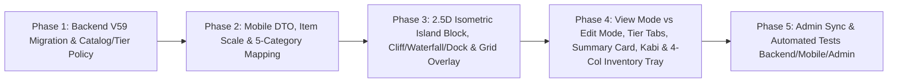

# Plan — Issue #46: Thiết kế lại Đảo Di Sản theo phong cách Isometric 2.5D mới (`Đảo An Lạc` · `Đảo Phồn Thịnh` · `Đảo Trường Tồn`)

> **Nguồn chân lý:** [Issue #46](https://github.com/longv0208/Dau_Viet/issues/46) · **Mockup:** `plans/261030-issue-46-island-redesign/island-mockup.png`  
> **Branch:** `feat/issue-46-island-redesign` · **Task:** `TASK-0035`  
> **Modules:** `dau-viet-backend`, `dau-viet-mobile`, `dau-viet-admin`  
> **Risk:** `high-risk` (có migration Flyway `V59` cập nhật cấu hình cấp đảo/lưới ô & danh mục vật phẩm, đồng bộ UI/UX Mobile + Admin).

---

## 1. Mục tiêu & Đối chiếu Acceptance Criteria

| AC | Yêu cầu từ Issue #46 | Giải pháp kỹ thuật & Điểm chạm |
|---|---|---|
| **AC-1** | **Giao diện 3 Cấp Đảo & Bối cảnh Isometric 2.5D:** Hiển thị đúng hệ thống 3 đảo (**Đảo An Lạc**, **Đảo Phồn Thịnh**, **Đảo Trường Tồn**) với thanh tab có thumbnail, thẻ thông tin diện tích/trạng thái (`Đang sử dụng` / `Mở rộng đảo`), nền biển mây vịnh núi, đảo phụ phía xa, nút chuyển `<` `>` và khung thoại hướng dẫn của Rùa Kabi. | 1. Chuẩn hóa 3 cấp đảo trong `V59` + `IslandDto` + `IslandTierTabs`: `Đảo An Lạc` (Cấp 1), `Đảo Phồn Thịnh` (Cấp 2), `Đảo Trường Tồn` (Cấp 3) kèm thumbnail isometric. 2. Tạo `IslandSummaryCard` hiển thị thumbnail, tên đảo, `Diện tích: 4×4 ô / 6×6 ô / 8×8 ô`, mô tả và badge `Đang sử dụng` / nút `🔒 Mở rộng đảo`. 3. Bổ sung `IslandPanoramicBackdrop` (biển trời vịnh Hạ Long, mây trôi, đảo phụ phía xa có icon `🔒`), hai nút `<` `>` chuyển đảo và khung thoại Rùa Kabi đội nón lá theo ngữ cảnh từng đảo. |
| **AC-2** | **Quy hoạch Diện tích & Lưới Ô Hợp lý:** Tinh chỉnh kích thước lưới ô của từng cấp đảo cân đối với màn hình điện thoại; phân biệt rõ tỷ lệ hiển thị giữa công trình lớn và vật phẩm trang trí nhỏ; chạm chọn chính xác, không rối mắt. | 1. Quy hoạch lại board chuẩn **đồng tâm vuông vắn** trên lưới `8×8`:   - **Cấp 1 (`Đảo An Lạc`):** Lõi `4×4` (`16 ô`) — camera auto-fit phóng to rõ nét trên mobile.   - **Cấp 2 (`Đảo Phồn Thịnh`):** Mở rộng đồng tâm `6×6` (`36 ô`) có bậc cấp đá & hồ sen.   - **Cấp 3 (`Đảo Trường Tồn`):** Toàn đảo `8×8` (`64 ô`) quần thể di sản. 2. Nâng cấp khối đảo 2.5D: vách đá cao có chiều sâu, thác nước đổ xuống biển, bậc thang đá và cầu tàu gỗ. 3. Phân cấp tỷ lệ hiển thị (`IslandItemVisualScale`): Công trình lớn (`1.50×` tileW), Cây cối/tiểu cảnh vừa (`1.25×` tileW), Vật phẩm trang trí nhỏ (`0.95×` tileW). |
| **AC-3** | **Chế độ Bài trí & Cụm Công cụ Lưu / Xoay / Xóa:** Khi bài trí, hiển thị rõ lưới ô trên mặt đảo cùng 3 nút công cụ nổi bên phải (**Lưu đảo**, **Xoay**, **Xóa**) hoạt động mượt mà, đồng bộ với Backend. | 1. Tách rõ **Chế độ Tham quan** (ẩn đường kẻ lưới & cọc `+` trống để đảo đẹp như tranh) và **Chế độ Bài trí** (hiện rõ đường kẻ lưới ô cỏ/đá sáng rõ trên mặt phẳng đảo). 2. Thêm cụm 3 nút công cụ nổi dọc bên phải trong Chế độ Bài trí: **Lưu đảo** (xác nhận & thoát về chế độ tham quan), **Xoay** (lật hướng vật phẩm đang chọn trên đảo), **Xóa** (gỡ vật phẩm trả về kho qua `DELETE /api/v1/me/island/placements/{slotId}`). |
| **AC-4** | **Khay Vật phẩm Phân loại 5 Tab:** Khay vật phẩm phía dưới có bộ lọc `Tất cả`, `Công trình`, `Cây cối`, `Trang trí`, `Khác`, hiển thị lưới thẻ vật phẩm (4 cột) kèm hình minh họa, tên và badge số lượng đúng như thiết kế. | Thiết kế lại `IslandInventoryTray`: 1. Thanh 5 filter chips: `Tất cả`, `Công trình`, `Cây cối`, `Trang trí`, `Khác` (active màu xanh cổ `#1E4D3B`). 2. Lưới 4 cột thẻ vuông bo góc nền giấy kem (`#F4E7CE`), hiển thị hình isometric vật phẩm (*Nhà đình, Cây đa, Giếng cổ, Cột cờ, Thuyền, Tượng Lý Thái Tổ, Cây đào, Đèn lồng...*), tên ngắn và badge tròn số lượng góc trên phải. |
| **AC-5** | **Responsive & Tests:** Giao diện chạy mượt trên nhiều kích thước màn hình mobile (`360×800`, `390×844`, tablet/desktop), không bị lỗi overflow và pass bộ test liên quan. | Cập nhật & bổ sung tests cho Backend (`IslandV51IT`), Mobile (`island_dto_test.dart`, `island_screen_test.dart`) và Admin (`island-builder`); kiểm tra responsive không overflow trên khung hình mobile chuẩn. |

---

## 2. Phân tích Hiện trạng & Nguyên nhân Gốc rễ

### 2.1. Hạn chế của Hệ thống Lưới & Giao diện Hiện tại (`V55` & `island_screen.dart`)
1. **Cách chia lưới `8×7` theo dải ngang thiếu cân đối trên mobile:**
   - Migration `V55__align_heritage_island_with_web.sql` tạo board `8×7 = 56 tile`, trong đó Tier 1 lấy 3 hàng đầu (`r < 3` → thực tế mở `21 slot` dù `island_tier_policies.slot_count` ghi `12`), Tier 2 lấy 5 hàng đầu (`r < 5` → mở `35 slot` dù policy ghi `28`), Tier 3 lấy toàn bộ (`55 slot` dù policy ghi `56`).
   - Vì Tier 1 là dải chữ nhật dẹt `3×7`, khi chiếu isometric lên màn hình dọc điện thoại (`360×800`), đảo bị lệch tỷ lệ, ô đất nhỏ và khó chạm chính xác.
2. **Chưa tách biệt Chế độ Tham quan (View Mode) và Chế độ Bài trí (Edit Mode):**
   - Hiện tại màn hình `/island` luôn ghim cố định `IslandInventoryTray` (dạng cuộn ngang 1 hàng) ở đáy màn hình và luôn hiển thị các cọc `+` (`buildable_parcel_plinth.png`) trên mọi ô trống, khiến cảnh đảo bị rối và mất chất tranh phong cảnh 2.5D.
   - Chưa có bối cảnh vịnh núi đá vôi Hạ Long, đảo phụ phía xa trên biển mây, nút `<` `>` chuyển nhanh giữa các cấp đảo, và trợ lý **Rùa Kabi đội nón lá** giới thiệu ngữ cảnh từng đảo như thiết kế mẫu.
3. **Vật phẩm có cùng kích thước `1×1` và thiếu phân loại 5 danh mục:**
   - Trong `IslandHeritageBuilding`, mọi vật phẩm đều vẽ cùng kích thước `modelW = tileWidth * 1.15`, `modelH = tileHeight * 2.4`. Công trình lớn (*Nhà đình, Khuê Văn Các*) trông bé ngang ngửa vật phẩm nhỏ (*Giếng cổ, Đèn lồng*).
   - `IslandInventoryTray` chưa có thanh lọc 5 danh mục (`Tất cả`, `Công trình`, `Cây cối`, `Trang trí`, `Khác`) và chưa hiển thị dạng lưới 4 cột có huy hiệu số lượng góc trên phải.
   - Một số vật phẩm trong mockup (*Cột cờ, Tượng Lý Thái Tổ, Cây đào*) chưa có mã/hình minh họa tương ứng trong `item_catalog` và `IslandHeritageBuilding`.

---

## 3. Kiến trúc & Thiết kế Chi tiết theo Từng Phase

---

### Phase 1: Quy hoạch lại Diện tích 3 Cấp Đảo & Danh mục Vật phẩm trên Backend (`V59`)

#### 1.1. Migration `dau-viet-backend/src/main/resources/db/migration/V59__redesign_heritage_island_3_tiers.sql`
1. **Cập nhật `island_tier_policies` (`config_version = 4`, vô hiệu hóa `config_version = 3`):**
   - Chuẩn hóa tên gọi, nhãn giai đoạn và số lượng ô khớp 100% với thiết kế đồng tâm vuông vắn:
     - **Tier 1 (`Đảo An Lạc`):** `name_key = 'tier.an_lac'`, `stage_label = 'Đảo An Lạc'`, `slot_count = 16` (lưới `4×4` ô trung tâm), `required_level = 1`.
     - **Tier 2 (`Đảo Phồn Thịnh`):** `name_key = 'tier.phon_thinh'`, `stage_label = 'Đảo Phồn Thịnh'`, `slot_count = 36` (lưới `6×6` ô mở rộng), `required_level = 2`.
     - **Tier 3 (`Đảo Trường Tồn`):** `name_key = 'tier.truong_ton'`, `stage_label = 'Đảo Trường Tồn'`, `slot_count = 64` (lưới `8×8` ô đại đảo), `required_level = 3`.
2. **Tạo và Publish Layout Version 3 (`v3_id = '22200000-2222-4000-8000-000000000003'`, archive `v2_id`):**
   - `island_layout_boards`: `grid_rows = 8`, `grid_columns = 8`, `tile_width = 128.0`, `tile_height = 64.0`, `projection_type = 'ISOMETRIC'`.
   - **Quy hoạch đồng tâm (Concentric Square Terraces) giúp mỗi cấp đảo luôn cân đối ở chính giữa khung nhìn:**
     - **Tier 1 — `TIER_1` (`Đảo An Lạc`):** `r BETWEEN 2 AND 5 AND c BETWEEN 2 AND 5` (`4×4 = 16 ô`).
       - Bậc thềm trung tâm (`r IN (2,3) AND c IN (2,3)`): `elevation = 1` (nền đặt công trình chính như Nhà đình, Tượng, Cột cờ).
       - Các ô xung quanh (`r IN (4,5) OR c IN (4,5)` trong vùng `2..5`): `elevation = 0`, lối đi lát gạch/đá và thảm cỏ xanh.
     - **Tier 2 — `TIER_2` (`Đảo Phồn Thịnh`):** Vành đai mở rộng `r BETWEEN 1 AND 6 AND c BETWEEN 1 AND 6` (thêm `20 ô`, tổng `6×6 = 36 ô`).
     - **Tier 3 — `TIER_3` (`Đảo Trường Tồn`):** Vành đai đại đảo `r BETWEEN 0 AND 7 AND c BETWEEN 0 AND 7` (thêm `28 ô`, tổng `8×8 = 64 ô`).
   - Tất cả 64 ô đều `buildable = true` và có `island_slots` tương ứng (`slot_1`..`slot_64`), đảm bảo `slot_count` trong policy (`16 / 36 / 64`) khớp tuyệt đối với số slot mở khóa thực tế ở từng cấp!
   - Khi người chơi hiện tại gọi `GET /api/v1/me/island`, cơ chế `ensureIsland` trong `IslandService` thấy `v2_id` đã `ARCHIVED` sẽ tự động chuyển sang `v3_id` an toàn.
3. **Bổ sung & Chuẩn hóa Vật phẩm Mẫu trong `item_catalog` & `island_shop_items`:**
   - Bổ sung (`ON CONFLICT (code) DO UPDATE`) đầy đủ bộ vật phẩm xuất hiện trong thiết kế mẫu kèm `source_metadata.islandCategory` (`BUILDING`, `TREE`, `DECORATION`, `OTHER`) và `footprintScale`:
     - `DECOR_DINH_LANG` (*Nhà đình* — `render_key = 'decor.dinh_lang'`, `islandCategory = 'BUILDING'`)
     - `DECOR_CAY_DA` (*Cây đa* — `render_key = 'decor.cay_da'`, `islandCategory = 'TREE'`)
     - `DECOR_GIENG_CO` (*Giếng cổ* — `render_key = 'decor.gieng_co'`, `islandCategory = 'DECORATION'`)
     - `DECOR_COT_CO` (*Cột cờ* — `render_key = 'decor.cot_co'`, `islandCategory = 'DECORATION'`)
     - `DECOR_THUYEN_RONG` (*Thuyền* — `render_key = 'decor.thuyen_rong'`, `islandCategory = 'OTHER'`)
     - `DECOR_TUONG_LY_THAI_TO` (*Tượng Lý Thái Tổ* — `render_key = 'decor.tuong_ly_thai_to'`, `islandCategory = 'DECORATION'`)
     - `DECOR_CAY_DAO` (*Cây đào* — `render_key = 'decor.cay_dao'`, `islandCategory = 'TREE'`)
     - `DECOR_DEN_LONG_HOI_AN` (*Đèn lồng* — `render_key = 'decor.den_long_hoi_an'`, `islandCategory = 'DECORATION'`)

---

### Phase 2: Nâng cấp Tầng Dữ liệu Mobile (`island_dto.dart`, `island_fixture.dart`, `mock_island_repository.dart`)

#### 2.1. Định danh 3 Cấp Đảo & Diện tích Lưới Ô (`island_dto.dart`)
- Bổ sung helper trên `IslandDto` và `IslandTierInfoDto`:
  - `tierDisplayName(int tier)`:
    - `1` / `'tier.an_lac'` / `'tier.small'` → **`Đảo An Lạc`**
    - `2` / `'tier.phon_thinh'` / `'tier.medium'` → **`Đảo Phồn Thịnh`**
    - `3` / `'tier.truong_ton'` / `'tier.grand'` → **`Đảo Trường Tồn`**
  - `tierGridDimensionLabel(int tier)`:
    - Tính từ tập tiles có `unlockTier <= tier` (ví dụ `4×4 ô`, `6×6 ô`, `8×8 ô`) để hiển thị chính xác trên `IslandSummaryCard`.
  - `tierKabiMessage(int tier)`:
    - Tier 1: *"Đây là Đảo An Lạc! Hãy trang trí đảo bằng những vật phẩm di sản mà bạn sưu tầm nhé!"*
    - Tier 2: *"Đảo Phồn Thịnh rộng hơn nhiều! Bạn có thể sắp xếp lại tất cả vật phẩm và trang trí theo ý thích nhé!"*
    - Tier 3: *"Đảo Trường Tồn uy nghi tráng lệ! Hãy kiến tạo quần thể di sản rực rỡ nhất của bạn nhé!"*

#### 2.2. Phân loại 5 Danh mục Vật phẩm & Tỷ lệ Kích thước (`island_dto.dart` & `reward_dtos.dart`)
- Thêm enum `IslandInventoryCategory`:
  - `all` (`Tất cả`)
  - `building` (`Công trình` — đình, đền, chùa, cổng làng, nhà tranh, cầu kiều, Khuê Văn Các, Tháp Bút, thành cổ)
  - `tree` (`Cây cối` — cây đa, cây đào, bụi tre, hồ sen, vườn thảo mộc)
  - `decoration` (`Trang trí` — giếng cổ, cột cờ, đèn lồng, tượng Lý Thái Tổ)
  - `other` (`Khác` — thuyền, trống đồng, cọc Bạch Đằng, hiện vật khác)
- Thêm hàm phân loại `resolveIslandItemCategory(String? code, String? renderKey, String? category, String? itemType)` và hàm xác định tỷ lệ kích thước `resolveIslandItemVisualScale(String? code, String? renderKey)`:
  - **Công trình lớn (`scale = 1.48`):** `dinh_lang`, `khue_van_cac`, `thap_but`, `cong_lang`, `nha_tranh`, `chua_my_son`, `thanh_nha_ho`, `co_loa`.
  - **Cây cối & Cảnh quan vừa (`scale = 1.24`):** `cay_da`, `cay_dao`, `bui_tre`, `ho_sen`, `cau_kieu`, `thuyen_rong`.
  - **Vật phẩm trang trí nhỏ (`scale = 0.96`):** `gieng_co`, `den_long`, `cot_co`, `tuong_ly_thai_to`, `trong_dong`, `coc_bach_dang`.
- Cập nhật `IslandFixture.createHeritageVillageFixture` và `MockIslandRepository` đồng bộ với lưới đồng tâm `4×4` / `6×6` / `8×8` và đầy đủ 8 vật phẩm mẫu để cả chế độ thực lẫn mock/test đều nhất quán.

---

### Phase 3: Thiết kế lại Khối Đảo Isometric 2.5D, Bối cảnh Vịnh Hạ Long & Lưới Ô (`island_scene.dart`, `island_isometric_renderer.dart`, `island_heritage_building.dart`)

#### 3.1. Bối cảnh Biển Mây Vịnh Núi & Đảo Phụ Phía Xa (`island_scene.dart`)
- Thay thế nền gradient đơn điệu bằng `IslandPanoramicBackdrop`:
  - Lớp bầu trời bình minh ấm áp chuyển dần xuống mặt biển ngọc bích vịnh Hạ Long.
  - Các dãy núi đá vôi (`karst mountains`) và lớp mây mờ trôi nhẹ ở chân trời trái/phải.
  - Khi ở **Chế độ Tham quan (`isEditMode == false`)**: hiển thị 2 hòn đảo phụ lơ lửng phía xa trên biển mây (góc trên trái & góc trên phải của vùng biển) kèm biểu tượng `🔒` nếu cấp đảo đó chưa mở khóa; chạm vào đảo phụ sẽ chuyển nhanh sang xem trước cấp đảo đó.

#### 3.2. Khối Đảo Nổi 2.5D Có Thác Nước, Bậc Thang Đá & Cầu Tàu Gỗ (`island_isometric_renderer.dart`)
- Nâng cấp `_HeritageIslandCliffAndUnderlayPainter` và `_OrganicWaterAndShorelinePainter`:
  - **Vách đá 2.5D hùng vĩ:** Tăng chiều cao vách đá rìa đảo (`baseCliffDepth = tileH * 1.15`), vẽ các mảng địa tầng đá vôi xám xanh kết hợp đất nâu ấm và rêu phong ở chân sóng.
  - **Thác nước đổ xuống biển (`_drawCliffWaterfalls`):** Vẽ 2 dòng thác nước trắng xóa đổ từ mép vách đá Tây Nam (SW) và Đông Nam (SE) xuống mặt biển kèm bọt nước tung trắng xóa theo nhịp `waterAnimationValue`.
  - **Bậc thang đá & Cầu tàu gỗ (`_drawWoodenPierAndStoneSteps`):** Ở rìa Đông Nam (SE) của đảo, vẽ bậc thang đá dẫn xuống cầu tàu gỗ vươn ra mặt nước ngọc bích.
  - **Chế độ hiển thị Lưới Ô (`showEditGrid: isEditMode`):**
    - Khi `isEditMode == false` (Tham quan): **ẩn hoàn toàn** các đường kẻ lưới và ẩn cọc `+` trên các ô trống để mặt đảo liền mạch như một bức tranh.
    - Khi `isEditMode == true` (Bài trí): vẽ lưới ô hình thoi sáng rõ (`#E6F9CA` / `#FFF3C4`) trên toàn bộ các ô đất đã mở khóa, làm nổi bật ô đang chọn bằng viền vàng kim phát sáng để người chơi đặt/di chuyển vật phẩm chính xác.

#### 3.3. Bổ sung Hình Minh Họa & Tỷ Lệ Vật Phẩm (`island_heritage_building.dart`)
- Áp dụng `resolveIslandItemVisualScale` vào `IslandHeritageBuilding` để công trình lớn (`Nhà đình`, `Khuê Văn Các`) hiển thị bề thế gấp `1.5×` vật phẩm nhỏ (`Đèn lồng`, `Giếng cổ`).
- Bổ sung vector/procedural art sắc nét cho các vật phẩm mới trong mockup:
  - `_VietnameseFlagpole` (*Cột cờ* — đài đá xanh, cột gỗ sơn son, đại kỳ thêu hoa văn truyền thống tung bay).
  - `_VietnameseLyThaiToStatue` (*Tượng Lý Thái Tổ* — bệ đá chạm rồng, tượng đồng uy nghi cầm chiếu dời đô).
  - `_VietnamesePeachBlossomTree` (*Cây đào* — gốc đào cổ thụ, tán hoa đào hồng thắm nở rộ).
  - `_VietnameseTraditionalBoat` (*Thuyền* — thuyền gỗ mũi cong truyền thống).
  - `_VietnameseRedLanternPost` (*Đèn lồng* — trụ gỗ treo đèn lồng lụa đỏ vàng ấm áp).

---

### Phase 4: Hai Chế độ Trải nghiệm (Tham quan & Bài trí), Header, Tier Tabs, Summary Card & Khay Vật Phẩm 4 Cột (`island_screen.dart`, `island_tier_tabs.dart`, `island_inventory_tray.dart`)

#### 4.1. Bố cục Màn hình `/island` (`island_screen.dart`)
- Quản lý trạng thái `_isEditMode` (`bool`, mặc định `false` — vào màn hình ở **Chế độ Tham quan** như Màn 1 & Màn 3; chuyển sang `true` — **Chế độ Bài trí** như Màn 2 khi bấm nút `Bài trí` hoặc chọn ô đất/vật phẩm để chỉnh sửa):
  1. **Top Bar (`_buildHeader`):**
     - Nút `<` tròn nền kem bên trái.
     - Tiêu đề **`ĐẢO DI SẢN`** chính giữa (font `Noto Serif` đậm màu đỏ chu sa `#B93430`).
     - Bên phải: Nút `?` (hướng dẫn) + Huy hiệu Điểm Sử Ký `⭐ 250` (bấm vào mở `/island/shop`).
  2. **Thanh Tab 3 Cấp Đảo (`IslandTierTabs` — hiển thị ở Chế độ Tham quan):**
     - 3 tab cân đối: **`Đảo An Lạc`** · **`Đảo Phồn Thịnh`** · **`Đảo Trường Tồn`**.
     - Mỗi tab có hình thu nhỏ (thumbnail isometric) của cấp đảo tương ứng phía trên và nhãn tên đảo kèm icon khóa `🔒`/`🔓` phía dưới.
     - Tab đang chọn có nền xanh cổ `#1E4D3B`, chữ trắng nổi bật.
  3. **Thẻ Thông tin Đảo (`_buildIslandSummaryCard`):**
     - Nền giấy kem `#FAF1E0` bo góc `18px`, viền `#DEC9A8`:
     - Bên trái: Thumbnail đảo isometric + Tên đảo (**`Đảo An Lạc`** / **`Đảo Phồn Thịnh`** / **`Đảo Trường Tồn`**) + **`Diện tích: 4×4 ô`** (hoặc `6×6 ô` / `8×8 ô`) + mô tả ngắn (*"Nơi lưu giữ những dấu ấn di sản và vật phẩm bạn đã sưu tầm."* khi ở chế độ Tham quan).
     - Bên phải:
       - Nếu đang xem cấp đảo đã mở khóa: hiển thị badge **`Đang sử dụng`** (xanh `#1E4D3B`) kèm nút **`Bài trí`** (hoặc nút **`🔒 Mở rộng đảo`** như Màn 2 nếu chưa đạt cấp tối đa).
       - Nếu đang xem cấp đảo chưa mở khóa: hiển thị nút **`🔒 Mở rộng đảo`** (mở `IslandUpgradePanel`).
  4. **Điều hướng & Trợ lý Rùa Kabi ở Chế độ Tham quan (`_isEditMode == false`):**
     - Hai nút tròn `<` và `>` ở mép trái/phải màn hình để chuyển nhanh giữa 3 cấp đảo (`1 ↔ 2 ↔ 3`).
     - Góc dưới trái: **Rùa Kabi đội nón lá** kèm khung thoại tự nhiên theo cấp đảo đang xem, nút chuyển nhanh sang **`Bài trí đảo`** và chỉ báo trang (`● ○ ○`) ở đáy.
  5. **Cụm 3 Nút Công cụ Nổi ở Chế độ Bài trí (`_isEditMode == true`):**
     - Nằm dọc bên phải màn hình (như Màn 2 trong mockup):
       1. **`Lưu đảo`** (icon hộp lưu trữ): Lưu bố cục hiện tại, thông báo *"Đã lưu bố cục Đảo Di Sản!"* và trở về Chế độ Tham quan (`_isEditMode = false`).
       2. **`Xoay`** (icon xoay tròn): Lật hướng (`flipHorizontally`) của vật phẩm tại ô đang chọn (lưu vào state/preferences theo `slotId`), hoặc xoay góc nhìn nếu chưa chọn vật phẩm.
       3. **`Xóa`** (icon thùng rác): Gỡ vật phẩm tại ô đang chọn khỏi đảo (`_removePlacement`), trả về kho vật phẩm.

#### 4.2. Khay Kho Vật Phẩm Phân loại 5 Tab & Lưới 4 Cột (`island_inventory_tray.dart`)
- Hiển thị ở đáy màn hình khi `_isEditMode == true`:
  - **Thanh 5 Filter Chips ngang:** `Tất cả`, `Công trình`, `Cây cối`, `Trang trí`, `Khác`.
    - Tab đang chọn có nền xanh cổ `#1E4D3B`, chữ trắng đậm; các tab khác nền kem trong suốt, chữ nâu đậm.
  - **Lưới 4 cột (`GridView.builder` với `crossAxisCount: 4`, `childAspectRatio: 0.92`, `crossAxisSpacing: 8`, `mainAxisSpacing: 8`):**
    - Mỗi thẻ vật phẩm hiển thị:
      - Hình minh họa isometric ở giữa.
      - Tên vật phẩm rút gọn ở đáy thẻ (*Nhà đình, Cây đa, Giếng cổ, Cột cờ, Thuyền, Tượng Lý Thái Tổ, Cây đào, Đèn lồng...*).
      - Huy hiệu tròn góc trên phải (`#5A4635`) hiển thị số lượng hiện có/đặt được (`1`, `2`, `3`...).
    - Chạm chọn vật phẩm trong khay → chạm vào ô đất trên lưới đảo để đặt ngay; chạm vào vật phẩm đã đặt trên đảo → có thể di chuyển sang ô trống khác, bấm **Xoay** hoặc bấm **Xóa**.

---

### Phase 5: Đồng bộ Web Admin (`dau-viet-admin`) & Kiểm thử Toàn diện (`AC-5`)

#### 5.1. Đồng bộ Admin Island Builder (`dau-viet-admin/src/features/island-builder/`)
- Cập nhật `island-builder-fixture.ts` và `island-builder-workspace.tsx`:
  - Đồng bộ kích thước board mặc định `8×8` đồng tâm (`TIER_1`: Đảo An Lạc `4×4`, `TIER_2`: Đảo Phồn Thịnh `6×6`, `TIER_3`: Đảo Trường Tồn `8×8`).
  - Hiển thị nhãn vùng đất mới (`Đảo An Lạc`, `Đảo Phồn Thịnh`, `Đảo Trường Tồn`) trong bộ công cụ chọn Tier của Admin.

#### 5.2. Kế hoạch Kiểm thử & Nghiệm thu (`AC-1` → `AC-5`)
1. **Backend Integration Tests (`dau-viet-backend`):**
   - Cập nhật `IslandV51IT.java`:
     - Kiểm tra `GET /api/v1/me/island` trả về 3 tiers (`tier.an_lac` / `16` ô, `tier.phon_thinh` / `36` ô, `tier.truong_ton` / `64` ô) và `board` `8×8` (64 slots).
     - Kiểm tra đặt nhiều bản sao của cùng 1 vật phẩm trên các ô `4×4` của Đảo An Lạc.
     - Kiểm tra nâng cấp lên Đảo Phồn Thịnh (`tier = 2`) mở khóa đúng `36` ô và hoàn trả vật phẩm về kho.
2. **Mobile Unit & Widget Tests (`dau-viet-mobile`):**
   - `test/island/island_dto_test.dart`: Kiểm tra parse `IslandTierInfoDto`, tên 3 cấp đảo (`Đảo An Lạc`, `Đảo Phồn Thịnh`, `Đảo Trường Tồn`), phân loại 5 danh mục (`Công trình`, `Cây cối`, `Trang trí`, `Khác`) và tỷ lệ kích thước vật phẩm.
   - `test/island/island_screen_test.dart`:
     - Kiểm tra Chế độ Tham quan hiển thị Top Bar `ĐẢO DI SẢN`, 3 tab `Đảo An Lạc` / `Đảo Phồn Thịnh` / `Đảo Trường Tồn`, thẻ `Diện tích`, nút `<` `>` và lời thoại của Rùa Kabi.
     - Kiểm tra chuyển sang Chế độ Bài trí hiển thị 3 nút `Lưu đảo`, `Xoay`, `Xóa` và Khay vật phẩm 5 tab (`Tất cả`, `Công trình`, `Cây cối`, `Trang trí`, `Khác`) với lưới thẻ vật phẩm.
     - Kiểm tra thao tác đặt vật phẩm từ khay lên ô đất, xoay và xóa vật phẩm hoạt động mượt mà, không bị lỗi overflow trên kích thước mobile (`360×800`, `390×844`).
3. **Admin Tests (`dau-viet-admin`):**
   - Chạy `npx tsc --noEmit` và `npx vitest run` đảm bảo không phát sinh lỗi TypeScript hay regression test.

---

## 4. Danh sách File Dự kiến Thay đổi / Tạo mới

| Module | File | Hành động |
|---|---|---|
| **Backend** | `dau-viet-backend/src/main/resources/db/migration/V59__redesign_heritage_island_3_tiers.sql` | **Tạo mới** — Migration cấu hình 3 cấp đảo (`Đảo An Lạc` 16 ô, `Đảo Phồn Thịnh` 36 ô, `Đảo Trường Tồn` 64 ô), layout v3 đồng tâm `8×8` và danh mục vật phẩm mẫu |
| **Backend** | `dau-viet-backend/src/test/java/com/dauviet/island/IslandV51IT.java` | **Cập nhật** — Đồng bộ assertions theo cấu hình 3 cấp đảo `16 / 36 / 64` ô của V59 |
| **Mobile** | `dau-viet-mobile/lib/features/island/data/island_dto.dart` | **Cập nhật** — Thêm tên 3 cấp đảo, diện tích lưới, lời thoại Kabi, phân loại 5 danh mục vật phẩm & tỷ lệ kích thước `IslandItemVisualScale` |
| **Mobile** | `dau-viet-mobile/lib/features/island/data/island_fixture.dart` | **Cập nhật** — Đồng bộ fixture lưới đồng tâm `4×4 / 6×6 / 8×8` và 8 vật phẩm mẫu |
| **Mobile** | `dau-viet-mobile/lib/features/island/data/mock_island_repository.dart` | **Cập nhật** — Đồng bộ danh sách vật phẩm mẫu và tiers trong chế độ mock |
| **Mobile** | `dau-viet-mobile/lib/features/island/presentation/island_screen.dart` | **Cập nhật** — Tái cấu trúc Top Bar, Summary Card, 2 chế độ Tham quan / Bài trí, nút `<` `>`, khung thoại Rùa Kabi và cụm 3 nút nổi (`Lưu đảo`, `Xoay`, `Xóa`) |
| **Mobile** | `dau-viet-mobile/lib/features/island/presentation/widgets/island_tier_tabs.dart` | **Cập nhật** — Thiết kế 3 tab `Đảo An Lạc`, `Đảo Phồn Thịnh`, `Đảo Trường Tồn` kèm hình thu nhỏ isometric và trạng thái khóa/mở |
| **Mobile** | `dau-viet-mobile/lib/features/island/presentation/widgets/island_inventory_tray.dart` | **Cập nhật** — Thiết kế Khay vật phẩm phân loại 5 tab (`Tất cả`, `Công trình`, `Cây cối`, `Trang trí`, `Khác`) và lưới thẻ vuông 4 cột có badge số lượng |
| **Mobile** | `dau-viet-mobile/lib/features/island/presentation/widgets/island_scene.dart` | **Cập nhật** — Bổ sung `IslandPanoramicBackdrop` (vịnh núi đá vôi, mây trôi, đảo phụ phía xa) và truyền `isEditMode` + `flippedSlotIds` |
| **Mobile** | `dau-viet-mobile/lib/features/island/presentation/widgets/island_isometric_renderer.dart` | **Cập nhật** — Nâng cấp vách đá 2.5D, thác nước đổ xuống biển, cầu tàu gỗ, bậc thang đá và ẩn/hiện lưới ô theo `isEditMode` |
| **Mobile** | `dau-viet-mobile/lib/features/island/presentation/widgets/island_heritage_building.dart` | **Cập nhật** — Hỗ trợ tỷ lệ kích thước theo loại công trình/vật phẩm và bổ sung hình minh họa cho *Cột cờ, Tượng Lý Thái Tổ, Cây đào, Thuyền, Đèn lồng* |
| **Mobile** | `dau-viet-mobile/test/island/island_dto_test.dart`, `dau-viet-mobile/test/island/island_screen_test.dart` | **Cập nhật** — Bổ sung unit & widget tests cho toàn bộ AC-1 → AC-5 |
| **Admin** | `dau-viet-admin/src/features/island-builder/island-builder-fixture.ts`, `island-builder-workspace.tsx` | **Cập nhật** — Đồng bộ tên 3 cấp đảo và cấu hình lưới đồng tâm `8×8` |

---

## 5. Quản trị Rủi ro & Invariants

| Rủi ro | Biện pháp kiểm soát |
|---|---|
| Người chơi cũ đang pin vào `layout_version` v2 (`V55`) | `V59` chuyển v2 sang `ARCHIVED` và đặt v3 làm `PUBLISHED`. Cơ chế `ensureIsland()` trong `IslandService` đã hỗ trợ tự động chuyển đảo đang pin ở version `ARCHIVED` sang version `PUBLISHED` mới nhất và trả toàn bộ vật phẩm đã đặt về kho (`user_inventory`) an toàn, không mất đồ. |
| Ô đất bị bé hoặc khó chạm trên màn hình điện thoại nhỏ (`360×800`) | Thiết kế lưới đồng tâm `4×4` (Cấp 1) → `6×6` (Cấp 2) → `8×8` (Cấp 3) giúp khi xem Đảo An Lạc, `IslandScene` chỉ đóng khung `4×4` ô nên mỗi ô lớn gấp đôi so với lưới `8×7` cũ; đồng thời hỗ trợ zoom/pan mượt qua `InteractiveViewer`. |
| Vỡ bố cục (overflow) khi mở Khay vật phẩm ở Chế độ Bài trí | Khi vào Chế độ Bài trí (`_isEditMode = true`), tự động ẩn `IslandTierTabs` và lời thoại Kabi, thu gọn `IslandSummaryCard` thành 1 dòng (như Màn 2 trong mockup) và giới hạn chiều cao `IslandInventoryTray` tối đa `38%` chiều cao màn hình có cuộn dọc nội bộ. |
