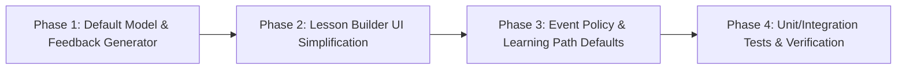

# Plan — Issue #47: Mặc định Bắt buộc cho toàn bộ Giai đoạn/Hoạt động/Bài học/Sự kiện & Tự động điền sẵn Phản hồi học viên (Default Feedback)

> **Nguồn chân lý:** [Issue #47](https://github.com/longv0208/Dau_Viet/issues/47)  
> **Branch:** `feat/issue-47-default-required-and-feedback` · **Task:** `TASK-0036`  
> **Module:** `dau-viet-admin` (Next.js 15 + React 19 + TypeScript + Vitest)  
> **Risk:** `normal` (Chuẩn hóa giá trị mặc định và tinh giản giao diện biên tập trên `dau-viet-admin`; giữ nguyên và tương thích 100% với hợp đồng API/schema `DraftSchema.java`, `DraftValidator.java`, `AdminCompletionPolicyService.java`, `AdminPathEventService.java` ở `dau-viet-backend`).

---

## 1. Mục tiêu & Đối chiếu Acceptance Criteria

| AC | Yêu cầu từ Issue #47 | Giải pháp kỹ thuật & Điểm chạm |
|---|---|---|
| **AC-1** | **Loại bỏ tích chọn Bắt buộc/Tuỳ chọn:** Không còn checkbox/dropdown bắt chọn *Bắt buộc vs Tuỳ chọn/Tham khảo* ở Stage, Activity, Completion, Event Policy và Learning Path Event; mọi thành phần tạo ra đều tự động là bắt buộc (`required: true`, `participationType: "REQUIRED"`, `graded: true`). | Chuẩn hóa `required: true` cho mọi `Stage` và `Activity` trong `parseDraft`, `serializeDraft`, `makeStage`, `makeActivity`, `makeTemplateActivity`; mặc định `config.graded = true` cho `EVIDENCE_SELECT` và bỏ checkbox khóa cứng trong `evidence-select-editor.tsx`; xóa checkbox/badge Bắt buộc/Tuỳ chọn trong `stage-editor.tsx`, `stage-navigator.tsx`, `shared-fields.tsx`, `completion-editor.tsx`; bỏ cột `Bài học tuỳ chọn (optional)` và mặc định chọn sẵn tất cả bài học PUBLISHED trong `policy-editor.tsx`; mặc định `participationType: "REQUIRED"` khi thêm sự kiện trong `event-catalog.tsx` và gỡ dropdown/nhãn/bộ đếm `Tham khảo` trong `event-panel.tsx`, `path-versions.tsx`, `path-preview.tsx`. |
| **AC-2** | **Phản hồi học viên mặc định:** Khi thêm bất kỳ Activity mới nào trong Lesson Builder (hoặc mở bản nháp hiện có), toàn bộ các trường phản hồi bắt buộc (`COMPLETED`, `INCORRECT`, `PARTIAL`, `SUPPORTED`, `CONTRADICTED`, `EXHAUSTED` tùy loại activity) đều đã được điền sẵn nội dung mặc định hợp lệ. | Xây dựng `defaultFeedbackForActivity(type)` và `withDefaultFeedback(type, existing)` trong `draft-model.ts`; tự động điền sẵn khi gọi `makeActivity(type, existing)`, `makeTemplateActivity(type, existing)`, `parseDraft(json)` và `serializeDraft(draft)`. |
| **AC-3** | **Không cần nhập lại nếu không muốn sửa:** Quản trị viên tạo hoạt động mới, chỉ cần cấu hình câu hỏi/đáp án và nhấn Lưu/Xuất bản là thành công ngay mà **không cần mở phần Phản hồi học viên**; nếu muốn tùy chỉnh câu chữ vẫn có thể mở `FeedbackPanel` để sửa hoặc khôi phục mặc định. | Cập nhật `FeedbackPanel` (`feedback-panel.tsx`): đổi tiêu đề phụ sang `(Đã có sẵn phản hồi mặc định — nhấn để xem hoặc chỉnh sửa)`, thêm nút **Khôi phục mặc định**, và tự động điền lại câu mặc định khi `onBlur` trên ô bắt buộc bị xóa trắng. |
| **AC-4** | **Tests:** Cập nhật và vượt qua toàn bộ unit/integration tests của Lesson Builder, Policy Editor và Learning Path. | Cập nhật & bổ sung tests trong `draft-model.test.ts`, `use-builder.test.ts`, `feedback-panel.test.tsx`, `builder-page.test.tsx`, `policy-editor.test.tsx`, chạy `npx tsc --noEmit` và `npx vitest run`. |

---

## 2. Phân tích Hiện trạng & Nguyên nhân Gốc rễ

### 2.1. Dư thừa thao tác tích chọn "Bắt buộc / Tuỳ chọn / Tham khảo" ở 6 tầng
1. **Cấp Giai đoạn (`stage-editor.tsx` dòng 80–99, `stage-navigator.tsx` dòng 74–78)**:
   - Hiển thị checkbox `"Bắt buộc hoàn thành"` (`stage.required`) và badge `<ClueTag label={s.required ? "bắt buộc" : "tuỳ chọn"} />`.
   - Nếu quản trị viên vô tình bỏ chọn trên một stage có chứa activity bắt buộc, backend `DraftValidator.validatePublishGuardrails` sẽ chặn xuất bản với lỗi `REQUIRED_IN_OPTIONAL_STAGE`.
2. **Cấp Hoạt động (`use-builder.ts` dòng 237, `template-catalog.ts` dòng 65, `shared-fields.tsx` dòng 38–53, `stage-editor.tsx` dòng 210)**:
   - `makeActivity` đang khởi tạo `required: false`! Khi quản trị viên tạo bài học mới và thêm hoạt động mà quên tích `"Bắt buộc hoàn thành"`, lúc bấm Kiểm tra xuất bản sẽ bị chặn bởi lỗi `NO_REQUIRED_ACTIVITY` (*"Cần ít nhất một hoạt động bắt buộc"*).
3. **Cấp Chấm điểm Hoạt động (`evidence-select-editor.tsx` dòng 44–53)**:
   - Hiển thị một checkbox `checked={true} disabled={true}` với nhãn `"Chấm điểm theo đáp án (graded) — bắt buộc theo luồng 4 giai đoạn"`. Tuy nhiên trong `makeActivity("EVIDENCE_SELECT")`, `config` khởi tạo là `{}` (chưa có `graded: true` cho đến khi người dùng thao tác vào picker), gây lỗi `validateEvidenceSelect` (`"Bắt buộc bật chấm điểm (graded)..."`) nếu bản nháp được tạo từ khung mẫu.
4. **Cấp Điều kiện hoàn thành Bài học (`completion-editor.tsx` dòng 32–76)**:
   - Hiển thị checkbox `"Yêu cầu hoàn thành tất cả giai đoạn bắt buộc"` (`requireAllRequiredStages`) và danh sách chọn thủ công `requiredStageIds`. Khi mọi giai đoạn đều bắt buộc, việc bắt chọn lại ở đây là dư thừa.
5. **Cấp Chính sách hoàn thành Sự kiện (`events/workspace/gamification/policy-editor.tsx` dòng 42–47, 125–128)**:
   - Chia giao diện thành 2 cột `"Bài học bắt buộc (required)"` và `"Bài học tuỳ chọn (optional)"`, đồng thời khi mở form tạo mới (`initial == null`) danh sách `required` đang rỗng `[]`, bắt quản trị viên phải tích chọn từng bài học.
6. **Cấp Lộ trình học / Bản đồ Dấu Ấn (`learning-path/event-catalog.tsx` dòng 33, 41; `event-panel.tsx` dòng 206–227, 260–264; `path-versions.tsx` dòng 29, 54; `path-preview.tsx` dòng 67–68, 87–90)**:
   - `event-catalog.tsx` khi bấm `"Thêm"` lại gửi `participationType: "EXPLORATION_ONLY"`, khiến mọi sự kiện mới gắn vào chương đều ở trạng thái `"Tham khảo — không chặn tiến độ"`, buộc quản trị viên phải bấm vào từng sự kiện đổi dropdown sang `"REQUIRED"`.

### 2.2. Phản hồi học viên (`FeedbackPanel`) để trống khi tạo hoạt động mới
- `makeActivity` đang tạo `{ id, type, required: false, instruction: "", config: {} }` mà không có `feedback`.
- Trong khi đó, `draft-local-validator.ts` (`validateFeedback`, dòng 312–337) và backend (`CerChoiceValidator.java`, cùng các handler trong `ScoredHandlers.java`, `SelectionHandlers.java`, `ReasoningHandlers.java`) đòi hỏi các trường phản hồi theo từng loại:
  - Nhóm cơ bản (`REQUIRED_FEEDBACK_TYPES`): `COMPLETED`, `INCORRECT`.
  - Nhóm `MULTIPLE_CHOICE`, `HYPOTHESIS_CHOICE`, `CER`: `COMPLETED`, `INCORRECT`, `EXHAUSTED`.
  - Nhóm chấm 3 mức (`EVIDENCE_SELECT`, `MATCHING`, `REASONING_CONNECT`, `DRAG_ORDER`, `CER_CHOICE`): `COMPLETED`, `INCORRECT`, `PARTIAL`, `EXHAUSTED`.
  - Nhóm `VERIFICATION`: `COMPLETED`, `INCORRECT`, `PARTIAL`, `SUPPORTED`, `CONTRADICTED`, `EXHAUSTED`.
- Hệ quả: Quản trị viên tạo hoạt động xong luôn bị chặn lưu/xuất bản bởi lỗi `MISSING_FIELD` trên `.feedback`.

---

## 3. Thiết kế Chi tiết theo Từng Phase



---

### Phase 1: Chuẩn hóa Model Bản nháp & Bộ khởi tạo Phản hồi Mặc định (`draft-model.ts`, `use-builder.ts`, `template-catalog.ts`) (AC-1, AC-2)

#### 1.1. Xây dựng `defaultFeedbackForActivity` và `withDefaultFeedback` trong `dau-viet-admin/src/features/lessons/builder/draft-model.ts`
- Định nghĩa bộ câu phản hồi chuẩn văn phong **Dấu Việt** theo từng `ActivityType`:
  ```ts
  export const DEFAULT_FEEDBACK_BY_TYPE: Record<ActivityType, Record<string, string>> = {
    READ: {
      COMPLETED: "Bạn đã nắm được bối cảnh và tư liệu lịch sử ở bước này.",
      INCORRECT: "Hãy đọc kỹ lại đoạn tư liệu lịch sử để nắm rõ thông tin nhé!",
    },
    VIEW_IMAGE: {
      COMPLETED: "Bạn đã quan sát và ghi nhận xong tư liệu hình ảnh lịch sử.",
      INCORRECT: "Hãy quan sát kỹ lại hình ảnh tư liệu để không bỏ sót chi tiết nhé!",
    },
    EXPLORE_MAP: {
      COMPLETED: "Tuyệt vời! Bạn đã khám phá đầy đủ các điểm dấu tích trên bản đồ.",
      INCORRECT: "Hãy mở hết các điểm đánh dấu trên bản đồ để thu thập đủ thông tin nhé!",
    },
    REFLECTION_PROMPT: {
      COMPLETED: "Cảm ơn bạn đã chia sẻ góc nhìn và suy ngẫm lịch sử của mình!",
      INCORRECT: "Hãy viết thêm suy nghĩ của bạn về bài học lịch sử này nhé!",
    },
    MULTIPLE_CHOICE: {
      COMPLETED: "Chính xác! Bạn đã nắm vững dữ kiện lịch sử ở bước này.",
      INCORRECT: "Chưa chính xác. Hãy quan sát kỹ lại các tư liệu và dấu vết lịch sử để thử lại nhé!",
      EXHAUSTED: "Bạn đã dùng hết số lượt thử ở bước này. Hãy ghi nhớ đáp án đúng để tiếp tục hành trình khám phá nhé!",
    },
    EVIDENCE_SELECT: {
      COMPLETED: "Chính xác! Bạn đã thu thập đúng các bằng chứng lịch sử quan trọng.",
      PARTIAL: "Gần chính xác! Bạn đã chọn đúng một phần bằng chứng, hãy rà soát lại các tư liệu còn thiếu nhé.",
      INCORRECT: "Chưa chính xác. Hãy đối chiếu kỹ nguồn tư liệu để chọn đúng bằng chứng liên quan nhé!",
      EXHAUSTED: "Bạn đã dùng hết số lượt thử ở bước này. Hãy ghi nhớ các bằng chứng chuẩn xác để tiếp tục điều tra nhé!",
    },
    MATCHING: {
      COMPLETED: "Chính xác! Bạn đã ghép nối đúng các mối liên hệ lịch sử.",
      PARTIAL: "Gần chính xác! Một số cặp ghép đã đúng, hãy kiểm tra lại các cặp còn lại nhé.",
      INCORRECT: "Chưa chính xác. Hãy suy luận lại mối liên hệ giữa các dữ kiện để ghép cho đúng nhé!",
      EXHAUSTED: "Bạn đã dùng hết số lượt thử ở bước này. Hãy ghi nhớ các cặp ghép đúng để tiếp tục hành trình nhé!",
    },
    REASONING_CONNECT: {
      COMPLETED: "Chính xác! Sơ đồ suy luận của bạn phản ánh đúng mạch liên kết lịch sử.",
      PARTIAL: "Gần chính xác! Bạn đã nối đúng một phần quan hệ, hãy rà soát lại các mắt xích còn thiếu nhé.",
      INCORRECT: "Chưa chính xác. Hãy phân tích lại quan hệ nhân quả giữa các dữ kiện lịch sử nhé!",
      EXHAUSTED: "Bạn đã dùng hết số lượt thử ở bước này. Hãy ghi nhớ mạch suy luận chuẩn để đi tiếp nhé!",
    },
    HYPOTHESIS_CHOICE: {
      COMPLETED: "Bạn đã lựa chọn giả thuyết lịch sử để chuẩn bị bước vào giai đoạn kiểm chứng.",
      INCORRECT: "Hãy chọn một giả thuyết phù hợp kèm bằng chứng dẫn chiếu để tiếp tục nhé!",
      EXHAUSTED: "Bạn đã hoàn tất lượt chọn giả thuyết. Hãy tiếp tục đối chiếu với bằng chứng ở bước tiếp theo nhé!",
    },
    DRAG_ORDER: {
      COMPLETED: "Chính xác! Bạn đã tái dựng đúng trình tự diễn biến của sự kiện lịch sử.",
      PARTIAL: "Gần chính xác! Một số mốc đã đúng vị trí, hãy sắp xếp lại các bước còn lệch nhé.",
      INCORRECT: "Chưa chính xác. Hãy đối chiếu lại trình tự thời gian và diễn biến tư liệu để sắp xếp lại nhé!",
      EXHAUSTED: "Bạn đã dùng hết số lượt thử ở bước này. Hãy ghi nhớ trình tự diễn biến đúng của sự kiện nhé!",
    },
    VERIFICATION: {
      COMPLETED: "Kiểm chứng hoàn tất! Bạn đã đối chiếu thành công giả thuyết với hệ thống bằng chứng.",
      SUPPORTED: "Bằng chứng lịch sử hoàn toàn củng cố cho giả thuyết bạn đã chọn!",
      PARTIAL: "Bằng chứng hiện có mới củng cố một phần giả thuyết. Hãy bổ sung hoặc rà soát lại tư liệu nhé!",
      CONTRADICTED: "Các bằng chứng thu thập được đã bác bỏ giả thuyết này. Hãy đối chiếu lại tư liệu nhé!",
      INCORRECT: "Chưa chính xác. Hãy kiểm tra lại mối liên hệ giữa giả thuyết và các bằng chứng đã thu thập nhé!",
      EXHAUSTED: "Bạn đã dùng hết số lượt kiểm chứng ở bước này. Hãy xem kỹ phân tích bằng chứng để rút ra kết luận nhé!",
    },
    CER: {
      COMPLETED: "Tuyệt vời! Lập luận Kết luận – Bằng chứng – Suy luận (CER) của bạn rất chặt chẽ và thuyết phục.",
      INCORRECT: "Lập luận chưa đầy đủ. Hãy đảm bảo nêu rõ Nhận định, trích dẫn Bằng chứng và giải thích Suy luận nhé!",
      EXHAUSTED: "Bạn đã hoàn thành bước xây dựng kết luận lịch sử. Hãy xem lại gợi ý chuẩn để củng cố kiến thức nhé!",
    },
    CER_CHOICE: {
      COMPLETED: "Chính xác! Bạn đã kết hợp hoàn hảo Nhận định (Claim), Bằng chứng (Evidence) và Lập luận (Reasoning).",
      PARTIAL: "Gần chính xác! Bạn đã chọn đúng một phần trong bộ Kết luận – Bằng chứng – Lập luận, hãy chỉnh lại phần còn chưa khớp nhé.",
      INCORRECT: "Chưa chính xác. Hãy kiểm tra lại sự ăn khớp giữa Nhận định, Bằng chứng và Lập luận lịch sử nhé!",
      EXHAUSTED: "Bạn đã dùng hết số lượt thử ở bước này. Hãy ghi nhớ tổ hợp Kết luận – Bằng chứng – Lập luận chuẩn xác nhé!",
    },
  };
  ```
- Hàm `defaultFeedbackForActivity(type: ActivityType): Record<string, string>`:
  - Trả về bản sao `{ ...(DEFAULT_FEEDBACK_BY_TYPE[type] ?? DEFAULT_FEEDBACK_BY_TYPE.MULTIPLE_CHOICE) }`.
- Hàm `withDefaultFeedback(type: ActivityType, feedback?: Record<string, unknown>): Record<string, unknown>`:
  - Lấy `defaults = defaultFeedbackForActivity(type)`.
  - Giữ nguyên mọi key/value do quản trị viên đã nhập trong `feedback` nếu `typeof val === "string" && val.trim().length > 0`.
  - Điền giá trị từ `defaults[key]` cho mọi key mặc định còn thiếu hoặc đang rỗng/chỉ chứa khoảng trắng.

#### 1.2. Tự động chuẩn hóa trong `parseDraft` và `serializeDraft` (`draft-model.ts`)
- Khi `parseDraft(json)` đọc dữ liệu:
  - Mỗi `stage`: luôn gán `required: true`.
  - Mỗi `activity`:
    - Luôn gán `required: true`.
    - Nếu `act.type === "EVIDENCE_SELECT"`, đảm bảo `config: { ...(act.config ?? {}), graded: true }`.
    - Nếu `act.type` nằm trong `ACTIVITY_TYPES`, gán `feedback: withDefaultFeedback(act.type, act.feedback as Record<string, unknown> | undefined)`.
  - Nếu `draft.completion` tồn tại: chuẩn hóa `requireAllRequiredStages: true` và loại bỏ `requiredStageIds` dư thừa (giữ nguyên `minScore` và các unknown keys nếu có).
- Khi `serializeDraft(draft)` xuất JSON gửi lên server:
  - Chuẩn hóa lại một lần nữa (`stage.required = true`, `activity.required = true`, `withDefaultFeedback`, `EVIDENCE_SELECT` có `config.graded = true`, và `completion` nếu có luôn mang `requireAllRequiredStages: true`) để đảm bảo không bao giờ gửi bản nháp thiếu `required` hoặc thiếu `feedback` bắt buộc.

#### 1.3. Cập nhật `makeActivity` (`use-builder.ts`) và `makeTemplateActivity` (`template-catalog.ts`)
- Trong `dau-viet-admin/src/features/lessons/builder/use-builder.ts`:
  ```ts
  export function makeActivity(type: ActivityType, existing: string[]): Activity {
    return {
      id: genSlugId("act", existing),
      type,
      required: true,
      instruction: "",
      config: type === "EVIDENCE_SELECT" ? { graded: true } : {},
      feedback: defaultFeedbackForActivity(type),
    };
  }
  ```
- Trong `dau-viet-admin/src/features/templates/template-catalog.ts`:
  - `makeTemplateActivity` gọi hoặc đồng bộ cùng cấu trúc với `makeActivity` (`required: true`, `config: type === "EVIDENCE_SELECT" ? { graded: true } : {}`, `feedback: defaultFeedbackForActivity(type)`), và `buildPresetJson` luôn ghi `required: true` cho mọi stage/activity.

---

### Phase 2: Tinh giản Giao diện Lesson Builder & Nâng cấp `FeedbackPanel` (AC-1, AC-2, AC-3)

#### 2.1. Xóa các nút tích & nhãn "Bắt buộc / Tuỳ chọn" trong Lesson Builder
1. **`dau-viet-admin/src/features/lessons/builder/stage-navigator.tsx`**:
   - Xóa `<ClueTag label={s.required ? "bắt buộc" : "tuỳ chọn"} ... />` (dòng 74–78). Giữ hiển thị gọn tên loại giai đoạn và số lượng hoạt động (`{meta?.label ?? "—"} · {s.activities.length} hoạt động`).
2. **`dau-viet-admin/src/features/lessons/builder/stage-editor.tsx`**:
   - Xóa khối `<div className="flex flex-col gap-1.5">` chứa checkbox `"Bắt buộc hoàn thành"` của Stage (dòng 80–99).
   - Trên danh sách hoạt động (dòng 208–211): xóa `{a.required ? " · bắt buộc" : " · tuỳ chọn"}`, chỉ hiển thị `{meta?.label ?? "—"}`.
3. **`dau-viet-admin/src/features/lessons/builder/activity-editors/shared-fields.tsx`**:
   - Trong `ActivityCommonFields`: xóa biến `blockedByOptional`, xóa `<label>` chứa checkbox `"Bắt buộc hoàn thành"` (dòng 38–47) và xóa thông báo cảnh báo `blockedByOptional` (dòng 48–53).
   - Trong `evidenceSelectActivities`: mặc định coi `s.required ?? true` và `a.required ?? true`.
4. **`dau-viet-admin/src/features/lessons/builder/activity-editors/evidence-select-editor.tsx`**:
   - Xóa `<label>` chứa checkbox `"Chấm điểm theo đáp án (graded) — bắt buộc theo luồng 4 giai đoạn"` (dòng 44–53).
   - Hiển thị trực tiếp các trường cấu hình đáp án (`EvidenceRefPicker` cho `acceptedEvidenceIds`, `maxAttempts`, `remedialAttempts`, `minRequired`), giữ helper `persistGraded` luôn ghi `graded: true`.
5. **`dau-viet-admin/src/features/lessons/builder/completion-editor.tsx`**:
   - Xóa checkbox `"Yêu cầu hoàn thành tất cả giai đoạn bắt buộc"` và xóa danh sách chọn từng giai đoạn `requiredStageIds` (dòng 32–76).
   - Thay bằng thông tin mặc định rõ ràng: *"Mặc định học viên cần hoàn thành toàn bộ các giai đoạn và hoạt động trong bài học."*
   - Giữ ô nhập `"Điểm tối thiểu (0–100, tuỳ chọn)"` (`minScore`); khi người dùng thay đổi `minScore`, hàm `set` luôn gửi `{ ...draft.completion, requireAllRequiredStages: true, minScore }`.

#### 2.2. Nâng cấp `FeedbackPanel` (`dau-viet-admin/src/features/lessons/builder/activity-editors/feedback-panel.tsx`)
- Lấy `defaults = defaultFeedbackForActivity(activity.type)`.
- Hiển thị các trường trong `OUTCOME_FIELDS` phù hợp với loại hoạt động (hoặc ưu tiên hiển thị các trường có trong `defaults` của `activity.type`, đồng thời vẫn hiển thị các trường mở rộng nếu bản nháp đã có sẵn):
  - Cụ thể: lọc `OUTCOME_FIELDS` theo các key có trong `defaults` (hoặc đang tồn tại trong `fb`), nhờ đó hoạt động `MULTIPLE_CHOICE` chỉ hiện 3 ô cần thiết (`COMPLETED`, `INCORRECT`, `EXHAUSTED`), nhóm 3 mức hiện 4 ô (`COMPLETED`, `INCORRECT`, `PARTIAL`, `EXHAUSTED`), `VERIFICATION` hiện đủ 6 ô (`COMPLETED`, `INCORRECT`, `PARTIAL`, `SUPPORTED`, `CONTRADICTED`, `EXHAUSTED`). Điều này giúp giao diện gọn gàng và khớp 100% với validator!
- Trên thanh tiêu đề `<summary>`:
  - Đổi nhãn phụ từ `(tuỳ chọn)` sang:
    ```tsx
    <span className="ml-2 font-normal text-xs text-ink-muted">
      (Đã có sẵn phản hồi mặc định — nhấn để xem hoặc chỉnh sửa)
    </span>
    ```
- Trong phần thân `<details>`:
  - Thêm thanh công cụ nhỏ kèm nút **"Khôi phục mặc định"**: khi nhấn sẽ gọi `onChange({ feedback: defaultFeedbackForActivity(activity.type) })`.
  - Giá trị hiển thị của mỗi `<Textarea>` là `String(fb[f.key] ?? defaults[f.key] ?? "")` (hoặc khi người dùng đang gõ thì cho phép xóa trắng tạm thời trong `onChange`, nhưng khi `onBlur` nếu ô bắt buộc đang trống `!e.target.value.trim()` thì tự động điền lại `defaults[f.key]` và gọi `onChange`). Nhờ vậy quản trị viên vừa có thể xóa chữ cũ để gõ câu mới thoải mái, vừa không bao giờ vô tình để trống gây lỗi xuất bản.

---

### Phase 3: Chuẩn hóa Mặc định Bắt buộc ở Event Policy & Learning Path (AC-1)

#### 3.1. Event Gamification Policy (`dau-viet-admin/src/features/events/workspace/gamification/policy-editor.tsx` & `policy-list.tsx` & `policy-publish-dialog.tsx`)
- Trong **`policy-editor.tsx`**:
  - Bỏ hoàn toàn state `optional` và cột `"Bài học tuỳ chọn (optional)"`.
  - Khi khởi tạo `required`:
    - Nếu `initial` có sẵn bài học: gộp `[...new Set([...(initial.requiredLessonIds ?? []), ...(initial.optionalLessonIds ?? [])])]`.
    - Nếu tạo bản nháp mới (`initial == null` hoặc chưa có bài học nào được chọn): ngay khi danh sách `allLessons` (các bài học `PUBLISHED` của sự kiện) tải xong lần đầu, tự động chọn sẵn **tất cả bài học** (`allLessons.map((l) => l.id)`).
  - Trong `buildReq()`: luôn gửi `optionalLessonIds: []`.
  - Giao diện chỉ còn 1 danh sách duy nhất: **"Bài học bắt buộc hoàn thành (mặc định chọn tất cả bài học đã xuất bản)"** kèm nút tiện ích `"Chọn tất cả"` khi chưa chọn hết.
- Trong **`policy-list.tsx`** và **`policy-publish-dialog.tsx`**:
  - Bỏ cột `"Tuỳ chọn"` trong bảng lịch sử `PolicyList` và dòng `"Tuỳ chọn"` trong hộp thoại xác nhận xuất bản `PolicyPublishDialog` để đồng nhất giao diện.

#### 3.2. Bản đồ Dấu Ấn / Learning Path (`event-catalog.tsx`, `event-panel.tsx`, `path-versions.tsx`, `path-preview.tsx`, `lesson-panel.tsx`)
1. **`dau-viet-admin/src/features/learning-path/event-catalog.tsx`**:
   - Dòng 33: Đổi chú thích thành `"Sự kiện thêm vào lộ trình mặc định là bắt buộc. Chọn sự kiện để gắn bài học tương ứng."`
   - Dòng 41: Khi bấm nút `"Thêm"`, gửi payload `{ eventId: event.id, participationType: "REQUIRED" }` (thay vì `"EXPLORATION_ONLY"`).
2. **`dau-viet-admin/src/features/learning-path/event-panel.tsx`**:
   - Dòng 206–221: Xóa `<label>` và `<Select>` `"Vai trò trong lộ trình"` (`Tham khảo — không chặn tiến độ` / `Bắt buộc trong lộ trình`).
   - Dòng 222–227: Hiển thị cảnh báo `event.contentStatus !== "PLAYABLE"` cho mọi sự kiện trong lộ trình (`"Sự kiện chưa sẵn sàng; cần hoàn thiện bài học và policy trước khi xuất bản."`).
   - Dòng 260–264: Xóa nhãn phân biệt `"Bắt buộc trong lộ trình" : "Tham khảo"` ở chế độ `readOnly`.
3. **`dau-viet-admin/src/features/learning-path/path-versions.tsx`**:
   - Dòng 29, 53–57: Bỏ ô thống kê `"Tham khảo"` (và `"Bắt buộc"` dư thừa), thay bằng 3 chỉ số cốt lõi trên `VersionCard`: `Chương`, `Sự kiện`, `Bài học` (`events.reduce((sum, e) => sum + e.lessons.length, 0)`).
4. **`dau-viet-admin/src/features/learning-path/path-preview.tsx`**:
   - Dòng 67–68, 87–90: Không còn hiển thị `"Tham khảo"`; mọi sự kiện trên cây xem trước đều dùng icon `Flag` và nhãn `"Bắt buộc"`.
5. **`dau-viet-admin/src/app/(admin)/learning-path/page.tsx`**:
   - Cập nhật câu mô tả trong `PageGuideBanner` (bỏ cụm `(Bắt buộc / Tham khảo)`).

---

### Phase 4: Kiểm chứng Unit/Integration Tests & Typecheck (AC-4)

1. **Cập nhật và bổ sung Unit / Component Tests (`vitest`)**:
   - `dau-viet-admin/src/features/lessons/builder/draft-model.test.ts`:
     - Kiểm tra `parseDraft` tự động chuẩn hóa `stage.required = true`, `activity.required = true`, `EVIDENCE_SELECT` có `config.graded = true`, và tự động điền đủ `feedback` mặc định theo từng `ActivityType` nhưng vẫn bảo toàn `feedback` tùy chỉnh đã có.
     - Kiểm tra `defaultFeedbackForActivity` trả về đủ các key bắt buộc cho cả 13 `ActivityType` (đặc biệt `VERIFICATION` đủ 6 key, nhóm 3 mức đủ 4 key, `MULTIPLE_CHOICE`/`HYPOTHESIS_CHOICE`/`CER` đủ 3 key) và vượt qua `validateDraftLocally`.
   - `dau-viet-admin/src/features/lessons/builder/use-builder.test.ts`:
     - Kiểm tra `makeActivity` tạo hoạt động với `required: true` và `feedback` mặc định đã điền sẵn.
     - Cập nhật test `removeStage` cho phù hợp với `completion.requireAllRequiredStages: true`.
   - `dau-viet-admin/src/features/lessons/builder/activity-editors/feedback-panel.test.tsx`:
     - Kiểm tra `FeedbackPanel` hiển thị nhãn `(Đã có sẵn phản hồi mặc định — nhấn để xem hoặc chỉnh sửa)` và hiển thị sẵn nội dung mặc định khi `activity.feedback` chưa truyền.
     - Kiểm tra chỉnh sửa nội dung phản hồi ghi đúng vào `activity.feedback`.
     - Kiểm tra khi xóa trắng một ô rồi `blur` hoặc bấm nút **"Khôi phục mặc định"**, hệ thống tự động điền lại câu phản hồi mặc định chuẩn của loại hoạt động đó.
   - `dau-viet-admin/src/features/lessons/builder/builder-page.test.tsx`:
     - Bổ sung test kiểm chứng: thêm hoạt động mới trên `StageEditor` không còn hiển thị checkbox `"Bắt buộc hoàn thành"`, hoạt động mới tạo có sẵn `required: true` và `feedback` mặc định hợp lệ không bị chặn bởi lỗi thiếu phản hồi.
   - `dau-viet-admin/src/features/events/workspace/gamification/policy-editor.test.tsx`:
     - Kiểm tra `PolicyEditor` không còn cột `"Bài học tuỳ chọn (optional)"`, tự động chọn sẵn các bài học `PUBLISHED` khi tạo mới, và gửi `optionalLessonIds: []` khi lưu/kiểm tra.
2. **Chạy Verification Gates**:
   - `npx tsc --noEmit` tại `dau-viet-admin` → 0 lỗi TypeScript mới.
   - `npx vitest run` tại `dau-viet-admin` → 100% test suite pass.
   - `git diff --check` → sạch lỗi whitespace/formatting.

---

## 4. Danh sách File Thay đổi

### Sửa đổi (Modify)
- `dau-viet-admin/src/features/lessons/builder/draft-model.ts` — Thêm `DEFAULT_FEEDBACK_BY_TYPE`, `defaultFeedbackForActivity`, `withDefaultFeedback`; chuẩn hóa `required: true`, `graded: true` (`EVIDENCE_SELECT`), và default feedback trong `parseDraft` / `serializeDraft`.
- `dau-viet-admin/src/features/lessons/builder/use-builder.ts` — Cập nhật `makeActivity` mặc định `required: true`, `config.graded = true` (cho `EVIDENCE_SELECT`) và `feedback: defaultFeedbackForActivity(type)`.
- `dau-viet-admin/src/features/lessons/builder/stage-editor.tsx` — Bỏ checkbox `"Bắt buộc hoàn thành"` của Stage và nhãn `"bắt buộc / tuỳ chọn"` trên danh sách Activity.
- `dau-viet-admin/src/features/lessons/builder/stage-navigator.tsx` — Bỏ `<ClueTag label="bắt buộc / tuỳ chọn" />`.
- `dau-viet-admin/src/features/lessons/builder/completion-editor.tsx` — Bỏ checkbox `requireAllRequiredStages` và danh sách chọn thủ công `requiredStageIds`; mặc định hoàn thành toàn bộ giai đoạn.
- `dau-viet-admin/src/features/lessons/builder/activity-editors/shared-fields.tsx` — Bỏ checkbox `"Bắt buộc hoàn thành"` và cảnh báo `blockedByOptional` trong `ActivityCommonFields`.
- `dau-viet-admin/src/features/lessons/builder/activity-editors/feedback-panel.tsx` — Đổi nhãn tiêu đề phụ, hiển thị sẵn phản hồi mặc định, tự khôi phục khi blur ô trống và thêm nút `"Khôi phục mặc định"`.
- `dau-viet-admin/src/features/lessons/builder/activity-editors/evidence-select-editor.tsx` — Bỏ checkbox khóa cứng `graded`, mặc định luôn bật chấm điểm theo đáp án.
- `dau-viet-admin/src/features/templates/template-catalog.ts` — Đồng bộ `makeTemplateActivity` và `buildPresetJson` với `required: true` và `defaultFeedbackForActivity`.
- `dau-viet-admin/src/features/events/workspace/gamification/policy-editor.tsx` — Bỏ cột `"Bài học tuỳ chọn (optional)"`, tự động chọn sẵn toàn bộ bài học `PUBLISHED` khi tạo mới, luôn gửi `optionalLessonIds: []`.
- `dau-viet-admin/src/features/events/workspace/gamification/policy-list.tsx` & `policy-publish-dialog.tsx` — Bỏ hiển thị cột/dòng `"Tuỳ chọn"`.
- `dau-viet-admin/src/features/learning-path/event-catalog.tsx` — Mặc định `participationType: "REQUIRED"` khi thêm sự kiện vào chương.
- `dau-viet-admin/src/features/learning-path/event-panel.tsx` — Bỏ dropdown chuyển đổi `"Tham khảo — không chặn tiến độ"` (`EXPLORATION_ONLY`).
- `dau-viet-admin/src/features/learning-path/path-versions.tsx` — Bỏ bộ đếm `"Tham khảo"`, thay bằng bộ đếm `"Bài học"`.
- `dau-viet-admin/src/features/learning-path/path-preview.tsx` & `dau-viet-admin/src/app/(admin)/learning-path/page.tsx` — Bỏ hiển thị nhãn `"Tham khảo"`.
- Tests:
  - `dau-viet-admin/src/features/lessons/builder/draft-model.test.ts`
  - `dau-viet-admin/src/features/lessons/builder/use-builder.test.ts`
  - `dau-viet-admin/src/features/lessons/builder/activity-editors/feedback-panel.test.tsx`
  - `dau-viet-admin/src/features/lessons/builder/builder-page.test.tsx`
  - `dau-viet-admin/src/features/events/workspace/gamification/policy-editor.test.tsx`

---

## 5. Quản lý Rủi ro & Invariants

| Rủi ro | Biện pháp kiểm soát |
|---|---|
| Bản nháp cũ trong DB có `required: false` hoặc thiếu `feedback` hoặc `EVIDENCE_SELECT` thiếu `graded: true` | `parseDraft` và `serializeDraft` tự động chuẩn hóa `required: true`, `graded: true` và điền bù các key `feedback` còn thiếu mà không làm mất câu phản hồi đã được quản trị viên tùy chỉnh trước đó. |
| Người dùng xóa chữ trong `FeedbackPanel` để gõ câu mới nhưng bị ghi đè ngay khi đang gõ | Trong `onChange` vẫn cho phép chuỗi rỗng tạm thời trên state đang nhập; chỉ tự động khôi phục câu mặc định khi `onBlur` (rời khỏi ô trống) hoặc khi bấm nút **"Khôi phục mặc định"** hoặc khi `serializeDraft` lưu bản nháp. |
| Tương thích với Backend (`DraftValidator.java`, `AdminCompletionPolicyService.java`, `AdminPathEventService.java`) | Giữ nguyên 100% cấu trúc JSON (`required: true`, `optionalLessonIds: []`, `participationType: "REQUIRED"`, `completion: { requireAllRequiredStages: true }`) đúng theo schema mà Backend yêu cầu khi lưu và xuất bản. |
