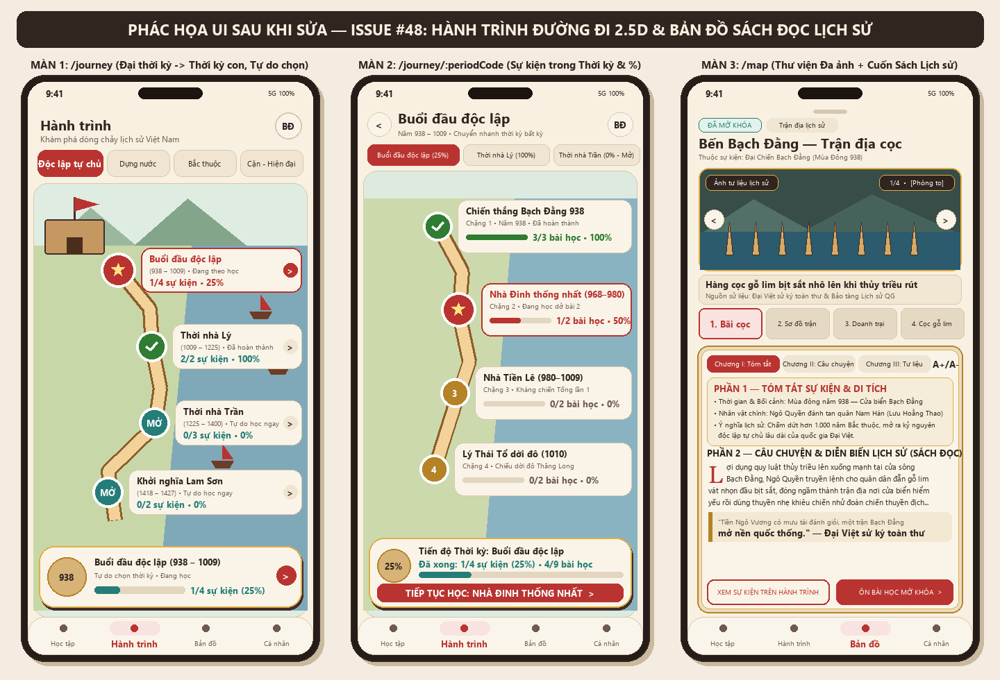
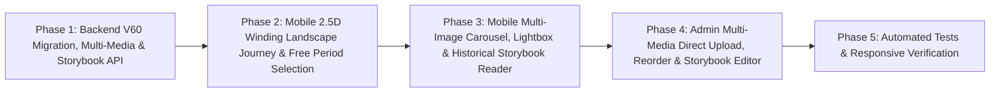

# Plan — Issue #48: Thiết kế lại Hành trình Lịch sử dạng Đường đi Phong cảnh 2.5D (Đại thời kỳ → Thời kỳ con, tự do chọn thời kỳ) & Nâng cấp Bản đồ Di sản thành Thư viện Đa ảnh và Sách Đọc Lịch sử

> **Nguồn chân lý:** [Issue #48](https://github.com/longv0208/Dau_Viet/issues/48) · **Mockup gốc:** `plans/261030-issue-48-journey-map/journey-mockup.png` · **Phác họa UI sau khi sửa:** `plans/261030-issue-48-journey-map/ui-sketch-after-fix.png`  
> **Branch:** `feat/issue-48-journey-map-redesign` · **Task:** `TASK-0038`  
> **Modules:** `dau-viet-mobile`, `dau-viet-backend`, `dau-viet-admin`  
> **Risk:** `high-risk` (có migration Flyway `V60` bổ sung đa ảnh tư liệu & nội dung sách lịch sử cho địa điểm di sản, mở rộng DTO `/api/v1/map/locations`, thiết kế lại giao diện `/journey`, `/journey/:periodCode`, `/map` `LocationProfileSheet` trên Mobile và nâng cấp trình quản lý đa ảnh trên Admin).

---

## 0. Phác họa Giao diện (UI Sketch) sau khi sửa



```text
┌──────────────────────────────────────────┐  ┌──────────────────────────────────────────┐  ┌──────────────────────────────────────────┐
│ 9:41                             5G 100% │  │ 9:41                             5G 100% │  │ 9:41                             5G 100% │
│ Hành trình                          (BĐ) │  │ (<) Buổi đầu độc lập                (BĐ) │  │ [ĐÃ MỞ KHÓA] [Trận địa lịch sử]          │
│ Khám phá dòng chảy lịch sử Việt Nam      │  │     Năm 938–1009 • Chuyển nhanh thời kỳ  │  │ Bến Bạch Đằng — Trận địa cọc             │
│                                          │  │ ┌──────────────┐┌────────────┐┌──────────┐ │  │ Thuộc sự kiện: Đại Chiến Bạch Đằng 938   │
│ ┌─────────────┐┌─────────┐┌─────────┐┌──┐│  │ │ ★ 938–1009   ││ Thời Lý    ││ Thời Trần│ │  │ ┌──────────────────────────────────────┐ │
│ │★Độc lập tự c││Dựng nước││Bắc thuộc││..││  │ │    (25%)     ││  (100%)    ││ (0%-Mở)  │ │  │ │ [Ảnh tư liệu]        [1/4 • Phóng to]│ │
│ └─────────────┘└─────────┘└─────────┘└──┘│  │ └──────────────┘└────────────┘└──────────┘ │  │ │  (<)   [TRANH TRẬN ĐỊA CỌC 938]  (>) │ │
│ ┌──────────────────────────────────────┐ │  │ ┌──────────────────────────────────────┐ │  │ └──────────────────────────────────────┘ │
│ │  [Thành cổ cắm cờ]     /\   /\       │ │  │ │      (✓) ┌─────────────────────────┐ │ │  │ ┌──────────────────────────────────────┐ │
│ │       \               /  \ /  \ ~~~~ │ │  │ │       ║  │ Chiến thắng Bạch Đằng   │ │ │  │ │ Hàng cọc gỗ lim nhô lên khi triều rút│ │
│ │      (★) ┌─────────────────────────┐ │ │  │ │       ║  │ ████████████ 3/3 (100%) │ │ │  │ │ Nguồn: Đại Việt sử ký toàn thư       │ │
│ │       ║  │ Buổi đầu độc lập    (>) │ │ │  │ │       ╚═╗└─────────────────────────┘ │ │  │ └──────────────────────────────────────┘ │
│ │       ║  │ (938–1009) • Đang học   │ │ │  │ │        (★) ┌───────────────────────┐ │ │  │ ┌────────┐ ┌────────┐ ┌────────┐ ┌─────┐ │
│ │       ╚═╗│ 1/4 sự kiện • 25%       │ │ │  │ │         ║  │ Nhà Đinh (968–980)    │ │ │  │ │★1.Bãi c│ │2.Sơ đồ │ │3.Doanh │ │4.Cọc│ │
│ │         ║└─────────────────────────┘ │ │  │ │         ║  │ █████░░░░░ 1/2 (50%) >│ │ │  │ └────────┘ └────────┘ └────────┘ └─────┘ │
│ │        (✓) ┌───────────────────────┐ │ │  │ │        ╔╝  └───────────────────────┘ │ │  │ ╔══════════════════════════════════════╗ │
│ │         ║  │ Thời nhà Lý (1009-1225│ │ │  │ │       (3)  ┌───────────────────────┐ │ │  │ ║ [I.Tóm tắt] [II.Câu chuyện][III.Tư l]║ │
│ │         ║  │ 2/2 sự kiện • 100%  > │ │ │  │ │        ║   │ Nhà Tiền Lê (980–1009)│ │ │  │ ║ ┌──────────────────────────────────┐ ║ │
│ │        ╔╝  └───────────────────────┘ │ │  │ │        ║   │ ░░░░░░░░░░ 0/2 (0%)   │ │ │  │ ║ │ PHẦN 1 — TÓM TẮT SỰ KIỆN & DI TÍCH│ ║ │
│ │      (MỞ)  ┌───────────────────────┐ │ │  │ │       (4)  ┌───────────────────────┐ │ │  │ ║ │ • Thời gian: Mùa đông năm 938    │ ║ │
│ │       ║    │ Thời nhà Trần (Tự do) │ │ │  │ │            │ Lý Thái Tổ dời đô 1010│ │ │  │ ║ │ • Nhân vật: Ngô Quyền vs Nam Hán │ ║ │
│ │       ║    │ 0/3 sự kiện • 0%    > │ │ │  │ │            │ ░░░░░░░░░░ 0/2 (0%)   │ │ │  │ ║ │ • Ý nghĩa: Mở kỷ nguyên độc lập  │ ║ │
│ │     (MỞ)   └───────────────────────┘ │ │  │ │            └───────────────────────┘ │ │  │ ║ └──────────────────────────────────┘ ║ │
│ │  (Không khóa 🔒 — Bấm chọn tự do!)   │ │  │ │ ┌──────────────────────────────────┐ │ │  │ ║ PHẦN 2 — CÂU CHUYỆN & DIỄN BIẾN      ║ │
│ │ ┌──────────────────────────────────┐ │ │  │ │ │ (25%) Tiến độ: Buổi đầu độc lập  │ │ │  │ ║ Lợi dụng quy luật thủy triều lên     ║ │
│ │ │ (Ảnh) Buổi đầu độc lập (938–1009)│ │ │  │ │ │       Đã xong: 1/4 sự kiện (25%) │ │ │  │ ║   xuống mạnh tại cửa sông Bạch Đằng..║ │
│ │ │       ███░░░░░░░ 1/4 sự kiện•25% >│ │ │  │ │ │ [ TIẾP TỤC HỌC: NHÀ ĐINH     > ] │ │ │  │ ║ ┃ "Một trận Bạch Đằng mở nền quốc..."║ │
│ │ └──────────────────────────────────┘ │ │  │ │ └──────────────────────────────────┘ │ │  │ ║ [XEM SỰ KIỆN]   [ÔN BÀI HỌC MỞ KHÓA] ║ │
│ └──────────────────────────────────────┘ │  │ └──────────────────────────────────────┘ │  │ ╚══════════════════════════════════════╝ │
│  Học tập   ● Hành trình   Bản đồ  Cá nhân│  │  Học tập   ● Hành trình   Bản đồ  Cá nhân│  │  Học tập    Hành trình  ● Bản đồ  Cá nhân│
└──────────────────────────────────────────┘  └──────────────────────────────────────────┘  └──────────────────────────────────────────┘
      MÀN 1: /journey (Tầng Đại thời kỳ)           MÀN 2: /journey/:periodCode (Sự kiện)        MÀN 3: /map (Đa ảnh & Sách Lịch sử)
```

---

## 1. Mục tiêu & Đối chiếu Acceptance Criteria

| AC | Yêu cầu từ Issue #48 | Giải pháp kỹ thuật & Điểm chạm |
|---|---|---|
| **AC-1** | **Giao diện Hành trình Đường đi Phong cảnh 2.5D:** Màn hình Hành trình hiển thị thanh chọn Đại thời kỳ (`ERA`), đường đi uốn lượn trên nền tranh phong cảnh lịch sử đẹp mắt, thẻ tổng quan nổi ở đáy màn hình và khi đi vào Thời kỳ con hiển thị đầy đủ `% hoàn thành` cùng `X/Y sự kiện đã hoàn thành`. | 1. Xây dựng `EraFilterTabBar` trên `PeriodSelectionScreen` (`/journey`) với tab đang chọn màu đỏ chu sa `#B93430`, các tab khác nền giấy kem `#F4E9D5`, kèm nút mở nhanh Bản đồ (`/map`) ở góc trên phải.<br>2. Xây dựng `WindingLandscapeJourneyCanvas` + `WindingStonePathPainter` vẽ con đường đá vàng uốn lượn chữ S (`Cubic Bezier`) trên nền tranh phong cảnh non nước Việt Nam 2.5D (thành cổ cắm cờ, vịnh biển thuyền buồm, núi đá vôi, đình chùa, làng mạc), dùng chung cho cả **Tầng 1 (`/journey` — các Thời kỳ con `PERIOD`)** và **Tầng 2 (`/journey/:periodCode` — các Sự kiện `EVENT`)**.<br>3. Xây dựng `BottomFloatingSummaryCard` nổi ở đáy màn hình (ảnh đại diện tròn, tên Thời kỳ + niên đại, thanh tiến độ màu xanh cổ `#247D78`, hiển thị rõ **`X/Y sự kiện`** và **`Z% hoàn thành`**, nút mũi tên `>`). |
| **AC-2** | **Tự do chọn Thời kỳ — Không bắt buộc thứ tự:** Người học có thể bấm chọn và học bất kỳ Đại thời kỳ / Thời kỳ con nào trên Hành trình mà không bị khóa chặn tuần tự giữa các thời kỳ. | 1. Chuẩn hóa `derivePeriodStatus` trong `path_status_badge.dart`: Thời kỳ (`PERIOD`) có nội dung học **không bao giờ trả về `LearnerPathStatus.locked`** hay hiển thị icon khóa `🔒`; khi chưa học (`0%`) hiển thị trạng thái **`AVAILABLE` (*"Sẵn sàng khám phá"*)**.<br>2. Trên cả `PeriodSelectionScreen` và thanh chuyển nhanh thời kỳ của `PeriodJourneyScreen`, người học bấm chọn bất kỳ Đại thời kỳ (`ERA`) hoặc Thời kỳ con (`PERIOD`) nào đều vào xem và học ngay sự kiện mở đầu của thời kỳ đó.<br>3. Khẳng định trên Backend (`LearnerPathProgressionService`) và `MockLearningPathRepository`: tiến độ mở khóa tuần tự chỉ áp dụng giữa các sự kiện bắt buộc bên trong cùng một `PERIOD`, không khóa chéo giữa các `PERIOD`. |
| **AC-3** | **Thư viện Đa ảnh & Tư liệu trên Bản đồ Di sản:** Mỗi địa điểm trên Bản đồ Di sản hiển thị được nhiều hình ảnh và tư liệu lịch sử (carousel + thumbnails + xem toàn màn hình zoom ảnh kèm chú thích) thay vì chỉ 1 ảnh đơn lẻ. | 1. Tạo migration `V60__enrich_heritage_storybook_and_multi_media_gallery.sql` bổ sung `source_citation` cho `map_location_media` và seed **3–4 hình ảnh/tư liệu lịch sử cho mỗi địa điểm di sản**.<br>2. Xây dựng `LocationMediaGalleryCarousel` trên `LocationProfileContent`: khung ảnh `PageView` có bộ đếm `1/N`, huy hiệu loại tư liệu, nút `<` `>`, dải ảnh thu nhỏ (`Thumbnail Strip`) bên dưới, khung chú thích (`caption`) + nguồn sử liệu (`sourceCitation`).<br>3. Xây dựng `LocationFullscreenLightbox` với `InteractiveViewer(minScale: 1.0, maxScale: 4.0)` hỗ trợ **pinch-to-zoom** và lướt xem toàn màn hình.<br>4. Nâng cấp tab **4. Media** trên `dau-viet-admin` (`/map-locations`): thêm nút tải ảnh trực tiếp, xem trước ảnh thu nhỏ, nút sắp xếp thứ tự Lên/Xuống (`↑`/`↓`) và ô nhập nguồn sử liệu (`sourceCitation`). |
| **AC-4** | **Chế độ Cuốn Sách Đọc hiểu Sự kiện:** Hồ sơ địa điểm di sản được trình bày như một cuốn sách lịch sử với phần Tóm tắt sự kiện, Câu chuyện diễn biến dễ đọc hiểu và Thư viện tư liệu trực quan. | 1. Mở rộng `MapLocationDto` & `MapLocationService` trả thêm thông tin sự kiện liên kết (`summary`, `description`, `periodCode`, `periodTitle`), các trường sách lịch sử (`storyNarrative`, `keyFigures`, `historicalSignificance`) và hồ sơ `dossiers` liên quan.<br>2. Xây dựng `HistoricalStorybookReader` trên `LocationProfileSheet` / `LocationProfileScreen` với thiết kế **Cuốn Sách Lịch Sử Mở Ra** (nền giấy dó `#F8F0E0`, viền đôi vàng cổ, chữ cái đầu đoạn phóng lớn *Drop-cap*, cỡ chữ điều chỉnh được `A-/A+`, mục lục 3 chương):<br>  - **Phần 1 — Tóm tắt Sự kiện Lịch sử:** Bối cảnh, thời gian, nhân vật chính, ý nghĩa cốt lõi.<br>  - **Phần 2 — Câu chuyện & Diễn biến:** Trang đọc hiểu mạch lạc xen kẽ hình ảnh minh họa và khung trích dẫn sử liệu.<br>  - **Phần 3 — Tư liệu & Dấu tích Di sản:** Thư viện hiện vật, bản đồ, hồ sơ và nút mở nhanh sang Sự kiện / Bài học tương ứng trong Hành trình. |
| **AC-5** | **Responsive & Tests:** Chạy mượt trên nhiều kích thước màn hình mobile, không lỗi overflow và pass bộ test liên quan. | Bổ sung & cập nhật bộ test tự động cho Backend (`MapLocationServiceTest` / IT), Mobile (`period_selection_screen_test.dart`, `period_journey_screen_test.dart`, `location_profile_storybook_test.dart`) và Admin (`map-locations`); kiểm tra responsive trên khung hình `360×800` và `390×844`. |

---

## 2. Phân tích Hiện trạng & Nguyên nhân Gốc rễ

### 2.1. Hiện trạng Hành trình Lịch sử (`/journey` & `/journey/:periodCode`)
1. **Giao diện dạng danh sách thẻ phẳng thay vì Đường đi Phong cảnh 2.5D:**
   - `PeriodSelectionScreen` (`dau-viet-mobile/lib/features/learning_path/presentation/period_selection_screen.dart`) hiện đang render một danh sách dọc các thẻ `ParchmentCard` (`_PeriodCard`) xếp chồng dưới các banner `ERA`, chưa có thanh tab ngang chọn Đại thời kỳ (`ERA`), chưa có con đường uốn lượn trên nền tranh phong cảnh 2.5D và chưa có **Thẻ Tổng quan Nổi ở Chân màn hình (`BottomFloatingSummaryCard`)** như thiết kế mẫu.
   - `PeriodJourneyScreen` (`period_journey_screen.dart`) cũng đang hiển thị danh sách dọc `_EventTimelineItem` (`HeritageTimelineNode` + `HistoricalEventCard`) thay vì đường đi phong cảnh uốn lượn qua từng mốc sự kiện.
2. **Hiển thị trạng thái `LOCKED` gây hiểu nhầm ở cấp Thời kỳ (`PERIOD`):**
   - Dù trên Backend (`LearnerPathProgressionService.java:374-482`) việc mở khóa tuần tự đã được cô lập **bên trong từng `PERIOD`** (sự kiện đầu tiên của mọi `PERIOD` đều có trạng thái `AVAILABLE` và `touchPeriod` không chặn bất kỳ `PERIOD` nào), nhưng ở phía Mobile:
     - Hàm `derivePeriodStatus` (`path_status_badge.dart:192-231`) vẫn có nhánh cuối trả về `LearnerPathStatus.locked` (hiển thị nhãn *"Đang khóa"* và icon `Icons.lock_rounded`), và thanh chú thích `_StatusLegendStrip` trên `PeriodSelectionScreen` (`:462`) vẫn liệt kê trạng thái `Đang khóa`.
     - Cần loại bỏ hoàn toàn trạng thái khóa ở cấp Thời kỳ (`PERIOD`) để người dùng thấy rõ mọi Đại thời kỳ / Thời kỳ con đều sẵn sàng để tự do lựa chọn khám phá.

### 2.2. Hiện trạng Bản đồ Di sản (`/map` & `LocationProfileSheet` / `LocationProfileScreen`)
1. **Chỉ hiển thị 1 ảnh đơn lẻ và bỏ sót URL ảnh:**
   - Trong database (`V43__seed_heritage_location_assets_and_media.sql:207-224`), mỗi địa điểm trong 12 địa điểm di sản chuẩn chỉ được seed **đúng 1 dòng `IMAGE_2D`** trong bảng `map_location_media`.
   - Endpoint danh sách `GET /api/v1/map/locations` gọi `toDtos(userId, rows, false)` (`MapLocationService.java:83`), trả về `media = []` cho đến khi tải xong `GET /api/v1/map/locations/{id}`.
   - Nghiêm trọng hơn, trong `location_profile_screen.dart:726-739`, widget `_MediaItemCard` chỉ render ảnh khi `media.assetId != null && media.assetId!.trim().isNotEmpty`, **bỏ qua hoàn toàn `media.assetUrl` và `media.externalUrl`** (khiến dữ liệu mock hoặc ảnh gắn qua URL/preset không hiển thị hình).
   - Giao diện tab `Ảnh` hiện chỉ xếp dọc các thẻ `_MediaItemCard`, chưa có **Carousel + Thumbnail Strip + Bộ đếm `1/N` + Chú thích/Nguồn sử liệu + Fullscreen Pinch-to-Zoom Lightbox**.
2. **Nội dung địa điểm sơ sài, chưa có giao diện "Cuốn Sách Lịch Sử":**
   - `map_locations` hiện chỉ có `short_summary` (1 câu ngắn) và `description` (1–2 câu trong `V29`/`V43`), còn `MapLocationDto.LinkedEventDto` (`MapLocationDto.java:120-127`) chỉ trả về `(eventId, title, yearLabel, role, sortOrder)` mà chưa trả về `HistoricalEvent.summary`, `HistoricalEvent.description`, `periodCode` hay `historical_dossiers` liên kết.
   - `LocationProfileContent` đang chia 3 tab nhỏ (`Ảnh / Video / Tư liệu`) đặt trong khung cuộn hẹp, người học không có trải nghiệm đọc hiểu trọn vẹn câu chuyện lịch sử như một cuốn sách mở ra.
3. **Trình quản lý Media Địa điểm trên Web Admin (`map-locations-page.tsx`) còn thiếu tiện ích:**
   - Tab `4. Media` đã cho phép thêm/xóa nhiều mục media nhưng chưa có nút **Tải ảnh trực tiếp từ máy** trên từng mục media, chưa có nút **Sắp xếp thứ tự Lên/Xuống (`↑`/`↓`)**, chưa có ô nhập **Nguồn tư liệu (`sourceCitation`)**, và tab `1. Thông tin` chưa có vùng biên tập chuyên biệt cho **Câu chuyện & Diễn biến Sách Lịch sử**.

---

## 3. Kiến trúc & Lộ trình Triển khai 5 Phase



---

### Phase 1: Nâng cấp Database (`V60`) & Mở rộng API Bản đồ Di sản + Lộ trình Học (`dau-viet-backend`)

#### 1.1. Migration `dau-viet-backend/src/main/resources/db/migration/V60__enrich_heritage_storybook_and_multi_media_gallery.sql`
1. **Bổ sung cột phục vụ Sách Đọc Lịch sử & Nguồn Tư liệu (an toàn, nullable, tương thích ngược):**
   - Bảng `map_locations`:
     - `key_figures VARCHAR(500)` — Nhân vật lịch sử tiêu biểu gắn với di tích (ví dụ: *"Ngô Quyền, Dương Tam Kha, Nguyễn Tất Tố; đối phương: Lưu Hoằng Thao"*).
     - `story_narrative TEXT` — Nội dung câu chuyện & diễn biến lịch sử chi tiết trình bày theo chương mục sách.
     - `historical_significance TEXT` — Ý nghĩa lịch sử & giá trị di sản truyền đời.
   - Bảng `map_location_media`:
     - `source_citation VARCHAR(500)` — Nguồn tư liệu / trích dẫn sử liệu cho từng bức ảnh, bản đồ hoặc tư liệu.
2. **Đăng ký bổ sung các Asset Hình ảnh Tư liệu & Bản đồ Lịch sử trong `assets`:**
   - Đăng ký đầy đủ các file ảnh sẵn có trong `classpath:seed-assets/heritage/*` và `classpath:seed-assets/maps/*` (như `bg_story_tran_dia.jpg`, `bg_story_thu_phong.jpg`, `bg_story_doanh_trai.jpg`, `dv_EVT_ngoquyen_bachdang_hero_v01.jpg`, `lesson_scene_hung_kings_life.jpg`, `dv_MAP_ngoquyen_bachdang-base_v01.jpg`, `map_van_lang.jpg`, `map_hai_ba_trung.jpg`, `map_nhu_nguyet.jpg`, `map_dien_bien_phu.jpg`).
3. **Seed Bộ sưu tập Đa ảnh (3–4 ảnh & tư liệu/địa điểm) và Nội dung Sách Lịch sử cho 12 Địa điểm Di sản chuẩn:**
   - Mỗi địa điểm di sản có **tối thiểu 3–4 mục `map_location_media`** (gồm ảnh toàn cảnh di tích, bản đồ/sơ đồ chiến thuật sự kiện, tranh tái hiện bối cảnh/doanh trại/nhân vật, và ảnh hiện vật/chứng tích khảo cổ) kèm `title`, `caption` sâu sắc và `source_citation` chuẩn sử liệu.
   - Cập nhật `key_figures`, `story_narrative` (chia thành các đoạn rõ ràng: *Bối cảnh lịch sử*, *Diễn biến tại di tích*, *Dấu tích & Di sản*) và `historical_significance` cho cả 12 địa điểm.

#### 1.2. Mở rộng Entity, DTO và Service (`com.dauviet.map.*`)
1. **Entity `MapLocation.java` & `MapLocationMedia.java`:**
   - Ánh xạ các cột mới `keyFigures`, `storyNarrative`, `historicalSignificance` trên `MapLocation` và `sourceCitation` trên `MapLocationMedia`.
2. **DTO `MapLocationDto.java` & `MapLocationService.java`:**
   - Bổ sung vào `MapLocationDto`:
     - `keyFigures` (`String`), `storyNarrative` (`String`), `historicalSignificance` (`String`).
   - Bổ sung vào `MapLocationDto.LinkedEventDto`:
     - `slug` (`String`), `summary` (`String`), `description` (`String`), `periodCode` (`String`), `periodTitle` (`String`) — truy vấn batch từ `HistoricalEventRepository` và `LearningPathEventNodeRepository` / `LearningPathChapterRepository` (không gây N+1 query).
   - Bổ sung vào `MapLocationDto.LocationMediaDto`:
     - `sourceCitation` (`String`).
   - Cập nhật `MapLocationService.list(...)`:
     - Cho phép nạp sẵn danh sách `media` đã lọc theo quyền hiển thị (`includeMedia = true` thông qua batch query `mediaRepo.findByLocationIdInOrderBySortOrderAsc(locationIds)`) để danh sách địa điểm trên `/map` có sẵn toàn bộ bộ sưu tập ảnh ngay khi người học chạm mở `LocationProfileSheet`.
3. **Admin DTO & Service (`AdminStandaloneMapLocationDtos.java`, `AdminMapLocationService.java`):**
   - Bổ sung `keyFigures`, `storyNarrative`, `historicalSignificance` vào `StandaloneLocationRequest` / `StandaloneLocationResponse`.
   - Bổ sung `sourceCitation` vào `MediaInput` / `MediaView` và lưu trong `AdminMapLocationService.replaceMedia(...)`.

---

### Phase 2: Thiết kế lại Hành trình Lịch sử (`/journey` & `/journey/:periodCode`) dạng Đường đi Phong cảnh 2.5D & Tự do Chọn Thời kỳ (`dau-viet-mobile`)

#### 2.1. Gỡ bỏ Trạng thái Khóa Cứng ở Cấp Thời kỳ (`PERIOD`) (AC-2)
- **File:** `dau-viet-mobile/lib/features/learning_path/presentation/path_status_badge.dart`, `dau-viet-mobile/lib/features/learning_path/data/mock_learning_path_repository.dart`
- Cập nhật `derivePeriodStatus({required List<LearningPathEventNodeDto> events, PeriodProgressDto? progress})`:
  - Nếu `events.isEmpty` hoặc mọi sự kiện đều `notReady` → trả về `LearnerPathStatus.notReady`.
  - Nếu đã hoàn thành toàn bộ sự kiện bắt buộc → trả về `LearnerPathStatus.mastered` hoặc `LearnerPathStatus.completed`.
  - Nếu đã bắt đầu học (`progress.hasStarted` hoặc có sự kiện/bài học `inProgress` / `completed`) → trả về `LearnerPathStatus.inProgress`.
  - **Mọi trường hợp còn lại (thời kỳ có bài học nhưng người học chưa bắt đầu — `0%`) → luôn trả về `LearnerPathStatus.available` (*"Sẵn sàng khám phá"*), tuyệt đối không trả về `LearnerPathStatus.locked`.**
- Cập nhật `MockLearningPathRepository`: đảm bảo tất cả các `PERIOD` có bài học đều có sự kiện mở đầu ở trạng thái `available` / `completed` / `mastered`.

#### 2.2. Xây dựng Canvas Đường đi Phong cảnh 2.5D (`WindingLandscapeJourneyCanvas`) (AC-1, AC-2)
- **File mới:** `dau-viet-mobile/lib/features/learning_path/presentation/widgets/winding_landscape_journey_canvas.dart`
- **Thành phần hiển thị:**
  1. **Nền Tranh Phong cảnh Lịch sử Việt Nam (`_LandscapeArtBackdrop`)**:
     - Sử dụng tranh phong cảnh sơn thủy Việt Nam (`assets/images/vietnam_journey_map_bg.jpg` và `assets/images/landscape_hero_bg.jpg`) kết hợp các lớp vẽ phong cảnh 2.5D sắc nét:
       - Phía trên: Thành cổ uy nghiêm cắm cờ đỏ sao vàng / cờ đại nghĩa Đại Việt giữa núi non trùng điệp.
       - Phía phải: Vịnh biển xanh ngọc bích với đoàn thuyền buồm cổ và đảo đá vôi Hạ Long.
       - Phía trái: Mái đình cổ kính, cổng làng, rặng tre xanh và đồi thông dọc theo bờ biển.
  2. **Con đường Đá Vàng Uốn lượn 2.5D (`WindingStonePathPainter`)**:
     - Vẽ đường đi uốn lượn chữ S mềm mại (`Cubic Bezier`) đi qua tọa độ tâm của các nút mốc.
     - Có lớp bóng đổ nền đất (`#402C29`), viền đá hai bên (`#8C5E2A`), mặt đường cát vàng ấm (`#F3D299` → `#DFB06B`) và vạch nối sáng rõ cho những đoạn đã đi qua.
  3. **Nút Mốc Tròn & Thẻ Nhãn Nổi (`JourneyPathMilestoneNode`)**:
     - Mỗi mốc gồm **Vòng tròn huy hiệu (`52×52`)** nằm ngay trên đường đi và **Thẻ thông tin nổi (`Callout Pill Card`)** đặt bên phải/trái tùy khúc cua:
       - **Trạng thái Đang chọn / Đang học (`isSelected` hoặc `inProgress`)**:
         - Vòng tròn đỏ chu sa `#B93430` viền trắng ngà `3.5px` + icon thành trì/ngôi sao vàng.
         - Thẻ nổi nền kem sáng `#FAF4E8` bo góc `18px`, tiêu đề chữ đỏ chu sa đậm (`Chiến thắng Bạch Đằng 938` / `Buổi đầu độc lập`), phụ đề **`X/Y sự kiện • Z%`** và nút tròn nhỏ có dấu `>`.
       - **Trạng thái Đã hoàn thành (`completed` / `mastered`)**:
         - Vòng tròn xanh lá di sản `#2E7D32` viền trắng `3px` + icon `✓` trắng.
         - Thẻ nổi hiển thị tên mốc, niên đại `(968 – 980)` và dòng tiến độ `Đã hoàn thành • 100%`.
       - **Trạng thái Sẵn sàng khám phá (`available` — thay cho icon khóa `🔒`)**:
         - Vòng tròn vàng ngự / đồng cổ `#C88A32` (hoặc xanh cổ `#247D78`) viền trắng `3px` + icon la bàn khám phá (`Icons.explore_rounded`).
         - Thẻ nổi hiển thị tên mốc, niên đại `(980 – 1009)` và dòng phụ `Sẵn sàng • 0/Y sự kiện (0%)` kèm dấu `>` để người học bấm vào bất kỳ lúc nào.

#### 2.3. Thiết kế lại Tầng 1 (`/journey` — `PeriodSelectionScreen`) & Tầng 2 (`/journey/:periodCode` — `PeriodJourneyScreen`) (AC-1, AC-2)
- **File:**
  - `dau-viet-mobile/lib/features/learning_path/presentation/period_selection_screen.dart`
  - `dau-viet-mobile/lib/features/learning_path/presentation/period_journey_screen.dart`
  - `dau-viet-mobile/lib/features/learning_path/presentation/widgets/bottom_floating_summary_card.dart` (mới)
- **Trên `PeriodSelectionScreen` (`/journey`)**:
  1. **Header**: Tiêu đề `"Hành trình"` (font `Noto Serif` `26px` đậm), phụ đề `"Khám phá dòng chảy lịch sử Việt Nam"`, góc phải là nút tròn mở nhanh Bản đồ (`/map` với icon `Icons.map_outlined`).
  2. **Thanh chọn Đại thời kỳ (`EraFilterTabBar`)**:
     - Hiển thị hàng ngang các tab Đại thời kỳ (`ERA` từ `path.eraGroups`, kèm chế độ xem toàn tuyến hoặc lọc/cuộn nhanh tới Đại thời kỳ đang chọn).
     - Tab đang chọn có nền đỏ chu sa `#B93430` chữ trắng đậm; các tab còn lại nền giấy kem `#F4E9D5` chữ nâu mực `#30251F` — người học **tự do bấm chuyển qua bất kỳ Đại thời kỳ nào**.
  3. **Bản đồ Đường đi Phong cảnh (`WindingLandscapeJourneyCanvas`)**:
     - Hiển thị các **Thời kỳ con (`PERIOD`)** (và các mốc sự kiện tiêu biểu thuộc thời kỳ đó) dọc theo đường đi uốn lượn.
     - Chạm vào nút tròn Thời kỳ → cập nhật Thời kỳ đang chọn trên `BottomFloatingSummaryCard`; chạm vào thẻ tên Thời kỳ hoặc nút `>` trên `BottomFloatingSummaryCard` → gọi `touchPeriod(period.code)` và chuyển sang `/journey/${period.code}`.
  4. **Thẻ Tổng quan Nổi ở Chân màn hình (`BottomFloatingSummaryCard`)**:
     - Nền giấy kem sáng `#FAF3E6` bo góc `22px`, đổ bóng nổi phía trên Bottom Navigation Bar:
     - Bên trái: Ảnh đại diện tròn (`56×56`) của Thời kỳ đang chọn.
     - Ở giữa: Tên Thời kỳ đậm + Niên đại `(938 – 1009)`, thanh tiến độ màu xanh cổ `#247D78` và chỉ số **`X/Y sự kiện • Z%`**.
     - Bên phải: Nút tròn `>` đi vào `/journey/:periodCode`.
- **Trên `PeriodJourneyScreen` (`/journey/:periodCode`)**:
  1. **Header & Thanh chuyển nhanh Thời kỳ con**:
     - Nút `<` quay về `/journey`, tiêu đề Thời kỳ con + Niên đại, thanh chip ngang cho phép **chuyển trực tiếp sang bất kỳ Thời kỳ con nào khác** mà không bị khóa, và nút mở Bản đồ `/map?period=:periodCode`.
  2. **Đường đi Phong cảnh của các Sự kiện (`WindingLandscapeJourneyCanvas`)**:
     - Hiển thị các **Sự kiện lịch sử (`EVENT`)** của thời kỳ đó dọc theo đường đi phong cảnh 2.5D.
     - Mỗi mốc Sự kiện hiển thị tên sự kiện, niên đại, trạng thái, tiến độ bài học (`A/B bài học • C%`) và nút `>` để mở chi tiết sự kiện (`/campaign/:eventId`) hoặc chọn bài học trực tiếp.
  3. **Thẻ Tổng quan Nổi ở Chân màn hình (`BottomFloatingSummaryCard`)**:
     - Hiển thị tổng tiến độ của Thời kỳ con hiện tại: Ảnh đại diện tròn, tên Thời kỳ + niên đại, thanh tiến độ xanh cổ, **`X/Y sự kiện đã hoàn thành`** + **`Z% hoàn thành`**, cùng nút CTA **`Tiếp tục học`** / **`Bắt đầu học`** dẫn thẳng vào bài học tiếp theo của thời kỳ đó.

---

### Phase 3: Nâng cấp Bản đồ Di sản (`/map` & `LocationProfileSheet` / `LocationProfileScreen`) thành Thư viện Đa ảnh & Sách Đọc Lịch sử (`dau-viet-mobile`)

#### 3.1. Cập nhật `MapLocationDto`, `MapLocationMediaDto` & `MockMapRepository` (`dau-viet-mobile/lib/features/map/data/`)
- Mở rộng `MapLocationMediaDto`:
  - Thêm trường `sourceCitation` (`String?`).
  - Thêm helper `resolvedImageSource` trả về nguồn ảnh ưu tiên (`assetId` → `assetUrl` → `externalUrl`) để mọi loại ảnh từ DB, Asset Service hoặc seed `/heritage/*.jpg` đều hiển thị đầy đủ.
- Mở rộng `MapLocationLinkedEventDto`:
  - Thêm `slug` (`String?`), `summary` (`String?`), `description` (`String?`), `periodCode` (`String?`), `periodTitle` (`String?`).
- Mở rộng `MapLocationDto`:
  - Thêm `keyFigures` (`String?`), `storyNarrative` (`String?`), `historicalSignificance` (`String?`).
  - Thêm getter `galleryImages` trả về danh sách ảnh tổng hợp (gộp `imageMedia` + ảnh bìa `coverAssetId` nếu chưa có trong `imageMedia`, đảm bảo luôn có danh sách ảnh cho Carousel).
- Cập nhật `MockMapRepository`: bổ sung 3–4 mục `MapLocationMediaDto` (kèm `caption` và `sourceCitation`) cùng nội dung `keyFigures`, `storyNarrative`, `historicalSignificance` cho từng địa điểm mẫu.

#### 3.2. Xây dựng Thư viện Đa ảnh & Fullscreen Lightbox (`LocationMediaGalleryCarousel` & `LocationFullscreenLightbox`) (AC-3)
- **File mới:** `dau-viet-mobile/lib/features/map/presentation/widgets/location_media_gallery_carousel.dart`
- **Cấu trúc `LocationMediaGalleryCarousel`:**
  1. **Khung ảnh chính (`PageView.builder`, cao `210px`)**:
     - Hiển thị hình ảnh tư liệu bo góc `14px` viền vàng cổ `#D5B886`.
     - Hỗ trợ tải ảnh từ cả `assetId` (`LearningAssetImage`), `externalUrl` (`/heritage/*.jpg` ánh xạ sang `assets/images/heritage/*.jpg` hoặc URL mạng), và `assetUrl`.
     - Badge góc trên trái: Loại tư liệu (`Ảnh lịch sử`, `Toàn cảnh 360°`, `Mở khóa từ bài học`).
     - Badge góc trên phải: **Bộ đếm ảnh `1/N`** (ví dụ `1/4`) + nút phóng to toàn màn hình `⛶`.
     - Hai nút mũi tên tròn `<` `>` chuyển ảnh trái/phải.
  2. **Hộp Chú thích & Nguồn sử liệu (`Caption & Source Box`)**:
     - Hiển thị ngay dưới khung ảnh chính: Tiêu đề bức ảnh đậm, lời chú thích chi tiết (`caption`) và dòng trích dẫn nguồn (`📚 Nguồn: ...`).
  3. **Dải Ảnh Thu Nhỏ (`Thumbnail Strip`, cao `56px`)**:
     - Hàng ngang các thumbnail (`68×48px`); ảnh đang chọn có viền đỏ chu sa `#B93430` dày `2.5px` và độ sáng 100%, các ảnh khác mờ nhẹ `0.65`; chạm vào thumbnail nhảy ngay tới ảnh tương ứng.
  4. **Chế độ Xem Toàn Màn Hình (`LocationFullscreenLightbox`)**:
     - Mở bằng `showDialog` toàn màn hình khi chạm vào ảnh chính hoặc nút `⛶`.
     - Dùng `PageView.builder` + `InteractiveViewer(minScale: 1.0, maxScale: 4.0)` cho phép **pinch-to-zoom** phóng to xem chi tiết từng nét vẽ/bản đồ cổ và vuốt chuyển giữa các bức ảnh, kèm thanh chú thích & nguồn sử liệu ở đáy màn hình.

#### 3.3. Xây dựng Giao diện "Cuốn Sách Lịch Sử" (`HistoricalStorybookReader`) (AC-4)
- **File mới:** `dau-viet-mobile/lib/features/map/presentation/widgets/historical_storybook_reader.dart`
- **Tích hợp vào:** `dau-viet-mobile/lib/features/map/presentation/location_profile_screen.dart` (`LocationProfileContent`)
- **Thiết kế tổng thể:**
  - Khu vực nội dung dưới `LocationMediaGalleryCarousel` được tạo hình như **một cuốn sách lịch sử mở ra** trên nền giấy dó cổ (`#F8F0E0`), viền đôi vàng kim (`#D5B886`), hiệu ứng gáy sách cổ điển, nút tăng/giảm cỡ chữ (`A-` / `A+`) và **Thanh Mục lục 3 Chương Sách** (`I. Tóm tắt` · `II. Câu chuyện` · `III. Tư liệu & Bài học`) hỗ trợ cả đọc liền mạch lẫn lật chuyển chương:
  - **Phần 1 — Tóm tắt Sự kiện Lịch sử (`_StorybookSummaryChapter`)**:
    - Khung tóm tắt đóng triện đỏ **DẤU VIỆT — HỒ SƠ DI TÍCH**:
      - **Sự kiện gắn liền & Thời gian:** Tên sự kiện chính + Niên đại (`Năm 938 • Buổi đầu độc lập`).
      - **Nhân vật lịch sử trung tâm:** Hiển thị `location.keyFigures` (hoặc suy ra từ sự kiện).
      - **Tóm tắt bối cảnh:** Hiển thị `location.shortSummary` và tóm tắt sự kiện (`primaryEvent.summary`).
      - **Ý nghĩa cốt lõi:** Khung điểm nhấn vàng ngự (`location.historicalSignificance`).
  - **Phần 2 — Câu chuyện & Diễn biến Lịch sử (`_StorybookNarrativeChapter`)**:
    - Trình bày câu chuyện lịch sử (`location.storyNarrative` hoặc tổng hợp từ `description` + `primaryEvent.description`) theo bố cục trang sách:
      - Chữ cái đầu tiên phóng lớn (**Drop-cap** font `Noto Serif` `34px` màu đỏ chu sa `#B93430`).
      - Đoạn văn chia tiết rõ ràng (`Noto Serif` / `Be Vietnam Pro`, `height: 1.68`), dễ đọc hiểu trên màn hình điện thoại.
      - Xen giữa các đoạn văn là **Hình minh họa trong trang sách** (lấy từ ảnh thứ 2 trong bộ sưu tập kèm chú thích nghiêng, chạm để zoom) và **Khung Trích dẫn Sử liệu (`Historical Quote Callout`)** có thanh dọc vàng ngự `#E0AE45`.
  - **Phần 3 — Tư liệu & Dấu tích Di sản (`_StorybookArtifactsAndLinksChapter`)**:
    - Hiển thị danh sách đầy đủ các tư liệu hình ảnh, bản đồ, phim tư liệu/audio (`videoMedia`) của di tích.
    - Hiển thị danh sách **Sự kiện lịch sử liên quan (`location.events`)** và **Bài học mở khóa (`location.unlockLessons`)** dưới dạng các thẻ tương tác có nút mở nhanh sang **Sự kiện (`/campaign/:eventId`)**, **Thời kỳ trên Hành trình (`/journey/:periodCode`)** hoặc **Vào Bài học (`/learning/lesson/:lessonId`)**.

---

### Phase 4: Nâng cấp Quản lý Đa ảnh, Sắp xếp & Nội dung Sách Lịch sử trên Web Admin (`dau-viet-admin`)

#### 4.1. Mở rộng DTO TypeScript (`dau-viet-admin/src/lib/dto/map-location.ts`)
- Bổ sung `keyFigures?: string | null`, `storyNarrative?: string | null`, `historicalSignificance?: string | null` vào `StandaloneMapLocation` và `StandaloneMapLocationInput`.
- Bổ sung `sourceCitation?: string | null` vào `MapLocationMediaItem`.

#### 4.2. Nâng cấp Workspace Địa điểm Di tích (`dau-viet-admin/src/features/map-locations/map-locations-page.tsx`) (AC-3, AC-4)
1. **Tab `1. Thông tin & Nội dung Sách Lịch sử`:**
   - Bổ sung nhóm trường **"Nội dung Cuốn Sách Lịch Sử (Hiển thị trên Bản đồ Di sản Mobile)"**:
     - `keyFigures`: Nhân vật lịch sử tiêu biểu.
     - `storyNarrative`: Câu chuyện & Diễn biến lịch sử chi tiết (Textarea `rows={6}`).
     - `historicalSignificance`: Ý nghĩa lịch sử & Giá trị di sản (Textarea `rows={3}`).
2. **Tab `4. Media (Thư viện Đa ảnh & Tư liệu)`:**
   - Trên mỗi thẻ `mediaItem`:
     - Hiển thị **Ảnh xem trước (`Thumbnail Preview`)** ngay bên trái thẻ.
     - Thêm cụm nút **Sắp xếp thứ tự**: **Lên (`↑`)**, **Xuống (`↓`)**, **Đặt làm ảnh đầu (`★`)** để điều chỉnh vị trí ảnh trong Carousel.
     - Thêm nút **"Tải ảnh từ máy"** (`<input type="file" accept="image/*">`, tự động upload lên Asset Service và gán `assetId` + `externalUrl`) bên cạnh nút *"Chọn từ kho Asset"* và ô *"URL"*.
     - Thêm ô nhập **"Nguồn sử liệu / Trích dẫn (`sourceCitation`)"** bên dưới ô `caption`.

---

### Phase 5: Kiểm thử Tự động & Xác minh Responsive (AC-5)

| Tầng | File Test | Nội dung kiểm증 |
|---|---|---|
| **Backend** | `MapLocationServiceTest.java` / `MapLocationControllerIT.java` | Xác minh migration `V60`, endpoint `/api/v1/map/locations` và `/api/v1/map/locations/{id}` trả về danh sách `media` đa ảnh kèm `sourceCitation`, `storyNarrative`, `keyFigures`, `historicalSignificance` và `events[].summary`. |
| **Mobile — Journey** | `test/learning_path/period_selection_screen_test.dart`, `test/learning_path/period_journey_screen_test.dart` | Xác minh `EraFilterTabBar`, `WindingLandscapeJourneyCanvas`, `BottomFloatingSummaryCard` hiển thị đúng `X/Y sự kiện` và `% hoàn thành`; xác minh **không có Thời kỳ (`PERIOD`) nào bị khóa (`LOCKED`)** và bấm chọn bất kỳ Thời kỳ nào cũng điều hướng thành công. |
| **Mobile — Map & Storybook** | `test/map/location_profile_storybook_test.dart`, `test/map/historical_map_test.dart` | Xác minh `LocationMediaGalleryCarousel` hiển thị bộ đếm `1/N`, dải thumbnails, chú thích + nguồn sử liệu, mở `LocationFullscreenLightbox` zoom ảnh; xác minh `HistoricalStorybookReader` hiển thị đủ 3 chương (*Tóm tắt Sự kiện*, *Câu chuyện & Diễn biến*, *Tư liệu & Dấu tích*) và điều hướng sang Sự kiện/Bài học; kiểm tra không lỗi overflow trên màn hình `360×800` và `390×844`. |
| **Admin** | `npx tsc --noEmit` & `npx vitest run` | Kiểm tra type-check và unit tests của `dau-viet-admin` sau khi bổ sung quản lý đa ảnh (upload trực tiếp, sắp xếp thứ tự, nguồn sử liệu) và nội dung sách lịch sử. |

---

## 4. Rủi ro & Biện pháp Kiểm soát

| Rủi ro | Mức độ | Biện pháp kiểm soát |
|---|---|---|
| Dữ liệu địa điểm cũ hoặc mới tạo trên Admin chưa điền `storyNarrative` / `keyFigures` | Trung bình | Thiết kế cơ chế fallback thông minh trong `HistoricalStorybookReader`: nếu `storyNarrative` trống thì kết hợp `location.description` + `primaryEvent.description`; nếu `keyFigures` trống thì ẩn dòng nhân vật hoặc rút trích từ sự kiện, đảm bảo trang sách luôn đầy đặn, không bao giờ hiện khung trống. |
| Địa điểm trên DB hoặc Mock chỉ có `coverAssetId` hoặc chỉ có `externalUrl` mà thiếu `assetId` | Cao | Sửa triệt để bộ nạp ảnh trong `LocationMediaGalleryCarousel`: hỗ trợ đồng thời `assetId` (`LearningAssetImage`), `externalUrl` (`/heritage/*.jpg` map sang asset bundle hoặc network URL) và tự động gộp `coverAssetId` vào đầu danh sách nếu `imageMedia` trống. |
| Các widget test hiện hữu của `/journey` và `/map` tìm kiếm theo `Key` cũ (`period-card-*`, `era-header-*`, `location-profile-tab-*`) | Trung bình | Giữ nguyên các `ValueKey` / `Key` hợp đồng (`Key('era-tab-${era.code}')`, `Key('period-card-${period.code}')`, `Key('location-profile-sheet')`, v.v.) trên các nút mốc và phần tử tương ứng, đồng thời cập nhật bộ test đồng bộ với giao diện mới. |
| Bố cục Đường đi Phong cảnh 2.5D và Sách Đọc Lịch sử bị tràn (overflow) trên màn hình nhỏ (`360×800`) | Trung bình | Dùng `CustomScrollView` / `SingleChildScrollView` cho đường đi uốn lượn với khoảng đệm đáy `140px` (tránh bị `BottomFloatingSummaryCard` che khuất), và dùng `Flexible`/`Expanded` + `maxLines` hợp lý trên thẻ gọi tên mốc và `BottomFloatingSummaryCard`. |
