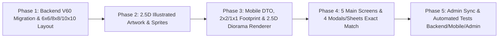

# Plan — Issue #50: Đại tu toàn diện Đảo Di Sản giống hệt thiết kế mẫu 9 màn hình (`Đảo Nhỏ` · `Đảo Vừa` · `Đảo Lớn`, Bản đồ toàn cảnh 3 đảo, Đặt vật phẩm `2×2`/`1×1` & Mở rộng diện tích đảo hợp lý)

> **Nguồn chân lý:** [Issue #50](https://github.com/longv0208/Dau_Viet/issues/50) · **Mockup:** `plans/261030-issue-50-heritage-island-overhaul/island-mockup.png`  
> **Branch:** `feat/issue-50-heritage-island-overhaul` · **Task:** `TASK-0040`  
> **Modules:** `dau-viet-backend`, `dau-viet-mobile`, `dau-viet-admin`  
> **Risk:** `high-risk` (có migration Flyway `V60` mở rộng diện tích lưới ô `6×6 / 8×8 / 10×10`, chuẩn hóa `Đảo Nhỏ / Đảo Vừa / Đảo Lớn`, bổ sung danh mục công trình/vật phẩm `2×2` & `1×1`, đại tu toàn bộ 9 màn hình Mobile + đồng bộ Admin).

---

## 1. Mục tiêu & Đối chiếu Acceptance Criteria

| AC | Yêu cầu từ Issue #50 | Giải pháp kỹ thuật & Điểm chạm |
|---|---|---|
| **AC-1** | **Đồ họa 2.5D & Bố cục Đảo Chính giống hệt ảnh mẫu:** Hiển thị thanh tab 3 cấp (`Đảo Nhỏ`, `Đảo Vừa`, `Đảo Lớn`), khung thoại Rùa đội nón lá ở phía trên đảo, khối đảo 2.5D sắc nét có cổ thụ/thác nước/cầu tàu thuyền gỗ, nút `Bản đồ` và khay `Kho vật phẩm` rút gọn ở đáy giống hệt thiết kế mẫu. | 1. Tinh gọn Top Bar (`<`, `ĐẢO DI SẢN`, `⭐ 250`, `?`) và Segmented Pill Tab 3 cấp (`Đảo Nhỏ` · `Đảo Vừa` · `Đảo Lớn` với nền xanh cổ `#1A5642`). 2. **Loại bỏ thẻ `IslandSummaryCard`** dưới thanh tab để giải phóng toàn bộ không gian cho bầu trời, mây và khối đảo. 3. Đặt **Khung thoại Rùa đội nón lá** ngay phía trên bên trái (dưới thanh tab), nút nổi **`Bản đồ`** ở góc dưới phải cạnh đảo và **Khay `🧰 Kho vật phẩm` rút gọn** (4 thẻ ngang có badge `xN` + nút mở rộng `⌄`) ở đáy màn hình. 4. Nâng cấp khối đảo 2.5D Illustrated Diorama: mặt phẳng cỏ vàng xanh liền mạch kẻ lưới isometric sắc nét, cây đa cổ thụ & dừa/tre ở đỉnh đảo, vách đá rêu phong, thác nước tung bọt trắng và cầu tàu gỗ kèm thuyền gỗ truyền thống neo đậu. |
| **AC-2** | **Diện tích Đảo & Lưới Ô To Hơn, Vừa Mắt & Hợp Lý:** Khối đảo được phóng to cân đối trên màn hình di động; diện tích lưới ô mặt đảo được mở rộng lớn hơn ảnh mẫu (`6×6` cho Đảo Nhỏ, `8×8` cho Đảo Vừa, `10×10` cho Đảo Lớn) và hỗ trợ đặt chuẩn xác cả công trình `2×2` lẫn vật phẩm `1×1`. | 1. Quy hoạch board đồng tâm `10×10` trong `V60`:   - **`Đảo Nhỏ` (Cấp 1):** Lưới `6×6` (`36 ô`) — rộng rãi hơn lưới `4×4` của ảnh mẫu để đặt thoải mái cả công trình `2×2` lẫn vật phẩm `1×1`.   - **`Đảo Vừa` (Cấp 2):** Lưới `8×8` (`64 ô`) — mở rộng địa hình, thác nước đôi và 2 cầu tàu thuyền gỗ.   - **`Đảo Lớn` (Cấp 3):** Lưới `10×10` (`100 ô`) — đại đảo quần thể di sản. 2. Phóng to tỷ lệ hiển thị đảo (`widthFill = 0.94`) chiếm trọn chiều ngang khung nhìn di động. 3. Hỗ trợ footprint thực tế `2×2` (*Nhà rông, Đình làng, Chùa cổ, Tháp Chăm, Cây đa cổ thụ*) và `1×1` (*Cột cờ, Bức tượng, Tre trúc, Giếng cổ, Đèn lồng*). |
| **AC-3** | **Luồng Đặt Vật Phẩm Trực Tiếp & Cụm Nút `Lưu / Thu hồi / Xoay`:** Chạm chọn vật phẩm hiển thị preview trên lưới với đế xanh lá + 3 nút tròn `✕ / ↻ / ✓` dưới chân vật phẩm + thẻ thông tin `Đặt` (`2x2`) ở đáy; khi quản lý đảo có cụm 3 nút nổi `Lưu`, `Thu hồi`, `Xoay` bên phải hoạt động mượt mà. | 1. **Màn 2 (Placement Preview):** Khi chọn vật phẩm để đặt, hiển thị trực tiếp vật phẩm trên lưới với vùng đế tô sáng màu **xanh lá** (`2×2` hoặc `1×1`) + cụm 3 nút tròn nổi **`✕` (Đỏ) / `↻` (Kem) / `✓` (Xanh lá)** ngay dưới chân vật phẩm + **Thẻ Đặt Vật Phẩm** ở đáy màn hình (hình lớn, tên, mô tả, nhãn `⊞ 2x2`, nút CTA **`Đặt`**). 2. **Màn 3 & 5 (Quản lý / Sau bài trí):** Cụm 3 nút công cụ nổi dọc bên phải: **`Lưu`**, **`Thu hồi`** (cất vật phẩm đang chọn về Kho vật phẩm), **`Xoay`** (xoay hướng vật phẩm/góc nhìn). |
| **AC-4** | **Bản đồ Toàn cảnh 3 Cấp Đảo:** Nhấn nút `Bản đồ` mở màn hình toàn cảnh 3 đảo xếp dọc trên biển mây (`✅ Đảo Nhỏ — Đang sử dụng`, `🔒 Đảo Vừa — Hoàn thành 15 bài học để mở khóa`, `🔒 Đảo Lớn — Hoàn thành 30 bài học để mở khóa`). | Xây dựng **Màn 4 (`IslandPanoramicMapOverlay`)**: hiển thị 3 hòn đảo 2.5D xếp dọc từ trên xuống dưới giữa tầng mây biển kèm thẻ nổi bên phải cho từng đảo; chạm đảo đã mở để chuyển sang đảo đó, chạm đảo đang khóa để mở modal **`NÂNG CẤP ĐẢO`**. |
| **AC-5** | **Đầy đủ 4 Modal / Sheet theo mẫu:** Hoàn thiện đúng thiết kế cho 4 popup/sheet: `KHO VẬT PHẨM` (4 tab lọc), `CHI TIẾT VẬT PHẨM` (`Kích thước: 2x2`, `⭐ 50`, nút `Đặt lên đảo`), `NÂNG CẤP ĐẢO` (sơ đồ chuyển đảo + 3 điều kiện tiến độ `X/Y`) và hộp thoại `Chuyển đến Đảo Vừa?` (`Để sau` / `Chuyển ngay`). | 1. **Modal 1 (`KHO VẬT PHẨM`):** 4 tab pill (`Tất cả`, `Công trình`, `Cây cối`, `Trang trí`) + lưới 4 cột (*Nhà rông, Đình làng, Chùa cổ, Tháp Chăm, Cây đa, Tre trúc, Cột cờ, Bức tượng...*). 2. **Modal 2 (`CHI TIẾT VẬT PHẨM`):** Hình lớn bên trái + Tên, mô tả, `Kích thước: 2x2`, `⭐ 50` bên phải + nút full-width **`Đặt lên đảo`**. 3. **Modal 3 (`NÂNG CẤP ĐẢO`):** Sơ đồ `Đảo Nhỏ → Đảo Vừa`, checklist 3 điều kiện (`Hoàn thành 15 bài học 15/15`, `Sở hữu ít nhất 8 vật phẩm 12/8`, `Đạt cấp độ 5 5/5`) + nút **`Mở khóa Đảo Vừa`**. 4. **Modal 4 (`Chuyển đến Đảo Vừa?`):** Hình minh họa Đảo Vừa vươn lên ở đỉnh hộp thoại + mô tả giữ nguyên vật phẩm + 2 nút **`Để sau`** / **`Chuyển ngay`**. |
| **AC-6** | **Responsive & Tests:** Chạy mượt trên các kích thước màn hình mobile (`360×800`, `390×844`), không lỗi overflow và pass toàn bộ bộ test liên quan. | Cập nhật & bổ sung bộ test tự động trên Backend (`IslandV51IT`), Mobile (`island_dto_test.dart`, `island_screen_test.dart`) và Admin (`island-builder`). |

---

## 2. Kiến trúc & Thiết kế Chi tiết theo 5 Phase

---

### Phase 1: Mở rộng Diện tích Lưới Ô (`6×6` / `8×8` / `10×10`) & Chuẩn hóa Danh mục Vật phẩm trên Backend (`V60`)

1. **Migration `dau-viet-backend/src/main/resources/db/migration/V60__overhaul_heritage_island_9_screens.sql`:**
   - Mở rộng ràng buộc `chk_island_slot_count` trên `island_tier_policies` và `chk_island_slot_idx` trên `island_slots` lên `BETWEEN 1 AND 256` để hỗ trợ đại đảo `10×10 = 100` ô.
   - Cập nhật `island_tier_policies` (`config_version = 5`, vô hiệu hóa `config_version = 4`):
     - **Tier 1 (`Đảo Nhỏ`):** `name_key = 'tier.small'`, `stage_label = 'Đảo Nhỏ'`, `slot_count = 36` (lưới `6×6`), `required_level = 1`.
     - **Tier 2 (`Đảo Vừa`):** `name_key = 'tier.medium'`, `stage_label = 'Đảo Vừa'`, `slot_count = 64` (lưới `8×8`), `required_level = 2`.
     - **Tier 3 (`Đảo Lớn`):** `name_key = 'tier.grand'`, `stage_label = 'Đảo Lớn'`, `slot_count = 100` (lưới `10×10`), `required_level = 3`.
   - Xuất bản Layout Version 4 (`v4_id = '22200000-2222-4000-8000-000000000004'`, archive `v3_id`):
     - `island_layout_boards`: `grid_rows = 10`, `grid_columns = 10`, `tile_width = 128.0`, `tile_height = 64.0`, `projection_type = 'ISOMETRIC'`.
     - Quy hoạch đồng tâm trên bàn cờ `10×10`:
       - `TIER_1` (`Đảo Nhỏ` — `6×6 = 36` ô): `r BETWEEN 2 AND 7 AND c BETWEEN 2 AND 7`.
       - `TIER_2` (`Đảo Vừa` — `8×8 = 64` ô): `r BETWEEN 1 AND 8 AND c BETWEEN 1 AND 8`.
       - `TIER_3` (`Đảo Lớn` — `10×10 = 100` ô): `r BETWEEN 0 AND 9 AND c BETWEEN 0 AND 9`.
     - Tạo đầy đủ 100 `island_tiles` và 100 `island_slots` (`slot_1`..`slot_100`).
   - Bổ sung & cập nhật `item_catalog` + `island_shop_items` cho đầy đủ bộ công trình & vật phẩm trong thiết kế 9 màn hình kèm `footprintWidth`, `footprintHeight` (`2x2` / `1x1`) và `islandCategory` (`BUILDING`, `TREE`, `DECORATION`):
     - `DECOR_NHA_RONG` (*Nhà rông* — `2×2`, `BUILDING`, `⭐ 120`)
     - `DECOR_DINH_LANG` (*Đình làng* — `2×2`, `BUILDING`, `⭐ 150`)
     - `DECOR_CHUA_CO` (*Chùa cổ* — `2×2`, `BUILDING`, `⭐ 180`)
     - `DECOR_THAP_CHAM` (*Tháp Chăm* — `2×2`, `BUILDING`, `⭐ 200`)
     - `DECOR_CAY_DA` (*Cây đa cổ thụ* — `2×2`, `TREE`, `⭐ 50`)
     - `DECOR_BUI_TRE` (*Tre trúc* — `1×1`, `TREE`, `⭐ 40`)
     - `DECOR_COT_CO` (*Cột cờ* — `1×1`, `DECORATION`, `⭐ 60`)
     - `DECOR_TUONG_LY_THAI_TO` (*Bức tượng* — `1×1`, `DECORATION`, `⭐ 80`)
2. **Cập nhật `IslandLayoutService.java`:**
   - Mở rộng giới hạn kiểm tra `slotIndex` từ `1..64` lên `1..256` đồng bộ với constraint DB mới.

---

### Phase 2: Bộ Tài nguyên Đồ họa 2.5D Illustrated Isometric (`dau-viet-mobile/assets/island/`)

Chuẩn bị bộ sprite PNG RGBA sắc nét trong `dau-viet-mobile/assets/island/` để mọi công trình, vật phẩm, trợ lý Rùa và bản đồ 3 đảo hiển thị đúng phong cách 2.5D Illustrated Isometric Diorama của ảnh mẫu:
- `assets/island/buildings/nha_rong.png` (*Nhà rông* 2.5D)
- `assets/island/buildings/chua_co.png` (*Chùa cổ* 2.5D)
- `assets/island/buildings/thap_cham.png` (*Tháp Chăm* 2.5D)
- `assets/island/buildings/cot_co.png` (*Cột cờ* 2.5D)
- `assets/island/buildings/buc_tuong.png` (*Bức tượng* 2.5D)
- `assets/island/scenery/turtle_hat_avatar.png` (Trợ lý Rùa đội nón lá)
- `assets/island/scenery/wooden_pier_boat.png` (Cầu tàu gỗ & thuyền gỗ truyền thống)
- `assets/island/effects/island_tier_1.png`, `island_tier_2.png`, `island_tier_3.png` (Hình minh họa 3 cấp đảo cho Bản đồ Toàn cảnh & Modal Nâng cấp/Chuyển đảo)
- Kết hợp cùng các sprite chất lượng cao sẵn có (`dinh_lang.png`, `decor_cay_da.png`, `bamboo_grove_large.png`, `khue_van_cac.png`, `thap_but.png`, `cong_lang.png`).

---

### Phase 3: Tầng Dữ liệu Mobile, Logic Footprint `2×2`/`1×1` & Khối Đảo 2.5D Diorama (`island_dto.dart`, `island_scene.dart`, `island_isometric_renderer.dart`, `island_heritage_building.dart`)

1. **Chuẩn hóa Tên 3 Cấp Đảo & Thông tin Vật phẩm (`island_dto.dart`):**
   - `IslandDto.tierHeritageName(int tier)`:
     - `1` → **`Đảo Nhỏ`**
     - `2` → **`Đảo Vừa`**
     - `3` → **`Đảo Lớn`**
   - `IslandDto.kabiGuideTextForTier(int tier)`:
     - Tier 1: *"Đây là Đảo Nhỏ của bạn! Hãy đặt các vật phẩm để xây dựng hòn đảo theo cách riêng nhé!"*
     - Tier 2: *"Đây là Đảo Vừa của bạn! Không gian rộng mở hơn để bạn bài trí thêm nhiều công trình di sản nhé!"*
     - Tier 3: *"Đây là Đảo Lớn của bạn! Hãy kiến tạo quần thể di sản văn hóa Việt rực rỡ nhất nhé!"*
   - Hàm `resolveIslandItemFootprint(String? code, String? renderKey)` trả về `(int width, int height)` (`(2, 2)` cho *Nhà rông, Đình làng, Chùa cổ, Tháp Chăm, Cây đa, Khuê Văn Các, Tháp Bút, Cổng làng, Nhà tranh*; `(1, 1)` cho *Cột cờ, Bức tượng, Tre trúc, Giếng cổ, Đèn lồng, Cầu kiều, Thuyền*).
   - Hàm `resolveIslandItemFootprintLabel(String? code, String? renderKey)` trả về `'2x2'` hoặc `'1x1'`.
   - Hàm `resolveIslandItemPrice(String? code, String? renderKey, int? shopPrice)` và `resolveIslandItemDescription(...)` cung cấp mô tả & giá `⭐` chuẩn cho Modal 2 (`CHI TIẾT VẬT PHẨM`) và Thẻ Đặt Vật Phẩm ở Màn 2.
2. **Nâng cấp Khối Đảo 2.5D Diorama & Tương tác Đặt `2×2` / `1×1` (`island_isometric_renderer.dart`, `island_scene.dart`):**
   - **Mặt phẳng đảo liền mạch, tươi sáng như tranh vẽ:**
     - Thay vì ghép các sprite cỏ tối màu rời rạc gây đốm loang lổ, vẽ mặt phẳng thảo nguyên xanh vàng ấm áp liền mạch (`#C9DF7A` → `#8EBF4E` → `#649A3A`), đường kẻ lưới isometric màu kem sáng (`#F4F2CE`) rõ nét trên vùng đất xây dựng, viền cỏ rủ tự nhiên quanh mép đảo.
     - Phía đỉnh Bắc (NW/NE) của đảo gắn quần thể **cây đa cổ thụ bóng mát**, hai bên rìa gắn **rặng dừa/tre xanh và đá tảng rêu phong**, sườn Tây Nam/Đông Nam có **thác nước đổ xuống biển tung bọt trắng** và **bậc thang đá dẫn xuống cầu tàu gỗ có thuyền gỗ truyền thống neo đậu**.
   - **Hiển thị trực tiếp Preview Đặt Vật Phẩm (Màn 2) trên lưới:**
     - Tô sáng vùng ô dưới chân vật phẩm (`2×2` hoặc `1×1`) bằng nền **xanh lá ngọc (`#43A047`)** kèm viền sáng.
     - Ngay dưới chân vật phẩm đang preview trên mặt đảo, hiển thị cụm **3 nút tròn nổi**:
       1. **`✕` (Đỏ `#E04F44`)**: Hủy đặt.
       2. **`↻` (Trắng kem `#FBF3E4`)**: Xoay hướng vật phẩm.
       3. **`✓` (Xanh lá `#2E7D5B`)**: Xác nhận đặt lên đảo.

---

### Phase 4: Hoàn thiện 5 Màn hình Chính & 4 Modal / Bottom Sheet (`island_screen.dart`, `island_tier_tabs.dart`, `island_inventory_tray.dart`, `island_inventory_sheet.dart`, `island_upgrade_panel.dart`)

1. **5 Màn hình Chính:**
   - **Màn 1 (Mặc định — `Đảo Nhỏ`):**
     - Top Bar (`ĐẢO DI SẢN`, `⭐ 250`, `?`) + Segmented Tab (`Đảo Nhỏ` · `🔒 Đảo Vừa` · `🔒 Đảo Lớn`).
     - Khung thoại **Rùa đội nón lá** ở phía trên bên trái (ngay dưới thanh tab).
     - Nút nổi **`Bản đồ`** ở góc dưới bên phải cạnh đảo.
     - Khay **`🧰 Kho vật phẩm`** rút gọn ở đáy màn hình: tiêu đề `Kho vật phẩm` + nút `⌄` (chạm để mở Modal 1 `KHO VẬT PHẨM`) + hàng 4 thẻ vật phẩm (`Cây đa x3`, `Nhà rông x2`, `Cột cờ x1`, `Bức tượng x2`...).
   - **Màn 2 (Chế độ Đặt Vật Phẩm — Placement Preview):**
     - Hiển thị vật phẩm đang chọn trên lưới với đế xanh lá `2×2`/`1×1` + 3 nút tròn `✕` / `↻` / `✓` ngay dưới chân vật phẩm.
     - Ở đáy màn hình: **Thẻ Đặt Vật Phẩm** gồm hình isometric lớn bên trái, tên (**`Nhà rông`**), mô tả (*"Biểu tượng văn hóa cộng đồng của người Việt."*), nhãn **`⊞ 2x2`** và nút xanh đậm **`Đặt`** bên phải.
   - **Màn 3 (Đảo Sau Khi Bài Trí & Cụm 3 Nút Công Cụ Nổi):**
     - Cụm 3 nút công cụ nổi dọc bên phải: **`Lưu`**, **`Thu hồi`**, **`Xoay`**.
     - Khay **`🧰 Kho vật phẩm`** rút gọn ở đáy màn hình.
   - **Màn 4 (Bản đồ Toàn cảnh 3 Cấp Đảo):**
     - Mở khi bấm nút **`Bản đồ`**: hiển thị 3 hòn đảo xếp dọc trên nền biển mây:
       - Tầng trên: **`Đảo Nhỏ`** + thẻ `✅ Đảo Nhỏ — Đang sử dụng`.
       - Tầng giữa: **`Đảo Vừa`** + thẻ `🔒 Đảo Vừa — Hoàn thành 15 bài học để mở khóa`.
       - Tầng dưới: **`Đảo Lớn`** + thẻ `🔒 Đảo Lớn — Hoàn thành 30 bài học để mở khóa`.
   - **Màn 5 (Giao diện `Đảo Vừa` / `Đảo Lớn` sau khi mở khóa):**
     - Hiển thị đảo cấp cao hơn (`8×8` / `10×10`) với thác nước đôi, cầu tàu thuyền gỗ, cụm nút `Lưu / Thu hồi / Xoay` bên phải và khay `Kho vật phẩm` ở đáy.

2. **4 Modal / Bottom Sheet Đồng bộ:**
   - **Modal 1 — `KHO VẬT PHẨM` (`IslandInventorySheet`):**
     - Tiêu đề **`KHO VẬT PHẨM`** + nút `✕`.
     - 4 tab lọc dạng pill: **`Tất cả`**, **`Công trình`**, **`Cây cối`**, **`Trang trí`**.
     - Lưới 4 cột hiển thị các thẻ vật phẩm: *Nhà rông, Đình làng, Chùa cổ, Tháp Chăm, Cây đa, Tre trúc, Cột cờ, Bức tượng...*
     - Chạm vào thẻ vật phẩm mở **Modal 2 (`CHI TIẾT VẬT PHẨM`)**.
   - **Modal 2 — `CHI TIẾT VẬT PHẨM` (`IslandItemDetailSheet`):**
     - Tiêu đề **`CHI TIẾT VẬT PHẨM`** + nút `✕`.
     - Bên trái: Hình minh họa lớn sắc nét (ví dụ `Cây đa cổ thụ`).
     - Bên phải: Tên **`Cây đa cổ thụ`**, mô tả, **`Kích thước: 2x2`**, **`⭐ 50`**.
     - Nút CTA lớn full-width ở đáy: **`Đặt lên đảo`** (chuyển sang Màn 2 Placement Preview).
   - **Modal 3 — `NÂNG CẤP ĐẢO` (`IslandUpgradePanel`):**
     - Tiêu đề **`NÂNG CẤP ĐẢO`** + nút `✕`.
     - Sơ đồ trực quan: Hình thu nhỏ **`Đảo Nhỏ`** `→` Hình thu nhỏ **`Đảo Vừa`** (hoặc `Đảo Vừa → Đảo Lớn`).
     - Danh sách 3 điều kiện mở khóa kèm icon tích xanh `✅` và tiến độ `X/Y`:
       - `Hoàn thành 15 bài học` (`15/15`)
       - `Sở hữu ít nhất 8 vật phẩm` (`12/8`)
       - `Đạt cấp độ 5` (`5/5`)
     - Nút CTA lớn full-width ở đáy: **`Mở khóa Đảo Vừa`** (bấm vào mở Modal 4 xác nhận chuyển đảo).
   - **Modal 4 — Hộp thoại `Chuyển đến Đảo Vừa?` (`IslandTransitionDialog`):**
     - Hình minh họa **`Đảo Vừa`** nổi bật vươn lên ở đỉnh hộp thoại + nút `✕`.
     - Tiêu đề: **`Chuyển đến Đảo Vừa?`**
     - Nội dung: *"Tất cả vật phẩm sẽ được giữ lại và chuyển sang Đảo Vừa. Bạn có thể sắp xếp lại vị trí sau khi chuyển."*
     - 2 nút ngang ở đáy: **`Để sau`** và **`Chuyển ngay`**.

---

### Phase 5: Đồng bộ Web Admin & Kiểm thử Toàn diện (`AC-6`)

1. **Web Admin (`dau-viet-admin/src/features/island-builder/`):**
   - Cập nhật `island-builder-fixture.ts` và `island-builder-workspace.tsx` đồng bộ lưới `10×10` đồng tâm (`TIER_1`: `Đảo Nhỏ` `6×6`, `TIER_2`: `Đảo Vừa` `8×8`, `TIER_3`: `Đảo Lớn` `10×10`).
2. **Kiểm thử Tự động:**
   - **Backend (`IslandV51IT.java`):** Kiểm tra `GET /api/v1/me/island` trả về 3 tiers (`Đảo Nhỏ` 36 ô, `Đảo Vừa` 64 ô, `Đảo Lớn` 100 ô), đặt nhiều bản sao vật phẩm và nâng cấp đảo.
   - **Mobile (`island_dto_test.dart`, `island_screen_test.dart`):** Kiểm tra đầy đủ 5 màn hình chính, 4 modal/sheet (`KHO VẬT PHẨM`, `CHI TIẾT VẬT PHẨM`, `NÂNG CẤP ĐẢO`, `Chuyển đến Đảo Vừa?`), luồng preview đặt vật phẩm `2×2`/`1×1` với `✕ / ↻ / ✓`, cụm nút `Lưu / Thu hồi / Xoay`, màn hình `Bản đồ` 3 đảo và kiểm tra responsive không overflow trên `360×800` & `390×844`.
   - **Admin:** Chạy `npx tsc --noEmit` và `npx vitest run`.
